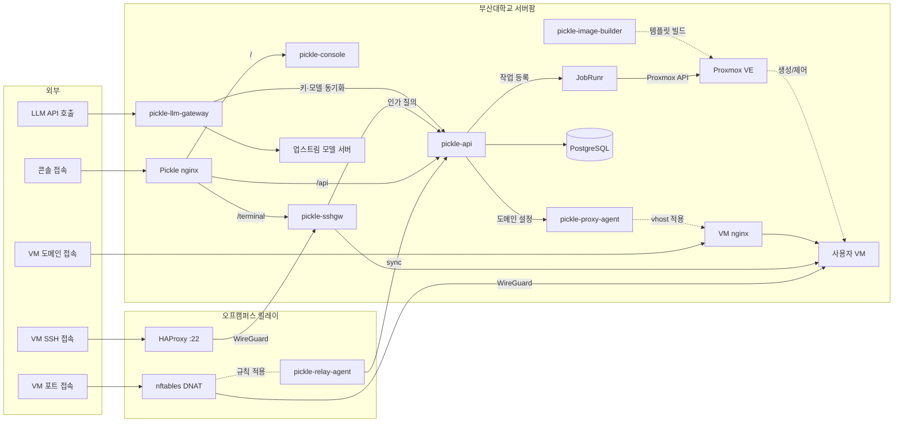

# pickle-api

부산대학교 클라우드 플랫폼(Pickle)의 백엔드 API 서버예요.

콘솔의 신청과 승인을 받아 VM과 LLM API 키, 외부 도메인을 발급하고 상태를 관리해요.
SSH 연결과 웹 터미널, HTTPS 공개는 각 게이트웨이와 에이전트가 맡아요.

접속: https://pickle.pusan.ac.kr

## 주요 기능

플랫폼은 VM 신청과 승인, 생성, SSH와 웹 터미널 접속, 도메인 공개, 만료와
삭제까지를 다뤄요. 이 레포지토리가 맡는 부분은 아래와 같아요.

- **VM 발급**: 승인된 신청의 사양과 이미지로 VM을 만들고 내부 IP와 접속 정보를 준비해요.
- **도메인 관리**: 이름 발급과 DNS 레코드 편집, 갱신과 예약 기간 중 되살리기를 제공해요.
- **LLM API 키**: 발급과 한도, 사용량, 정지와 폐기를 관리해요. 사업 계정의 자격증명과 예산도 다뤄요.
- **계정과 접근 권한**: 가입과 메일 인증, 2단계 인증을 처리하고 리소스별 접근 등급과 기관 업무를 확인해요.
- **운영 지원**: 만료와 삭제 작업, 관리자 확인이 필요한 상태 차이를 조회하고 알림과 공지를 보내요.

## 동작 방식

Spring Boot의 REST API(`/api/v1`)와 JobRunr 워커, Proxmox 클라이언트,
주기 스케줄러가 하나의 JAR에서 실행돼요. 리소스 상태와 잡 큐, IP 할당과 라우팅 정보는
PostgreSQL에 저장해요. 잡은 백오프로 재시도하고 단계별 결과를 기록해요.

Proxmox 응답은 WireMock 테스트로, 역할별 진입과 실제 기관 업무, 부여 출처, 워크스페이스
범위와 응답 필드는 권한 테스트로 검증해요. SSH 연결 자체는 이 서버에서 열지 않아요.

비밀번호 변경과 회원 탈퇴, 2단계 인증 관리에는 현재 비밀번호와 필요한 인증 코드를
확인해요. 계정 상태가 바뀌면 로그인 세션과 게이트웨이의 접근 조건에도 반영돼요.
필수 자격증명이 없으면 실행을 거부하고, 기계 연동 토큰이 없으면 해당 경로를 거절해요.

공유 JobRunr 워커를 끈 환경에서는 LLM 사용량 일별 집계와 일일 토큰 한도 갱신을
별도로 활성화할 수 있어요. 실행 조건과 단일 쓰기 주체, 관측 실패 시 중단 조건은
아래 설정 절에서 설명해요. 테스트는 Zonky embedded-postgres와 WireMock을 사용해요.

## 외부 도메인

플랫폼 루트 아래 이름 하나를 발급하고 소유자가 A, AAAA, CNAME, TXT 레코드를 편집해요.
플랫폼 밖 서버도 가리킬 수 있으며 콘텐츠는 플랫폼이 보관하지 않아요.
루트 도메인 정책에 따라 사람이 검토하거나 접수와 동시에 자동 승인해요.
자동 승인은 결재자가 없는 승인 기록으로 남아요.

사용 기한을 연장하지 않으면 레코드를 내리고 이름을 예약해요. 예약 기간에는 같은
워크스페이스만 이름을 되살릴 수 있어요. 되살려도 삭제된 DNS 레코드는 복원되지 않아요.

## 공지와 알림

승인과 만료 임박, 프로비저닝 결과는 콘솔 알림과 메일로 안내해요. VM 삭제는 접수와 예약,
취소, 강제 삭제 요청, 완료 시점에 활성 VM 소유자와 워크스페이스 소유자에게 알려요.
두 범위에 겹치는 소유자는 한 번만 받아요.

`POST /api/v1/admin/announcements/preview`는 발송 권한으로 현재 활성 대상 수와
조회 가능한 명단 일부를 확인해요. 발송 예산은 쓰지 않아요. 실제 큐 접수 때 명단과 주소를
확정하므로 미리보기와 달라질 수 있어요.
`GET /api/v1/admin/announcements/{announcementId}`는 당시 본문과 대상, 저장 인원을 제공해요.

팝업 공지는 로그인하지 않은 방문자에게도 바로 열리고, 일반 공지는 로그인한 사용자가
게시판에서 읽어요. 읽을 수 없는 공지는 404로 응답해요. 점검 모드에서도 공지를 읽을 수 있어요.
`GET /api/v1/notices?popup=true`는 기존 공개 범위에서 팝업만 조회해요.

`GET /api/v1/admin/notices/{noticeId}`는 공지 읽기 또는 관리 업무로 예정, 게시, 종료 공지를
조회해요. 시스템 계층의 조회 범위도 유지해요. 본문은 평문 20,000자까지 받고 이미지는
공지 등록 뒤 첨부해요. 실제 바이트로 PNG, JPEG, WebP, GIF를 판별하며 한 장 2 MiB,
공지당 5장까지 받아요.

## LLM 서비스 상태와 금액

게이트웨이의 5초 sync는 공급원별 실제 요청 상태와 별도 `/models` probe, 카탈로그 비교,
사용량 전송 큐를 보고해요. `GET /api/v1/admin/llm/status`와 `/metrics`는 저장된 상태와
원시 사용량 기록을 읽고 공급원을 호출하거나 라우팅을 바꾸지 않아요. 지표는 각 이벤트의
마지막 처리 공급원과 최종 결과이며 중간 재시도 경로나 uptime은 나타내지 않아요.

`modelRoutes`는 같은 응답에서 읽을 수 있는 공급원에 연결된 공개된 활성 TOKEN 모델의
주 구성과 대체 구성의 관계예요. 전체 모델 목록이나 실제 처리 경로는 아니에요. `VISIBLE`은 공개 ID와
이름을 제공하고, 기관 응답의 `NOT_PROVIDED`는 미설정과 범위 밖, 미등록을 구분하지 않아요.
시스템 응답만 구성이 없는 참조를 `NOT_CONFIGURED`로 구분해요.

`llm_usage_events.cost_usd`는 요청마다 공급원이 보고한 귀속 금액이며 청구액이 아니에요.
한도와 잔액은 vendor meter 기준이에요. 두 값은 기간이 다르고 이벤트 금액에는 가격이
미확인인 요청이 빠져 있으므로 서로 빼거나 합산하지 않아요. 없는 값은 0으로 표시하지 않고,
보고 금액과 가격이 확인된 요청 수를 함께 제공해요. TOKEN/CREDIT 예산 축과 공급 경로는
별개이며 보고 금액만으로 사용자나 플랫폼의 부담을 확정하지 않아요.

## 키 사용량 알림

만료되지 않은 ACTIVE 키의 양수 한도를 TOKEN과 CREDIT으로 나누어 평가해요.
80%에는 콘솔 알림, 100%에는 콘솔과 선택된 수신자의 메일로 안내해요. 토큰 한도에 도달한
ACTIVE 키도 평가해요. 현재 키 소유자와 워크스페이스 소유자 중 일반 키 사용량을 읽을 수
있는 활성 사용자만 받아요. 학생 소유자에게 관리자 금융 업무를 요구하지 않아요.

`GET /api/v1/me/notification-preferences`와 `PUT /api/v1/me/notification-preferences`는
본인의 `usageMailEnabled`를 조회하고 저장해요. 기본값은 `true`예요. 끄면 본인의 새 사용량
알림 메일만 제외하며 콘솔 알림과 다른 수신자, 기존 업무 메일과 보안 메일은 유지해요.

TOKEN은 KST 일일 quota와 같은 요청 시점의 입출력 합계를 사용해요. CREDIT은 공급자 대사의
같은 응답에 담긴 키 한도와 잔여, 리셋과 조회 시각을 현재 연결과 설정에 대조해요.
이전 기간의 누적 사용액을 새 기간의 사용량으로 쓰지 않아요. 공급자 금액은 십진 정밀도를
유지하고, 누락과 오래된 조회, 최근 실패, 설정 불일치나 리셋 경계를 걸친 조회는 미확인으로
보류해요. 지원하지 않는 BYOK 설정을 합산하지 않아요.
금액의 일일과 주간, 월간 경계는 UTC 기준이고 주는 월요일에 시작해요. 토큰 일자는 KST예요.

알림에는 키 이름과 한도 종류, 도달 단계를 담고 일반 키 상세로 연결해요. 새 사용량 알림은
목록과 개수, 읽기와 SMTP 직전에 현재 읽기 권한을 확인해요. 권한을 잃으면 표시하거나 보내지
않으며 기존 알림의 확정 주소와 본문은 유지해요. 이미 인계한 메일은 회수할 수 없어요.

키와 축의 조합별 최신 기준과 최고 단계를 보존해 같은 평가마다 새 알림을 만들지 않아요. 기간이나
한도 기준이 바뀌면 다시 평가해요. 본문은 기존 보존 설정을, 메일 인계와 시도 기록은
기존 영구 보존을 따라요.

`PICKLE_LLM_USAGE_ALERTS_ENABLED`는 기본 `false`예요. 켜면 5분 평가와 새 사용량 메일을
허용하며 실제 작업은 JobRunr worker 설정을 따라요. 개인 수신 설정과는 별개예요.
새 공급자 호출은 추가하지 않아요. TOKEN 배치 전송과 약 30분 CREDIT 대사, SMTP 대기 때문에
5분 안의 도착을 보장하지 않아요.

활성화 전에 알림을 읽거나 발송하는 모든 API 인스턴스와 작업자가 새 인가 검사를 지원해야 해요.
구버전으로 돌아가려면 잔존 사용량 알림의 읽기와 전송 검사를 유지하는 호환 빌드나 별도 승인된
처리가 필요해요. 대기 메일과 작업만 지워도 이미 보낸 알림과 메일 없는 콘솔 이력은 남아요.
새 검사와 스위치를 모르는 구버전 API는 새 버전의 flag만으로 보호할 수 없어요.

## 사업 계정과 키 탐색

`GET /api/v1/admin/llm/keys`는 기관과 워크스페이스, 신청, 계정 조건에 `cohort`와 `sort`를
적용하고 전체 개수와 현재 페이지를 반환해요.
`cohort=COMMITTED|AWAITING_PROVISION|USAGE_UNREPORTED`는 현재 유효한 양수 한도와
발급과 vendor meter 상태를 구분해요. 계정 상세의 `keyNavigation`은 현재 읽을 수 있는 키
부분집합이고, `boundKeyCount`와 계정 전체 `allocation`은 별도 값이에요.
TOKEN 사용량은 보존된 당일 이벤트로 집계하며 저장 한도와 vendor meter 잔여,
실제 gateway 적용 상태를 구분해요. RPM과 TPM, 동시성의 서비스 기본값과 실시간 여유는 미보고예요.

`policyModel`과 `policyFeature`는 공개 모델 캐시와 허용 및 차단 패턴, 기능 정책으로 키를 찾아요.
실제 처리 성공이나 현재 공급 경로의 가용성을 뜻하지 않아요. 금액과 관측, 정책 필터와 정렬은
조건 적용 전 모집단 전체에서 그 필드를 읽을 수 있을 때만 제공해요. 권한은 있으나 관측이
없는 행도 개수에 남고 vendor 잔여 정렬에서는 뒤에 놓여요.

`GET /api/v1/admin/llm/usage`의 소비처는 `consumerPage`, `consumerSize`, `consumerSort`로,
현재 한도 검토는 `reviewPage`, `reviewSize`로 탐색해요.
`GET /api/v1/admin/llm/accounts/{id}/usage`는 `days`, `page`, `size`, `sort`를 받아요.
계정의 키 페이지와 `keysUsed`, 전체 합계는 같은 KST 일별 rollup과 현재 계정 연결 관계로
계산해요. 실제 일자 범위와 출처를 함께 제공하며 원시 요청의 capacity 키 개수와는 구분해요.

키 상세 GET의 `projectLimits=true`는 현재 한도와 제안을 같은 서버 계산으로 비교해요.
`proposedCreditLimit`은 생략하면 유지하고, 지정하면 0 이상이며 정수부 10자리와 소수부 2자리까지 받아요.
`proposedCreditLimitResetSet=true`에서 reset을 생략하면 명시 총액 한도이고 `false`이면 기존
기간을 유지해요. `proposedOpenrouterAccountId`는 기존 최초 연결 조건에만 사용해요.
`limitsProjection.draft`는 전달한 제안을 구분해 반환해요. 이 GET은 키 연결이나 자격증명 사용
기록, 잡 등록, vendor 호출을 하지 않아요.

단건 제안과 일괄 미리보기의 `accountImpact`는 읽기가 허용된 계정 전체의 변경 전후 캐시예요.
키별 사용량을 한도 안에서 clamp하고 적용 대상의 기여를 교체해요. 출처와 시각, 오래된 관측,
미발급 키와 미보고 키 수, reset 기간 불일치를 따로 제공해요. 미보고 키에 현재 한도를 대입한 값은
실측 금액이나 보장된 상한이 아니에요. 기간을 바꾸면 이전 사용량으로 잔여나 초과 여부를 추정하지
않고 null로 둬요. 읽을 수 없으면 `NOT_PROVIDED`이며 한도 변경 권한은 유지해요.
새 예약이나 금융 잠금은 만들지 않으며 저장된 미리보기도 현재 필드 권한으로 가려요.

## LLM 수요와 현재 한도

`GET /api/v1/admin/llm/capacity`는 UTC `[from,to)` 구간의 보존된 요청 수요를 조회해요.
최대 90일이며 실제 기간과 `generatedAt`, `timezone`, `bucketSeconds`를 함께 제공해요.
기관과 워크스페이스, 보이는 등록 upstream의 공개 ID, 현재 사업 계정의 공개 ID
(`openrouterAccountId`), 요청 당시 공개 모델 이름과 오류 유형으로 좁힐 수 있어요.
`errorTypeMissing=true`는 정상 응답을 제외한 오류 유형 미기록 요청이며 `errorType`과 함께
지정할 수 없어요. `reasonCategory`는 같은 오류 유형의 공급 경로 결과와 전역 중계 포화를
해당 사유의 소비처로 나눠요. 미기록 시도 횟수는 0으로 만들지 않고 근거가 부족한 과거 거절은
미분류로 남겨요.

요약과 시계열, 거절 사유, 소비처 페이지는 같은 조건을 적용해요. 소비처는
`group=ORG|WORKSPACE|KEY`, `page`, `size`로 탐색해요. 현재 키 한도는 저장된 override이며
과거 적용값이나 gateway 반영 완료는 아니에요. 실제 서비스 기본값은 미보고로 표시해요.
기관과 워크스페이스 최소 참조는 관측 업무가 허용한 키 관계만 제공하며 관리 권한을 늘리지 않아요.

`quality`는 원시 기록의 삭제 경계와 전달 상태예요. 완전히 삭제된 구간과 버킷의 수치는 null이고,
부분 삭제 구간은 남은 관측분만 표시해요. 마지막 event 수신 시각은 수집 완료 시각이 아니에요.
최종 공급원 소비와 TOKEN/CREDIT 한도 종류, 보고 금액은 서로 다르며 중간 재시도 부하나
개인별 GPU 점유율로 환산하지 않아요.

전역 장비를 읽을 수 있는 SYS 응답은 `telemetry.device`를 제공해요. ORG 응답은
`telemetryVisible=false`, `telemetry.status=NOT_PROVIDED`, `device=null`이며 원천과 장비, 엔진
이름을 노출하지 않아요. 장비 표본은 기관과 워크스페이스, 원인, 공개 모델의 수요 필터와 별개예요.
`telemetrySourceId`는 단일 원천의 공개 ID이며 최종 upstream 필터와도 독립이에요.
원천 설정이 없으면 `NOT_CONFIGURED`, 요청 기간에 보고가 없으면 `NOT_REPORTED`, 있으면
`REPORTED`예요. 실제 설치나 가용성, 기간 전체의 수집 완료를 뜻하지 않아요.

### 장비 관측 표본

`POST /internal/inference-observations`는 전용 보고자의 경로예요. 기본 비활성이며 별도 bearer와
실제 TCP peer, 고정 source/upstream UUID가 모두 필요해요. SSH와 relay, LLM gateway 토큰이나
사용자 JWT를 공유하지 않아요. 직접 연결의 원래 peer를 검사하며
`server.forward-headers-strategy=none`만 지원해요. Forwarded/X-Forwarded-For와 본문 hostname은
인증 근거로 쓰지 않아요.

UTF-8 JSON 512 KiB 이하의 version1 표본 하나를 받아요. source UUID와 producer epoch,
안전 정수 sequence, UTC 밀리초 `observedAt`과 최초 `reporterReceivedAt`, 최소 host 측정값과
정해진 누적 추론 지표가 필요해요. source별 UTC 분에 새 표본 하나를 저장해요.
같은 source/epoch/sequence의 본문 bytes가 같으면 `DUPLICATE`, 다르면 409예요.
`contentSha256`은 받은 bytes의 SHA-256이며 원 HTTP 본문은 중복 저장하지 않아요.
보고자는 최초 import 시각을 포함한 불변 outbox bytes를 다시 보내고, ACK의 key와 byte SHA가
일치하는 `ACCEPTED` 또는 `DUPLICATE`만 완료로 처리해요.

host는 CPU 1분 load average와 메모리와 swap bytes, GPU 이용률과 온도, 전력, 지원 여부를 구분해요.
load average는 백분율이 아니며 통합 메모리와 GPU 표본을 두 용량으로 합산하지 않아요.
측정된 0과 미지원, 미보고, source 실패를 구분해요. 임의 사용자 label과 원시 Prometheus 본문은
저장하지 않아요. 허용 secondary label의 빈 값과 escaped newline은 보존하고 JSONB가 표현할 수
없는 NUL은 치환 없이 거절해요.

읽기도 `[from,to)`와 실제 `bucketSeconds`를 사용해요. gauge는 측정 시각을 따르고, 비율과
histogram mean은 양끝이 요청과 보존 범위 안인 완전 관측 구간을 종료 시각 버킷으로 묶어요.
부분 구간을 나눠 요청 분포를 추정하지 않아요. 비율은 누적 차분 합/실제 경과 시간 합,
histogram mean은 sum 차분 합/count 차분 합이에요. min/max는 gauge 표본이나 완전 구간 평균의
범위이며 분위수가 아니에요. `intervalSeconds`는 완전 관측 구간의 실제 초 합으로 버킷보다 길 수
있으며 시간 점유율이나 연속 센싱 비율이 아니에요. 첫 표본과 identity 변경, reset, gap,
불가능한 delta의 비율은 null이에요. 행 수와 metric별 측정 시각과 수는 다를 수 있어 행 수 0만으로
실제 metric 0을 숨기지 않아요.

새 표본에만 90일 만료를 적용해요. `retainedFrom`은 즉시 조회 cutoff이며 물리 삭제 완료
watermark가 아니에요. `WITHIN|PARTIAL|OUTSIDE`와 미수집 구간을 구분하고 보존 범위 밖은
null이에요. 최신 원천의 freshness와 과거 구간 조회 성공도 구분해요. JobRunr가 매시간
1,000행씩 최대 10회 정리하므로 워커가 멈추면 지연돼요. 수신을 꺼도 이 정리는 유지하며
기존 사용량과 본문, 감사 보존 정책은 바꾸지 않아요.

조회 상한은 fetch size128 cursor의 130,000행, 1,440버킷, 32 engine identity,
20,000 metric 집계, device JSON 4 MiB예요. 원문 목록을 메모리에 모으지 않고 상한을 넘으면
`truncated=true`와 누락값을 반환해요. 0으로 채우지 않아요. 일반 로그는 secret masking을 적용한
Logback 출력이고, 감사는 append-only `audit_logs`, 요청 사용량과 장비 표본은 별도 테이블이에요.

| 환경 변수 | 의미 |
|---|---|
| `PICKLE_INFERENCE_OBSERVATIONS_ENABLED` | 기본 `false`, 기계 보고 수신 활성화 |
| `PICKLE_INFERENCE_OBSERVATIONS_TOKEN` | 보고자 전용 현재 bearer |
| `PICKLE_INFERENCE_OBSERVATIONS_PREVIOUS_TOKEN` | 교체 중인 이전 bearer, 현재 값도 필수 |
| `PICKLE_INFERENCE_OBSERVATIONS_SOURCE_IP` | 실제 연결의 고정 TCP peer |
| `PICKLE_INFERENCE_OBSERVATIONS_SOURCE_ID` | 고정 관측 원천 UUID |
| `PICKLE_INFERENCE_OBSERVATIONS_UPSTREAM_ID` | 연결된 등록 공급원의 공개 UUID |

토큰과 주소, UUID의 기본값이나 등록 UI, 환경 seed는 없어요. 실제 자격증명 발급과 설치,
네트워크 허용, DB 배포는 별도 운영 작업이에요.

## 유료 모델 허용·차단

키의 `creditAllowedModels`와 `creditDeniedModels`는 부호 없는 문자열 배열이에요.
승인 입력과 사업 계정 기본값도 같은 문법을 사용해요. 각 목록은 최대 50개,
항목은 200바이트까지 받아요. 허용과 차단이 겹치면 차단이 우선해요.

- `openai/*`는 공급자 전체, `openai/gpt-5-*`는 모델 접두 패턴이에요.
- `*/*-pro`는 모든 공급자의 `-pro` 모델을 차단할 때 쓰며 `~`별칭도 포함해요.
  공급자는 정확한 이름 또는 `*`만 받으며 `open*/*`는 입력 오류예요.
- 허용에서 `openai/*`와 `~openai/*`는 별개예요. 차단은 `~`를 뺀 이름도 검사하지만
  별칭이 가리키는 실제 모델까지 추적하지는 않아요.
- 정확한 모델명과 접미 패턴은 `:batch` 같은 변형도 포함해요. `openai/gpt-5-*`의
  구분자 생략 규칙은 `openai/gpt-5`에만 적용하고 `openai/gpt-5:batch`에는 적용하지 않아요.
- 허용 목록이 비면 허용 제한이 없고 차단 목록이 비면 차단이 없어요. 금액이 0이어도
  차단 목록을 저장할 수 있어요. 모델 제한이 있는 키는 `openrouter/` 라우터를 쓸 수 없으며
  자체 서빙 모델은 두 목록의 영향을 받지 않아요.

모델 조회는 같은 판정을 적용한 목록과 현재 캐시에 일치하지 않는 패턴을 반환해요.
새 공급자 패턴은 게이트웨이를 먼저 업데이트한 뒤 API와 콘솔에 적용해요.

## 프로비저닝 파이프라인

승인 트랜잭션이 CREATING VM과 잡을 저장하면 워커가 다음 단계를 실행해요.

```
guard → 승인 배치 확인 → IP 할당 → VMID 채번 → OS 이미지 clone
  → 설정(사양·cloud-init·고정 IP·protection=1) → 디스크 리사이즈
  → 기동 → qemu-agent 검증 → 호스트키 수집 → 완료(RUNNING, 알림)
```

각 단계는 멱등이며 실패한 단계부터 재시도해요. 일반 생성 실패는 단계에 따라 VM과 IP를
정리하거나 NEEDS_ADMIN으로 남겨요. clone pin과 현재 노드, prepared NIC 같은 안전 조건을
확인할 수 없으면 VMID와 IP, 기존 guest와 pin을 보존한 채 관리자 확인을 기다려요.

완료는 RUNNING 상태와 생성 이벤트, 작업 DONE을 한 트랜잭션으로 저장한 뒤 알려요.
완료 기록 저장 실패는 생성 실패와 구분해 재시도하거나 관리자 확인을 기다려요.
RUNNING만 저장된 이전 실행은 완료 단계에서 누락 이벤트와 결과를 복구하며 기존 이벤트는 유지해요.

승인할 때 이미지 revision과 후보 노드를 잠그고 CPU, 메모리, 디스크 여유를 확인해요.
선택한 노드와 clone 원본 행, template VMID, revision metadata hash를 VM에 고정해요.
재시도도 같은 좌표를 사용하고 이미지나 위치가 바뀌면 멈춰요. 복구로 현재 노드가 바뀌어도
최초 clone 좌표는 이력으로 남으며 다른 노드에서 clone을 다시 실행하지 않아요.
pin이 없는 기존 VM은 조회와 일반 lifecycle을 지원하지만 새 clone을 시작하지 않아요.
REINSTALL 파이프라인은 제공하지 않아요.

OS 이미지는 `(node_id, name, version)`으로 구분해요. 공개 목록은 같은 `(name, version)`의
호환 replica를 묶고 가장 먼저 등록된 행의 UUID를 유지해요. 그 행이 비활성이어도 ACTIVE
노드에 metadata가 같은 활성 replica가 있으면 선택할 수 있어요. 신청과 승인, clone은
같은 revision 판정을 사용해요.

새 노드는 `labels`에 `placement_capacity`와 `vm_nic_requirements`를 함께 등록해요.
용량에는 `schema_version`, 측정 시각, `physical`/`reserved`/`allocatable`의 `cpu_threads`,
`memory_mb`, `disk_gb`가 필요하며 승인 시 세 축을 모두 hard limit으로 적용해요.
NIC는 `schema_version: 1`, `mtu: 1370`, `firewall: true`만 허용해요. 이미지 활성화와 clone
직전에 template의 `net0`를 대조하고 VM 설정에서는 MAC과 기존 NIC 속성을 보존해 bridge만 바꿔요.
두 label이 모두 없는 기존 노드는 메모리 hard limit과 CPU와 aggregate disk advisory를 유지해요.
하나라도 등록한 노드는 두 문서가 모두 유효해야 ACTIVE로 바꿀 수 있어요.

만료된 VM은 데이터를 남긴 채 중지하고 삭제는 별도로 예약해요. 30초 상태 폴러와
10분 드리프트 리컨실러, 5분 삭제 스위퍼, 10분 고아 태스크 복구가 상태를 확인해요.
드리프트는 기록과 실제 상태의 차이이며 자동으로 고치거나 지우지 않아요.
관리 대상 VM의 하이퍼바이저 `protection`은 유지하고 의도된 삭제 직전에만 내려요.

### 공개 접속과 VM 통신 정책

도메인과 포트 매핑의 출발지 정책은 revision CAS로 저장하고 generation과 함께 agent에 보내요.
도메인은 IPv4와 IPv6, 포트 매핑은 IPv4 CIDR을 지원하며 빈 목록은 새 연결을 거절해요.
Proxy는 적용 직전 fresh `/status`에서, relay는 현재 sync에서 `source-acl-v1`을 확인해요.
확인하지 못하면 정책을 생략하지 않고 반영 대기나 실패로 남겨요. 제거는 capability와 무관하게 진행해요.

`pickle.network-policy.enabled`는 기본 false예요. false인 legacy 행만 기존 wire를 유지하며
저장 정책이나 activation marker가 있으면 생략으로 완화하지 않아요.
`pickle.network-policy.campus-source-cidrs`에는 기본 허용 대역이 없어요. Preset은 확인된 CIDR의
snapshot이고 정책에는 최종 배열만 저장해요. VM NIC의 PVE 방화벽 정책은 별도예요.

`GET`/`PUT /api/v1/vms/{vmId}/network-policy`와 대응 관리자 경로에서 VM 통신 정책을 다뤄요.
조회는 VM 열람자, 변경은 VM 편집자 이상이며 관리자도 실제 기관과 시스템 범위를 검사해요.
IPv4 `ANY`/`TCP`/`UDP`/`ICMP`, `IN`/`OUT`, `ACCEPT`/`DROP` 규칙을 순서 있는 전체 목록으로
교체하고 `expectedRevision`으로 동시 수정을 거절해요. System rule은 목적만 보여 주며
운영 source IP나 PVE group 이름은 노출하지 않아요.

기본값은 `PICKLE_VM_FIREWALL_ENABLED=false`예요. 활성화 전에 운영자가 20자 이하의
immutable IN/OUT DROP security group을 만들고 이름과 각 IPv4 source를
`PICKLE_VM_FIREWALL_BARRIER_GROUP`, `PICKLE_VM_FIREWALL_SSH_GATEWAY_SOURCE_IPS`,
`PICKLE_VM_FIREWALL_TERMINAL_SOURCE_IPS`, `PICKLE_VM_FIREWALL_PROXY_SOURCE_IPS`,
`PICKLE_VM_FIREWALL_RELAY_SOURCE_IPS`로 지정해야 해요. API credential은 group 조회의
`Sys.Audit`와 VM 방화벽의 `VM.Audit`/`VM.Config.Network`만 사용하고 group을 바꾸지는 못해요.
노드 label `vm_firewall_policy: {schema_version: 1}`과 durable policy 행이 있는 VM만 갱신해요.

전역 기능과 `vm_firewall_policy`, `vm_nic_requirements`가 준비된 노드의 새 VM은 CONFIG에서
정책 행을 만들어요. `onboot=0`을 유지하고 firewall options, `ipfilter-net0`, immutable control
prefix와 초기 mutable policy를 정확히 읽어 `APPLIED`로 기록한 뒤 첫 START 직전에만
`onboot=1`로 바꿔요. 정책 행이 생긴 뒤 설정이나 label이 사라져도 legacy로 우회하지 않아요.
START 접수 뒤 polling이나 QGA 확인에서 중단됐으면 정책을 다시 검증하고, VM이 이미 running이면
START를 다시 보내지 않고 QGA 확인부터 이어가요.

START와 REBOOT worker도 정책 행이 있으면 최신 revision/generation/hash와 node와 VMID, allocated IP,
실제 PVE config/rules/runtime을 전원 명령 직전에 확인해요. Policy PUT은 같은 VM의 생성과
전원과 장치 작업에 대해 non-blocking advisory lock으로 순서를 지켜요. 충돌은 409이며 draft를
보존해요. SHUTDOWN과 FORCE_STOP은 이 시작 검사를 기다리지 않아요.

적용기는 cluster firewall enable과 노드의 legacy PVE firewall backend를 먼저 확인해요.
유일한 net0의 MAC과 bridge와 MTU, `firewall=1`, VLAN tag/trunk 부재, control rule,
`ipfilter-net0`, immutable group을 대조한 뒤 group barrier 아래에서 mutable rule을 교체해요.
IPv6는 NDP를 끄고 net0의 IN/OUT DROP control rule로 차단해요. 추가 `netN`, custom QEMU args, 알 수 없는
enabled rule, IPSet `nomatch`/provider error, group drift는 자동 정리하지 않아요.
barrier가 실제 enabled이고 지원 NIC 전체와 immutable base가 맞을 때만 `FAILED_CLOSED`예요.
이는 기존 연결 종료가 아니라 PVE conntrack의 새 연결 차단 상태예요. 불확실하면 `FAILED`로 남겨요.
`APPLIED`와 `FAILED_CLOSED`는 설정 readback이며 실제 packet enforcement 검증은 아니에요.
실행 중인 VM을 자동 중단하지 않아요.

### 복구된 VM의 정책 단독 적용

`RecoveryPolicyMain`은 이미 위치를 옮긴 VM 한 대의 정책을 적용해요. HTTP listener와
JobRunr worker와 recurring producer, Flyway, 시더, 일반 API runner는 실행하지 않아요.
DB/PVE 설정은 운영 API와 같아야 하며 API와 다른 writer는 모두 정지해야 해요.
원본과 대상 VM은 stopped, `onboot=0`, 모든 NIC의 `link_down=1`을 유지해요.
대상에는 net0 하나와 immutable firewall options, `ipfilter-net0`, control rule, barrier group이
정확히 복원돼 있어야 해요. 누락된 기반을 만드는 명령은 아니에요.

다음 SQL을 **명령이 사용할 DB 계정과 연결**로 실행하고 JSON 결과를 보호 파일에 저장해요.
`pg_control_system()` 권한이 없으면 실패해요. 파일은 DB 이름과 계정, 연결 방식, primary 여부와
PostgreSQL system identifier를 고정해요.

```sql
select jsonb_build_object(
    'database', current_database(), 'user', current_user,
    'local_socket', inet_server_addr() is null,
    'primary', not pg_is_in_recovery(),
    'system_identifier', (select system_identifier::text from pg_control_system()));
```

`DB_IDENTITY_FILE`과 복구 manifest, 위치 채택 뒤 만든 정책 proof가 필요해요.
Manifest와 proof는 root 소유 0600 일반 파일이어야 하며 symlink는 거절해요.
두 파일의 실제 SHA-256을 별도 인자로 고정하고 경로에는 공백을 넣지 않아요.
Proof에는 operation ID와 fencing token, DB system identifier, 원본과 대상의 node UUID/VMID/PVE digest,
VM 신원과 정책 revision/generation/hash가 있어야 해요. Manifest의 owner lease는 적용 직전
90초 이상 남아야 하고 최종 DB commit 직전에도 유효해야 해요.

API 레포지토리에서 Java 25와 Maven, 운영 DB/PVE 환경 변수를 준비해 실행해요.
`ATTEMPT_UUID`는 호출마다 새 UUID이며 재시도에는 앞선 명시적 실패 감사 행도 필요해요.

```bash
./mvnw -q -DskipTests \
  -Dspring-boot.run.main-class=kr.ac.pusan.pickle.networkpolicy.RecoveryPolicyMain \
  "-Dspring-boot.run.arguments=$MANIFEST_FILE $MANIFEST_SHA256 $POLICY_PROOF_FILE $POLICY_PROOF_SHA256 $DB_IDENTITY_FILE $ATTEMPT_UUID" \
  spring-boot:run
```

명령은 같은 JDBC session의 per-VM advisory lock 아래 채택 감사와 proof, 현재 VM과 정책, IP, 노드를
대조해요. VM은 채택 뒤 `STOPPED`와 삭제 없음, 고정 `updated_at`, 작업 부재를 만족해야 해요.
PVE 양쪽의 stopped와 `onboot=0`, `link_down=1`, HA와 진행 task 부재, hostname/MAC,
cloud-init IP와 gateway, bridge/MTU/firewall, config digest와 변경 대기 부재도 확인해요.
원본의 `pickle-recovery-owner:<operationId>:<fencingToken>`과 대상의
`pickle-recovery-operation:<operationId>` description은 정확한 한 줄로 대조해요.
Config digest는 디스크 설정을 포함한 현재 설정이며 디스크 내용이나 fencing 증거는 아니에요.

기존 compiler/reconciler로 정책을 적용하고 PVE 정책과 두 VM의 격리를 다시 확인해요.
같은 JDBC session의 짧은 트랜잭션에서 VM과 policy, IP, 노드와 채택 증거를 재검사해
`APPLIED`와 `vm.recovery_policy_applied`를 함께 commit해요. Commit이나 잠금 해제가 불확실하면
성공을 주장하지 않고 읽기 전용 판정만 보여 줘요. `APPLIED_WITH_AUDIT`도 DB tuple과 해당 attempt의
감사 확인이며 packet enforcement나 원본 fencing, VM 기동 허가는 아니에요.
두 VM을 격리한 채 DB와 PVE를 직접 확인해야 해요. 완료된 operation은 **같은 proof SHA와 완료
attempt ID**일 때만 PVE 쓰기 없이 조회해요. VM을 기동하거나 NIC를 연결하지 않아요.

### 공개 경로의 반영과 회수

HTTP 생성과 포트 변경은 새 proxy target allow가 `APPLIED`된 뒤 DNS/proxy PRESENT를 보내고,
ABSENT ACK 뒤 이전 allow를 제거해요. 포트 매핑 생성과 재개는 `PENDING`으로 relay 목록에서
제외한 채 VM allow를 먼저 적용하고 relay generation ACK 뒤 `ACTIVE`로 바꿔요.
중단 의도는 `SUSPENDED`, 삭제는 `REMOVING`으로 표시하지만 exact retirement receipt 전에는
VM allow와 mapping tombstone, public port, IP allocation을 유지해요.
15초 recurring coordinator가 DB operation을 재시도하며 after-commit enqueue만 믿지 않아요.
사용자 정책 revision은 유지하고 derived path는 desired generation/hash만 올려요.
Operation revision CAS는 close로 대체된 stale open/replace worker의 완료 기록과 삭제를 거절해요.
포트 activation의 relay generation과 delivery, operation phase는 한 트랜잭션으로 바꿔요.

`PICKLE_RELAY_RETIREMENT_ENABLED`는 기본 `false`예요. 켜려면 fresh `mapping-retirement-v1`
heartbeat와 고정 durable ledger UUID, 역행하지 않는 consumer-mapping-id/flow-mark/retirement
high-watermark, live mark namespace 확인과 armed row가 모두 필요해요.
Managed mapping은 nonzero uint32 flow mark와 별도 consumer epoch id를 사용해요.
복원한 DB가 이미 퇴역한 mapping/mark를 다시 보내면 sync를 거절해요. Consumer는 마지막 수락
generation과 typed snapshot의 canonical hash를 보존해 역행과 같은 generation의 다른 내용을 거절해요.
API의 복원된 generation이 consumer보다 낮으면 high-watermark보다 크게 발급해요.
active mapping과 retirement, ACK content 변화도 같은 규칙으로 generation을 올려요.

Retirement이 armed된 relay에는 generation이 같아도 `mappings`(빈 배열 포함)와 `retirements`,
`acknowledgedRetirementHighWater`를 담은 전체 snapshot을 보내요. `{"generation": N}`만 보내는
응답은 armed되지 않은 legacy relay에만 사용해요.
퇴역 tuple hash는 `mappingId`, lowercase protocol, public port, canonical target IPv4,
target port, flow mark를 줄바꿈으로 이은 ASCII의 SHA-256이에요. Consumer는 DNAT 제거와 exact
mark DROP fence를 원자적으로 적용하고 다시 읽어 확인한 뒤 native conntrack API로 original/reply exact tuple만 지워요.
삭제 후 zero readback까지 성공해야 `CLEARED`예요. Receipt의 retirement UUID와 generation,
mapping id, mark, tuple hash가 모두 같아야 하며 generation ACK만으로 삭제나 IP 회수를 하지 않아요.
API는 빈틈없는 CLEARED prefix만 ACK하고 consumer는 ACK 이하 tuple/fence를 정리해요.

정리 뒤에도 consumer의 ledger UUID와 세 high-watermark, API의 relay high-watermark는 보존해
이미 쓴 epoch와 mark를 재발급하지 않아요. 중단 뒤 재개는 같은 public mapping에 새 consumer epoch와
mark를 발급해요. Armed relay는 ledger를 모르는 이전 바이너리로 돌아갈 수 없어요.
일반 VM 정책 변경은 conntrack을 비우거나 기존 세션을 끊지 않아요. 선택적 conntrack 삭제는
mapping 중단과 삭제와 VM 소유권 종료의 resource retirement에만 사용해요.

### 노드의 CPU 배치 예산

`labels.placement_capacity` schema1은 물리 용량에서 예약량을 뺀 CPU와 메모리, 디스크 예산을
사용해요. schema2는 `cpu_policy`의 `allocation_ratio`(1 또는 2)와 `committed_vcpu`도 확인해요.
CPU 예산은 `(physical.cpu_threads - reserved.cpu_threads) × allocation_ratio - committed_vcpu`예요.
`reserved.cpu_threads`는 호스트의 물리 CPU 예약량, `committed_vcpu`는 플랫폼 VM 목록 밖에서
사용하거나 확보한 vCPU예요. 노드를 잠근 채 기존 플랫폼 VM 할당과 새 요청을 남은 예산에 대조해요.
외부 vCPU를 두 번 빼지 않아요.

메모리와 디스크는 두 schema 모두 `physical - reserved`예요. CPU column은 물리 thread 수이며
공유 비율은 VM 개수나 성능 보장 비율이 아니에요. Metadata가 없으면 기존 배치를 유지하지만
문서가 있는데 version과 정수, 필드 구성이나 계산이 맞지 않으면 배치를 거절해요.

다음은 16 physical threads에서 호스트용 4개와 외부 vCPU 6개를 예약한 예예요.
플랫폼 VM의 CPU 예산은 18 vCPU예요.

```json
{
  "schema_version": 2,
  "physical": {"cpu_threads": 16, "memory_mb": 65536, "disk_gb": 512},
  "reserved": {"cpu_threads": 4, "memory_mb": 8192, "disk_gb": 128},
  "allocatable": {"cpu_threads": 18, "memory_mb": 57344, "disk_gb": 384},
  "cpu_policy": {"allocation_ratio": 2, "committed_vcpu": 6},
  "measured_at": "2026-01-01T00:00:00Z"
}
```

## GPU 할당 API

GPU는 VM과 별도로 임대 시간을 신청해 승인 후 대기열에 들어가요. 빈 카드가 할당된 순간부터
임대 시간이 시작되며 VM을 연결하지 않아도 점유해요. 기본 임대 시간은 없어요.

`GET /api/v1/gpu-allocations`와 상세 경로에서 조회해요. `attach`는 VM과 GPU의 편집 권한,
중단 동의를 확인해요. `detach`는 연결만 해제하고 `release`는 카드를 반납해요.
기존 전원 상태를 보존하며 정상 종료에 실패해도 강제 종료하지 않아요. 장치 상태가 불명확하면
점유와 작업 잠금을 유지해요. 시스템 관리자의
`POST /api/v1/admin/gpu-allocations/{allocationId}/reconcile`도 원격 작업 진행 중이거나
접수 여부가 불명확하면 읽기 검증만으로 잠금을 풀지 않아요.

실제 연결에는 같은 노드 배치와 게스트 드라이버 준비 확인이 필요해요. 기본 준비 검사기는
확인 불가로 연결을 거절하며 다른 노드로 VM을 옮기지 않아요. 운영 GPU 등록과 검사 구현을
갖추기 전에도 목록과 신청, 검토 화면은 사용할 수 있지만 실제 연결은 열리지 않아요.

정책은 DB의 `gpu_unattached_review_hours`, `gpu_low_util_window_hours`,
`gpu_low_util_threshold_percent`, `gpu_low_util_snooze_hours`, `gpu_lease_notice_hours`로 정해요.
검토할 때 현재 값을 읽으며 누락이나 오류를 기본값으로 대신하지 않아요. 설정을 바꿔도 승인된
임대 만료 시각은 유지해요. 임대 종료는 매분, 미연결과 저사용 검토는 매시간 확인해요.
저사용 검토는 관리자에게 알리며 자동 회수하지 않아요.

`pickle.gpu.collector`는 기본 `none`이며 실제 수집기는 `GpuUtilizationCollector`를 구현해요.
미측정 구간은 0%가 아니에요. 연결 후 검토 기간이 온전히 지났고 5분 구간의 80% 이상과
최근 10분 이내 표본이 있어야 저사용을 판정해요. VM을 바꾸면 이전 연결 표본은 사용하지 않아요.

## 기관 업무 권한

`GET /api/v1/me/institution-authority`는 현재 역할과 기관별 부여 출처, revision, 업무,
전체 또는 선택 지정 상태를 반환해요. `ORG_ADMIN`과 `ORG_MANAGER`, `ORG_VIEWER`는 표시 역할과
controller 진입 범위예요. 실제 수행에는 같은 출처의 업무와 대상 범위가 모두 필요해요.
한 출처의 업무에 다른 출처의 워크스페이스 목록을 붙일 수 없어요.

`FULL`은 기관의 등록 업무와 명시된 전역 지원과 위임을 포함해요. `SELECTED`는 저장한 업무만
가지며 모든 항목을 골라도 FULL이나 위임으로 바뀌지 않아요. VM, LLM, DOMAIN, GPU, WORKSPACE
그룹마다 `ALL` 또는 `LISTED` 범위를 사용해요. ALL은 이후 생기는 워크스페이스에도 적용해요.
LISTED의 빈 목록이나 삭제된 UUID를 전체 범위로 바꾸지 않으며 기관 소속이 없는
워크스페이스의 기관 소유값도 만들지 않아요.

개별 LLM 키 비용 읽기는 실제 FULL 출처의 전역 예외를 유지해요. SELECTED의
`llm.key.cost.read`는 실제 기관과 LLM 워크스페이스 범위로 제한해요. 예산과 사업 계정
재무와 자격증명, 별도 기관 집계에는 그 예외를 적용하지 않아요. 유료 신청 승인과 새 유료 명단
지급은 같은 출처에 해당 결정 또는 지급 업무와 예산 업무가 함께 있어야 해요.
승인된 대상자 재시도는 저장된 승인안과 별도 재시도 업무를 사용하고 승인안은 바꾸지 않아요.

`metadataVisible`과 `allowedWorkIds`는 실제 대상에서 확인한 공개 조건과 업무예요.
관측과 금융, 명령용 설정 참조도 따로 제공해요. 읽을 수 없는 값은 null이며 0이나 빈 목록으로
대신하지 않아요. 명령만 가진 담당자는 작업과 현재 설정을 확인할 최소 참조를 받아요.
토큰 설정은 다른 한도 설정을 보존하고 생략한 입력은 잠근 현재 값을 유지해요.
금액과 `chatEnabled`는 생략할 수 있지만 명시 null은 거절해요.

일괄 변경 diff도 읽을 수 있는 필드만 보여 줘요. 토큰 담당자가 Chat만 바꾸면 `chatEnabled`만
표시하고 다른 유료 기능 목록은 보내지 않아요. 금융 읽기를 잃으면 저장 결과와 중복 요청의
금융 diff를 가리고 읽을 수 없는 변경 본문은 null로 반환해요. 이전 확인값에 숨긴 금융 값이
들어 있을 수 있으면 비우고 새 미리보기를 요구해요. 같은 권한으로 만든 정상 토큰 전용 이력은
계속 읽을 수 있어요.

권한 상태가 없거나 맞지 않으면 기관 인가를 거절해요. 최고 역할과 로그인, 개발 시드가 기존
부여를 복구하지 않아요. 개인 OWNER와 ACL과 실제 SYS 역할은 별도로 판정해요. 쓰기는 관리 잠금
뒤 같은 트랜잭션의 변경을 반영하고 현재 계정과 토큰 버전, 부여 출처를 다시 검사해요.
기관 업무 편집만으로 개인 로그인 세션 전체를 폐기하지 않아요.

V143은 기존 기관 행을 명시 FULL 또는 고정 SELECTED로 변환하고 role-only 저장을 거절해요.
기존 명시 payload와 revision은 유지해요. 적용 전 DB 복구 지점이 필요하며 변환 뒤에는
payload를 모르는 이전 JAR로 돌아갈 수 없어요. `fix-forward` 또는 검증한 DB 복원을 사용해요.

## 기관 담당자와 신청 알림

`GET /admin/orgs/{orgId}/operations`는 담당자 읽기와 신청 메일 읽기와 설정을 따로 판정해요.
읽을 수 없는 권한의 `permission`과 메일 설정 필드는 null이에요. 권한 편집은 실제 FULL의
위임 또는 SYS_ADMIN에게 허용해요. 같은 경로의 `POST /preview`로 미리보고 `PUT`으로 저장해요.

전체 저장은 기관 `expectedRevision`과 현재 명단의 `expectedPermissionRevisions`, 각 담당자의
명시 `permission`을 받아요. 신규 source revision은 0이며 단건 부여와 회수도 기관과 source
revision을 확인해요. 오래된 값은 409예요. 명단과 표시 역할, 새 revision, 감사는 함께 저장해요.
마지막 활성 FULL 또는 실제 신청 결정 담당자를 보호하고 종류별 담당 공백은 따로 안내해요.
권한 데이터가 불일치해도 긴급 계정 정지는 허용하고 감사에 상태를 기록해요. 인원 수는
만들어 내지 않으며 DB나 감사 저장이 실패하면 정지도 함께 롤백해요.

메일은 `/operations/request-mail/preview`와 `/operations/request-mail`로 따로 미리보고
저장해요. `expectedRevision`, `mailMode`, `recipientIds`를 받고 권한 payload는 바꾸지 않아요.
담당자 GET과 메일 preview의 `requestType`과 `workspaceId`는 함께 지정하거나 함께 생략하는
조회 문맥이에요. `selectionContext`와 최소 `selectionTargets`를 제공하며 문맥 변경으로
전역 수신 명단이나 모드를 바꾸지 않아요.

실제 신청 종류와 기관, 워크스페이스의 결정 업무를 가진 활성 담당자가 수신 후보예요.
전체 후보나 지정 명단을 선택할 수 있고 지정 0명도 저장할 수 있어요. 새 기관은 지정 0명으로
시작하며 명시 지정에는 자동 대체 발송이 없어요. 신청자 확인 알림과 기관 알림은 별개예요.

큐 등록 당시 수신자와 주소, 본문, 정책을 보존해요. 이후 권한이나 계정 상태가 바뀌어도
대기 메일을 재선정하거나 기존 알림 본문을 다시 가리지 않아요. 현재 상세와 새 변경에는
현재 인가를 적용해요. `SENT`는 SMTP 인계이며 메일함 도착을 뜻하지 않아요.

## 사용자 관계와 접근 조건

학생 검색과 프로필 조회와 정정은 각각의 명시 업무를 검사해요. 전역 학생 지원 담당자도 SYS
계정의 전체 프로필은 읽지 않으며 자원 업무에 필요한 계정 참조는 따로 제공해요.
`GET /api/v1/admin/users/{userId}/support`의 워크스페이스와 초대, 신청, 자원, ACL 관계도
종류별 업무와 범위로 제한해요. 읽을 수 없는 관계는 `relationshipsLimited`와 null로 표시하고
제한된 관계의 수를 전체 수처럼 합산하지 않아요. 전역 프로필 읽기만으로 전체 관계는 열리지 않아요.

`orgId`는 조회 조건이며 학생이나 워크스페이스의 기관 소유를 뜻하지 않아요.
`GET /api/v1/admin/support-orgs`는 필요한 기관의 ID와 이름, 상태를 제공해요.
`supportCapabilities`와 `supportDetailVisible`은 프로필 상세와 정정, 계정 활성화의 현재 조건이에요.
자격증명과 원문, 물리 인프라는 각각의 인가를 유지해요.

`GET /api/v1/admin/users/{userId}/support/access?type=VM&resourceId=...`는 지정 자원의 구성원
자격과 개인 부여와 워크스페이스 전체 부여, 계정 상태를 읽어요. 워크스페이스 소유자의 ACL 관리 권한과
내용 접근 등급은 별개예요. 공통 조건을 만족해도 VM 연결이나 LLM 호출 성공을 뜻하지 않으며
이미 발급된 비밀번호와 키 평문은 부여 회수로 지워지지 않아요. VM 연결 도메인은 그 VM의
접근 조건과 관리자 도메인 목록에서 확인해요.

프로필 정정 업무를 가진 기관 담당자와 시스템 관리자는
`PATCH /api/v1/admin/users/{userId}/profile`로 정정해요. 저장 전에는
`POST /api/v1/admin/users/{userId}/profile-impact`에 `action: PROFILE`과 `profile`을 보내
초대 영향을 확인해요. 활성화의 `action: ENABLE`과 실제 활성화와 정지, MFA 초기화는 시스템 관리자만
할 수 있어요. 생략과 명시 null, 학번 정규화는 실제 정정과 같아요. 활성 계정에 새 학번이 들어가거나
비활성 계정이 ACTIVE로 복원될 때만 초대를 수락할 수 있어요. PENDING_VERIFICATION은 인증을 기다려요.
미리보기는 수락이나 작업 접수를 하지 않아요. 저장 뒤 실제 가입과 생성 대기, 등록된 자원을
다시 조회하며 VM 생성 완료는 VM 상태로 확인해요.

관리자 워크스페이스 목록의 `orgId`는 현재 기관 관계의 metadata 조건이에요.
지원 읽기가 없는 명단 담당자에게도 실제 기관 업무와 범위가 허용하는 새 지급용 최소 참조를 제공해요.
Metadata를 읽는 담당자는 `all=true&orgId=<실제 지급 기관>`으로 관계 조건을 해제하되 지급 문맥을
유지해요. `all`로 다른 기관의 결정 또는 지급 업무를 빌릴 수는 없어요.

`/api/v1/admin/workspaces/{workspaceId}`는 정보와 구성원, 초대, OWNER, 종료 업무를 따로 검사해요.
명단 지급 담당자는 `rosterCandidates`로 활성 구성원의 최소 참조를 받지만 전체 관계와 이메일,
학번, 초대 목록은 열리지 않아요. 기능별 capability와 `canChangeRole`과 `canRemove`는 현재 권한과
보호 조건이에요. PERSONAL의 구성원 구조와 유형은 유지하고 마지막 소유자는 강등하거나 제거하거나
탈퇴할 수 없어요. 다른 소유자를 지정하거나 워크스페이스를 삭제해야 해요.
삭제되지 않은 자원이 남아 있으면 워크스페이스 삭제도 거절해요.

현재 소유자와 해당 워크스페이스의 종료 또는 초대 관리 담당자는 `termination-impact`에서 자동 취소될
신청과 종료될 대상자, 남은 자원의 차단 수를 확인해요. 전체 총계와 페이지의 실제 대상, 실패 이력을
구분하며 기관 선택으로 영향을 줄이지 않아요. 차단 자원은 ID와 종류, 기관, 저장 상태로 확인하고
`resourcePage`로 탐색해요. 신청과 대상자의 `page`와 자원 페이지는 같은 `size`를 사용해요.
자원별 읽기를 적용하고 제한된 VM은 표시 이름 또는 공개 ID로 보여 줘요. 제한된 자원의 기관은
숨기고 상세 조회 가능 여부를 따로 제공해요. 소유자에게 상세 권한을 자동 부여하지 않아요.
조회는 가입과 생성, 취소를 실행하지 않아요. fingerprint는 수행자와 현재 권한, 전체 대상 상태를
식별하며 조회 시각이나 페이지에는 의존하지 않아요.

`/api/v1/admin/resource-access/{resourceType}/{resourceId}`는 VM과 LLM 키, 외부 도메인,
GPU 할당의 ACL을 읽고 변경해요. 종류별 지원 읽기와 관리를 검사하며 `canManageAccess=true`여야
변경할 수 있어요. 단건과 일괄 변경은 같은 부여 로직을 사용하고 워크스페이스 전체에는 VIEWER
또는 MEMBER까지만 부여해요. 일괄 REVOKE는 비활성 계정이나 탈퇴한 구성원의 개인 부여도 회수해요.
새 부여와 등급 변경은 활성 구성원만 가능하며 일괄 회수도 워크스페이스 전체 부여는 유지해요.
개인 부여가 없으면 `NO_GRANT`예요. 일반 소유자의 기존 단건 조건도 유지하며 계정 정지만으로
개인 부여나 기관 역할을 자동 회수하지 않아요.

수행자의 실효 접근이 증가하면 변경 목적과 fingerprint, `confirmed: true`를 담은 `confirmation`으로
정확한 대상과 얻는 등급을 확인해야 해요. 본인 부여와 등급 상승, 공유 부여, 지원 경로의 자기 초대도
같아요. 권한이 바뀌면 다시 미리봐야 해요. 자기 프로필 정정의 `actorAccessImpact`는 기존 자원의
권한 증가와 승인된 신청의 미래 OWNER 생성 대기를 구분해요. `QUEUED`는 생성 완료가 아니에요.
일반 가입과 활성화, 첫 프로필 저장의 자동 초대 수락은 기존 흐름을 사용해요.

## 워크스페이스 종료와 생성 대기 취소

워크스페이스 삭제와 대기 초대 취소는 먼저 각 대상의 `termination-impact`를 조회해요.
일반 경로는 현재 OWNER, `/admin`은 대상의 종료 또는 초대 관리 업무가 필요해요.
DELETE 본문의 `confirmation: { fingerprint, confirmed: true }`는 영향이 0건이어도 필요해요.
전체 워크스페이스 또는 정확한 초대 FK의 대상이나 상태가 바뀌면 409로 다시 확인해요.
조회 시각이나 페이지만 바뀌면 확인값은 유지해요. 확인 뒤 신청 자동 취소와 승인 명단의 대기 종료를
함께 저장하며 PERSONAL과 남은 실제 자원의 삭제 제한은 유지해요.

승인된 VM과 LLM 키 명단은 대상자의 `/cancellation-impact`를 조회하고 `/cancel`에 `reason`과 같은
`confirmation`을 보내 생성 대기를 취소해요. 일반 경로는 현재 OWNER만, 관리자 경로는 실제
WORKSPACE 범위의 생성 취소 업무 또는 기존 SYS_ADMIN 예외를 허용해요. 신청자나 수신자라는
이유만으로 취소할 수는 없어요. `ownerAllowed`와 `supportAllowed`는 실제 호출 경로의 조건이에요.

PENDING_JOIN과 QUEUED, 자원 등록 전 FAILED만 취소해요. 자원 포인터가 있거나 등록 행의 귀속이
불명확하면 기존 상세와 삭제와 폐기 경로를 사용해요. CREATING VM과 미발급 키, DELETED와 REVOKED
이력도 등록 행이에요. 다른 대상자에 정상 연결된 자원은 선택한 미등록 대상자의 취소를 막지 않아요.
선택한 행만 CANCELED로 끝내고 승인값과 다른 대상자, 구성원, 초대는 유지해요.

신청 상세의 `cancellation`은 사유와 시각, 이전 상태와 실패 이유, 시도 횟수를 제공해요.
취소와 감사는 함께 저장하거나 롤백해요. 응답을 잃어도 상세에서 결과를 다시 읽고 같은 수행자와
확인값, 사유로 재요청하면 실행과 감사를 반복하지 않아요. 재요청도 현재 권한은 다시 검사해요.
생성과 취소는 기존 잠금으로 순서를 지키며 가입 처리와 생성기, 실패 기록, 재시도는 CANCELED를
되살리지 않아요.

생성 재시도는 종류별 업무와 실제 기관과 워크스페이스 범위를 다시 확인해요. 삭제된 워크스페이스는
FAILED를 QUEUED로 접수하지 않고 409로 거절하며 실패 이유와 시도 횟수를 보존해요.
생성과 삭제, 재시도는 같은 워크스페이스 행을 잠가 순서를 지켜요. 삭제는 SUBMITTED 신청과 해당
명단을 먼저 잠그고 워크스페이스와 남은 명단을 잠그는 두 단계를 유지해요.

## 기간 변경과 일괄 변경 결과

VM의 `endDate`는 KST 해당 날짜까지 포함하고 없으면 고정 종료일이 없어요. 만료된 VM도 연장할 수
있지만 삭제 중인 VM에는 상태 보호를 적용해요. LLM 끝 날짜는 다음 날 KST 00:00의 만료 시각으로
바꿔요. 폐기된 키는 변경할 수 없고 유료 제공자에 발급된 키는 기존 만료를 뒤로 미룰 수 없어요.
미발급 키와 교내 키는 기존 재활성화 조건을, 외부 도메인은 유형과 해제 상태의 갱신 조건을 따라요.

`POST /api/v1/admin/bulk-changes/preview`는 최대 200개 대상의 판정과 확인값을 저장하고
`previewId`와 `createdAt`, `expiresAt`를 반환해요. 자원을 바꾸지는 않아요.
`POST /api/v1/admin/bulk-changes`에는 같은 변경과 대상, fingerprint와 `previewId`, 한 번 생성한
`operationId`를 보내요. 이 값은 결과의 `batchId`이며 응답을 잃어도 유지해요.
미리보기 하나는 한 적용에만 써요. 같은 적용 ID의 다른 본문이나 이미 소비한 미리보기의 새 ID는
409예요. 새 적용은 미리보기 저장 후 24시간까지 가능하고 커밋된 동일 적용의 결과 조회와 정확한
재시도에는 그 제한이 없어요.

본인의 미리보기는 `GET /api/v1/admin/bulk-changes/previews/{previewId}`, 결과는
`GET /api/v1/admin/bulk-changes/operations/{operationId}`에서 다시 읽어요.
`consumedOperationId`는 이미 저장된 결과를 가리키고
`GET /api/v1/admin/bulk-changes/operations`는 본인의 최근 결과 최대 20개를 반환해요.
현재 역할과 대상별 범위를 검사해 읽을 수 없는 이름과 값, 확인값, 변경 내용, 후속 작업 참조를 가려요.
조회는 작업을 다시 실행하지 않아요. 응답 유실 뒤 404이면 접수 여부를 확인할 수 없다는 뜻이며
새 ID로 자동 재적용하지 않아요.

`APPLIED`와 `STALE`, `SKIPPED`, `UNCHANGED`는 저장 당시 결과예요. `APPLIED`와 `COMMITTED`는
DB 변경과 결과 저장의 commit이며 외부 완료가 아니에요. `effects`의 `REGISTERED`는 callback 등록,
`ACCEPTED`는 실제 큐 접수 참조 확인이에요. 감사 callback의 `COMPLETED`와 현재 `queueState`의
`SUCCEEDED`도 물리적 완료를 대신하지 않아요. 접수 증거가 없으면 `UNKNOWN`으로 남고 후기 관측
저장이 실패해도 기존 변경을 되돌리거나 재실행하지 않아요. `observations`는 현재 DB의 공개 값과
현재 조회 거절을 구분해요. 현재 값이 요청과 같다는 이유만으로 그 적용의 외부 완료를 판정하지 않아요.

## 통합 자원 기한 조회

`GET /api/v1/admin/resource-deadlines`는 종류별 metadata 또는 지원 읽기 업무의 출처와
기관 및 워크스페이스 범위로 자원당 주 기한 하나를 조회해요. `orgId`, `workspaceId`, `type`, `deadlineKind`는 선택
필터이며 없는 기관이나 워크스페이스 ID는 빈 페이지예요. `page`는 0부터, `size`는 기본 20, 최대
100이에요. `sort=deadlineAt` 또는 `-deadlineAt`을 사용하고 같은 기한은 종류와 공개 ID 순서예요.
Count와 페이지는 같은 DB snapshot이에요.

VM은 그날까지 포함하는 종료일, LLM 키는 정확한 만료 시각을 사용해요. 외부 도메인은 해제 전
갱신 기한, 해제 후 현재 예약 설정으로 계산한 예약 종료예요. GPU는 대기 중 승인 종료일,
할당과 반납 중 실제 임대 종료를 주 기한으로 쓰고 승인 기간과 임대 시각은 따로 제공해요.
종료 상태와 기한 없는 자원은 제외해요. 기관 범위를 가진 출처는 실제 기관과 맞아야 하고, 비시스템 출처는 워크스페이스 관계가
있어야 해요. 시스템 계층의 기존 전역 조회에는 관계가 없는 과거 행도 남아요.

`expiringInDays=1..365`는 KST 오늘부터 오늘+N일까지의 달력 창이에요. VM과 대기 GPU는 종료일
양끝을 포함해요. LLM 키는 관측보다 미래인 만료 중 오늘+N 다음 날 0시까지 포함하고,
도메인과 GPU 임대의 정확한 기한은 같은 0시 미만이에요. `expired=true`는 종료일이 오늘보다
이전이거나 정확한 기한이 관측 시각 이하인 자원이에요. 두 조건의 교집합은 비어 있어요.

`overdue`와 `observedAt`은 기한 판정이고 `sourceStatus`는 저장 상태예요. LLM 키 `status`에는
현재 만료를 반영해요. 날짜 경과는 정지나 회수, 삭제 완료가 아니며 GPU 연결과 종류별 날짜는
따로 제공해요. 기간 변경과 키 만료 조정, 도메인 갱신, GPU 임대 연장은 기존 상세와 실제
기관 쓰기 권한을 사용해요.

## 신청 검토와 배치 조건

`GET /api/v1/admin/requests/{requestId}/context`는 참고 자료의 실제 기관과 상세 조회 가능 여부를
제공해요. `recipientUserReadFlags`는 저장된 대상 계정과 현재 디렉터리 권한을 대조해요.
워크스페이스를 떠난 계정도 연결하지만 가입 전 이메일이나 학번으로 새 관계를 추정하지 않아요.
생성 결과는 VM과 LLM 키, GPU, 새 도메인의 `request_id`에서 읽고 배치 노드와 상세 링크에는
각 자원의 읽기 조건을 적용해요. 신청자 가입 시각은 전역 학생 지원 프로필을 읽을 수 있을 때만
제공해요. 대상자 `CREATED`는 자원 행 등록이며 VM의 `CREATING`과 `ERROR`, `RUNNING`과 다른
종류의 상태는 별도로 확인해요. 기록 갱신 시각은 외부 적용이나 연결 성공의 관측 시각이 아니에요.

새 도메인은 승인과 발급을 처리할 때 원래 신청도 기록해요. `REMOVED`는 같은 기관의 이력 범위에서
관측하고 상세 조회 가능 여부는 따로 표시해요. raw `ACTIVE`와 해제 시각, 갱신 기한, 예약 종료는
구분해요. 신청 FK가 없는 과거 이름은 보존하지만 같은 이름의 현재 도메인을 옛 결과 ID로
추정하거나 과거 행을 이름으로 backfill하지 않아요.

`GET /api/v1/admin/domains/{domainId}`는 정확한 ID로 관리자 목록과 같은 상태를 읽어요.
도메인 레코드와 같은 기관과 삭제 조건을 적용하고 접근할 수 없거나 삭제된 도메인은 404예요.
필수 기관·워크스페이스 정보가 없는 과거 행도 404예요. 저장된 DNS와 해제 및 갱신, 예약 시각만
제공하며 외부 DNS 조회와 provider 적용, 감사나 작업 생성은 하지 않아요.

`POST /api/v1/admin/vm-placement/preview`는 승인 가능한 기관과 `imageId`, `vcpu`, `memoryMb`,
`diskGb`로 한 VM의 현재 배치를 확인해요. 저장 전과 승인 검토가 같은 조회를 사용해요.
같은 논리 revision의 호환 ACTIVE replica와 노드, 실제 용량 계산으로 판정하고 노드 ID와 이름,
한 VM 적합성만 제공해요. 일반 노드 읽기를 확대하거나 용량이나 다인 전체 용량을 예약하거나 승인하지 않아요.
실제 생성 때 다시 확인해요. `inputImageId`는 검증한 입력, `image.id`는 canonical 식별자라
호환 replica를 입력하면 둘이 다를 수 있어요.

관리자 신청 목록의 `q`는 표시 이름과 목적, 신청자 이름과 이메일, 워크스페이스 이름을 검색하고
프로필 학번은 검색하지 않아요. `requestedEndFrom`과 `requestedEndTo`, `reqIndefinite`는 저장된
요청 종료일 조건이며 현재 카탈로그나 부여 종료일이 아니에요. `relatedUserId`는 실제 신청자와
대상 계정, 수락한 초대의 계정 연결만 사용하고 미가입자의 학번으로 계정을 추정하지 않아요.
모든 조건은 페이지를 나누기 전에 적용해요.

## API 명세

springdoc이 생성한 `contract/openapi.yaml`이 공개 API 명세이며 콘솔의 TypeScript 타입도
이 파일에서 만들어요. 엔드포인트와 설명이 바뀌면 재생성해요.

```bash
mvn test -Dtest=ContractDriftTest -Dcontract.update=true
```

`ContractDriftTest`는 전체 생성 YAML의 바이트와 경로 및 HTTP 메서드를 구현에 대조하고,
`operationId`가 비어 있지 않고 서로 중복되지 않는지도 확인해요.
실행 중인 명세: https://pickle.pusan.ac.kr/api/v1/openapi

기본 Bean Validation의 한국어 문구는 `src/main/resources/messages_ko.properties`에 있어요.
명시한 DTO 메시지는 유지하고, 다른 요청 언어의 기본 문구와 나머지 보간은 제공자가 처리해요.
일반 Spring MessageSource를 사용하고 앱 메시지는 시스템 로케일로 폴백하지 않아요.
명세를 바꾸면 console 프로젝트에서도 `npm run gen:api`로 타입을 갱신해요.

## 초기 데이터

마이그레이션은 스키마를 다뤄요. 노드와 IP 풀, 릴레이, 인증서, OS 이미지, 런타임 설정,
약관 같은 환경별 데이터는 별도로 준비해요.

dev와 test 시더는 런타임 설정과 약관, 개인정보처리방침 자리표시자, 시스템 관리자와 기관 관리자, 시험용 기관,
노드와 IP 풀, 이미지와 사양 프리셋, 릴레이, 와일드카드 인증서를 채워요.
감사가 없는 DB에서만 SSH와 웹 터미널 전역 스위치를 준비하며 실제 켜짐 여부는
`PICKLE_DEV_ENABLE_GATEWAYS`를 따라요. 각 부분은 대상 테이블이 비었을 때만 채워 기존 값을
덮어쓰지 않아요. 개발 환경의 신청 화면은 이 데이터를 사용해요.

수정 가능한 설정의 안내 문구는 코드의 공통 메타데이터에서 제공해요. 설정 조회는 저장된
값과 수정 시각을 바꾸거나 없는 행을 만들지 않아요. 등록하지 않은 설정의 설명은 저장된
문구를 유지해요.

`staging`과 `prod`에는 최초 SYS_ADMIN 부트스트랩만 있고 나머지는 따로 등록해요.

- 설정 행이 없으면 SSH와 웹 터미널, 포트포워딩을 거절해요. 수정 API는 기존 키만 바꾸므로
  없는 행은 404이며 콘솔에서 새 키를 만들 수 없어요.
- 약관이 없으면 회원가입을 거절해요. 기관이 없으면 신청 대상도 선택할 수 없어요.
- OS 목록은 활성 카탈로그 행을 보여 주고 상태는 관리자 API로 전환해요.

### V127 순차 배포

V127은 OS 이미지의 `(name, version)` unique를 노드 범위로 바꾸고 nullable clone pin 네 열을
추가해요. 환경 행이나 replica는 넣지 않아요. 전체 Flyway 이력이 성공 상태여야 하며 V125와
V126 다음에 순서대로 적용해요. out-of-order 적용은 지원하지 않아요.

스키마만 적용하고 replica를 등록하기 전에는 이전 JAR가 기존 행을 읽을 수 있어요.
여러 노드에 같은 `(name, version)`을 등록한 뒤에는 중복 제거와 clone pin을 지원하는 JAR만
사용해요. 기존 VM의 null pin은 backfill하지 않아요.
JAR를 되돌려도 unique 범위와 열은 복구되지 않아요. Replica 등록 뒤에는 이전 global catalog
JAR나 legacy writer로 돌아가지 않아요. 등록과 신규 생성을 중지하고 호환 버전 또는 검증한 DB 복구
지점으로 복원해요. 기존 이미지 행이나 UUID를 지워 전역 unique를 되살리지 않아요.

### 부트스트랩 관리자 자격

`staging`과 `prod`는 매 기동마다 `PICKLE_BOOTSTRAP_ADMIN_EMAIL`과
`PICKLE_BOOTSTRAP_ADMIN_PASSWORD`를 검증해요. SYS_ADMIN이 없을 때만 새 계정을 만들어요.

- 두 값은 비어 있으면 안 돼요. 새 계정을 만들 때 이메일이 이미 쓰이고 있으면 거절해요.
- 비밀번호는 12자 이상이며 UTF-8 72바이트 이하여야 해요.
- `changeme`, `password`, `admin`, `secret`, `pickle`, `qwerty`, `letmein`, `12345678` 같은
  전용 자리표시자 목록을 대소문자 구분 없이 거절해요.
- 같은 문자를 반복한 값이나 문자 또는 숫자의 단순 연속값을 거절해요. 문자 종류 조합은 요구하지 않아요.

### 격리 검증 프로파일

`isolated`는 새 복구 환경의 스키마와 인증 경로를 JAR로 확인하는 프로파일이에요.
개발 시더와 SMTP와 로컬 메일 spool은 사용하지 않고 DNS provider는 `none`이에요.
JobRunr server/dashboard와 외부 정책 producer도 실행 unit에서 꺼야 해요.

최초 관리자는 일반 기동이 아닌 `isolated,isolated-bootstrap` one-shot으로 만들어요.
`PICKLE_ISOLATED_BOOTSTRAP_ENABLED=true`와 보호 파일의
`PICKLE_BOOTSTRAP_ADMIN_EMAIL`/`_PASSWORD`가 필요해요. 같은 트랜잭션의 advisory lock 아래
Flyway와 JobRunr metadata를 제외한 애플리케이션 테이블이 비었는지 확인해요.
V87의 `llm_upstreams` 세 행(`openai`, `openrouter`, `dgx`)은 endpoint와 credential이 없고 모든
값이 migration과 같을 때만 허용해요. verified ACTIVE SYS_ADMIN과 그 PERSONAL/OWNER 행만
만든 뒤 종료하며 일반 `isolated` 기동에서는 계정을 만들지 않아요.

### 공유 워커를 끈 LLM 사용량 일별 집계

`PICKLE_LLM_USAGE_ROLLUP_DIRECT_ENABLED=true`와
`--jobrunr.background-job-server.enabled=false`를 함께 설정해요. 기본은 꺼져 있으며 일반
JobRunr 서버가 켜져 있거나 서버 bean이 있으면 기동을 거절해요. 기동 중 기존
`LlmUsageRollupService.refresh()`를 실행해 시작 전에 확인한 원시 이벤트 최고 ID까지
watermark가 진행해야 준비를 완료해요. 이후 완료 시점부터 5분 간격으로 다시 실행해요.

같은 DB의 실행 겹침은 PostgreSQL advisory lock으로 건너뛰어요. 기동 중 누락분을 채우지 못하는
잠금 경합은 기동 실패이며 정기 경합은 뒤처진 ID와 성공 시각을 기록해요. 원시 이벤트가 없으면
두 직접 스케줄러가 함께 기동할 수 있으므로 실행 주체 한 곳은 별도로 정해야 해요.

사용량 배치는 첫 INSERT부터 commit까지 별도 transaction advisory lock을 잡아요.
집계기는 같은 잠금으로 watermark와 최고 ID, 대상 날짜를 읽고 날짜별 재집계 전에 놓아요.
ID와 commit 순서가 달라도 낮은 미커밋 ID를 건너뛰지 않아요. 배치는 잠금 앞에서 직렬화될 수
있고 DB `lock_timeout`을 넘으면 전송이 실패해 게이트웨이가 재시도해요.

보존 작업과 집계는 같은 session advisory lock도 사용해요. 보존은 commit 잠금과 watermark,
미집계 만료 이벤트의 첫 KST 날짜를 확인해 집계가 끝난 **온전한 날짜 prefix**만 `swept_before`에
먼저 동결해요. 짧은 트랜잭션 뒤에도 session 잠금을 유지하며 1,000행씩 지워요.
삭제 실패 뒤 동결 경계는 남고 다음 실행이 다시 삭제해요. 늦게 재전송한 동결 날짜의 이벤트는
rollup을 다시 그리지 않고 다음 보존 때 원시 행을 지워요. 경합은 경고와 JobRunr 실패로 표시해요.
기본 보존 설정 0은 원시 기록을 지우지 않아요. 동결 경계는 물리 삭제 완료가 아니에요.

협조 잠금에 참여하지 않는 이전 API와 보존 작업이나 수동 SQL, 별도 배치 INSERT를 같은 DB에서
함께 실행하지 않아요. 모든 raw writer를 멈추고 단일 writer를 확인한 뒤 새 집계를 시작해요.
동결되거나 원시 기록을 지운 날짜는 현재 DB만으로 완전 재집계할 수 없어요.
이전 버전에서 watermark 아래로 빠진 이벤트도 정기 집계가 복구하지 않아요. 남은 원시 기록과
보호 백업, 별도 작업 시간을 확인해 복구 절차를 준비해야 해요.

매분 DB의 `last_success_at`, watermark, 원시 이벤트 최고 ID를 확인해요. 마지막 성공이나
동일 ID의 집계 지연이 15분 이상이면 readiness를 거절하고 직접 스케줄러를 멈춰요.
DB를 읽지 못하면 마지막 정상 관측부터 15분을 재요. 자동 복구하지 않으므로 원인을 확인한 뒤
재기동해야 해요. 관측 작업 자체가 실행되지 못할 때도 있어 외부 서비스 감시가 필요해요.

다른 JobRunr 작업과 원시 적재와 키별 조회는 바꾸지 않아요. 별도 DB 복사본은 잠금을 공유하지
않으므로 사용량 전송과 API 쓰기의 실행 환경은 별도로 옮겨야 해요.

### 공유 워커를 끈 LLM 일일 한도 갱신

일일 토큰 한도는 `null`이면 무제한, `0`이면 토큰 차단이에요. 설정 변경 뒤 다음 갱신에서
차단을 다시 계산하고 유한 한도를 해제하면 기존 소진도 풀어요. 차단 상태가 실제 바뀔 때만
gateway generation을 올려요.

`PICKLE_LLM_QUOTA_DIRECT_ENABLED=true`와
`--jobrunr.background-job-server.enabled=false`를 함께 설정해요. 한쪽만 설정하면 갱신이
실행되지 않거나 기동을 거절해요. 기동 중 첫 갱신에 실패해도 기동을 중단해요.
이후 완료 시점부터 5분 간격으로 실행하고 실패는 기록한 뒤 다음 주기에 재시도해요.
15분간 성공하지 못하거나 소유한 PostgreSQL session을 잃으면 스케줄러를 멈추고 readiness를
거절해요. 원인을 확인해 재기동해야 하며 종료 중 갱신이 길어지면 작업 완료나 프로세스 종료까지
잠금을 유지해요.

같은 DB의 두 직접 스케줄러는 advisory lock으로 충돌을 막아요. 별도 DB에는 통하지 않으므로
원본 API와 게이트웨이 쓰기와 전송을 멈춘 뒤 새 실행 주체를 활성화해요. 계정 잔액 조회와 키 대사,
신규 유상 키 발급, 알림 발송, 사용량 집계는 이 설정으로 실행하지 않아요.

## 시작하기

Spring Boot 4.1과 Java 25, PostgreSQL 18을 사용해요. JDK와 Maven, 개발 DB를 준비해요.

```bash
# 로컬 또는 별도 개발 PostgreSQL에 역할과 데이터베이스를 먼저 만들어요.
sudo -u postgres psql -c "create role pickle login password '<직접 정한 값>'"
sudo -u postgres createdb -O pickle pickle_dev

# 자격증명에는 커밋된 기본값이 없어요. 로컬 기동 전에 직접 export해요.
export PICKLE_DB_PASSWORD=...            # 위에서 역할에 준 값
export PICKLE_DB_URL=jdbc:postgresql://127.0.0.1:5432/pickle_dev
export PICKLE_JWT_SECRET=...             # 32바이트 이상
export PICKLE_CREDENTIALS_KEY=...        # base64 32바이트
export PICKLE_SEED_SYSADMIN_PASSWORD=...
export PICKLE_SEED_ORGADMIN_PASSWORD=...

mvn spring-boot:run -Dspring-boot.run.profiles=dev   # :8080
scripts/verify.sh        # checkstyle + mvn verify(전체 테스트) + 의존성 감사
```

- 프로파일을 지정해야 해요. `MailSender`가 프로파일별로 제공되어 없으면 실행할 수 없어요.
- dev 메일은 SMTP로 보내지 않고 `MockMailSender`가 `PICKLE_MOCK_MAIL_SPOOL`
  (기본 `/var/lib/pickle/mock-mail.log`)에 적어요. 가입 인증 링크도 이 파일에서 확인해요.
- `users.email`은 `citext`라 마이그레이션 역할에 확장 생성 권한이 필요해요.
- dev는 loopback DB 또는 명시한 원격 개발 DB를 사용해요. 원격은 `PICKLE_DEV_DB_HOST`,
  `_NAME`, `_USER`와 실제 연결이 같아야 하며 `sslmode=verify-full`, 절대 경로 `sslrootcert`가
  필요해요. 실제 설정과 DB의 개발 표시는 context 생성과 Flyway 전에 검사해요.

## 구성

관리형 환경은 `/etc/pickle/api.env`로 자격증명을 주입해요. 주요 설정은 다음과 같아요.

| 변수 | 용도 |
|---|---|
| `PICKLE_DB_URL` / `_USER` | PostgreSQL 접속 (기본 `jdbc:postgresql://localhost:5432/pickle_dev`, 사용자 `pickle`) |
| `PICKLE_DB_PASSWORD` | 데이터베이스 비밀번호. 기본값이 없어 비면 기동 실패 |
| `PICKLE_JWT_SECRET` | HS256 서명 키. 없으면 기동 실패 |
| `PICKLE_CREDENTIALS_KEY` | VM 초기 비밀번호 저장용 AES-256-GCM 키. 없으면 기동 실패 |
| `PICKLE_PROXMOX_TOKEN_ID` / `_SECRET` | PVE API 토큰. Proxmox 없는 로컬 개발은 비워 둘 수 있어요 |
| `PICKLE_SSH_PLATFORM_PUBLIC_KEY` | 전 VM에 주입되는 게이트웨이 공개키. 없으면 프로비저닝 중단 |

소속 목록은 다음 호스트 파일로 바꿀 수 있어요.

| 파일 | 용도 |
|---|---|
| `/etc/pickle/departments.json` | 내장 소속 목록을 대체하는 선택 파일이에요. 없으면 내장 목록을 쓰고, 파일이 있지만 읽을 수 없거나 JSON이 잘못됐으면 기동을 거부해요. 형식은 `src/main/resources/departments.json`과 같고, 코드 중복 없이 `OTHER` 항목을 포함해야 해요 |

<details>
<summary>전체 환경 변수 표 (메일, Proxmox, 내부 연동, 시드 계정)</summary>

### 메일 발송 기록

SYS 세 역할은 `/admin/mail-deliveries`에서 당시 수신 주소와 결과, 개별 시도를 확인해요.
`SENT`는 SMTP 인계이며 메일함 도착 증거가 아니에요. 발송 중 행을 다른 작업자가 가져가지
않고, 인계 여부가 불명인 `UNKNOWN`도 자동 재시도하지 않아요. 확실한 실패는 총 세 번,
1분과 5분 간격으로 시도해요. 일반 관리자 메일은 기본 60분 창으로 묶되 서로 다른 확정
주소는 나눠 보내요. 과거 주소가 미상이면 기존 사용자 창을 유지해요. 신청 수신자와 당시
정책은 현재 명단으로 다시 계산하지 않아요.

결과 metadata와 시도는 영구 보존하고 알림함 본문은 설정한 기간 뒤 정리해요. 시스템 관리자와
운영자는 확실한 실패 코드와 본문, 주소가 남은 알림 한 건을 재발송할 수 있어요. 주소나 실패
근거가 미상인 기록, 본문이 정리된 기록, 계정 인증 메일은 재발송하지 않아요.
계정 메일은 작업자 2명과 최대 1,000건 메모리 큐를 쓰고 자동 복구하지 않아요. 지원 기록에는
종류와 주소, 접수/시도/결과 시각, 안전한 사유만 남기며 본문과 인증 링크, 토큰은 저장하지
않아요. 종료나 큐 초과로 못 보낸 인증 메일은 사용자가 해당 계정 화면에서 다시 요청해요.

### 메일

| 변수 | 용도 | 기본값 |
|---|---|---|
| `PICKLE_VERIFICATION_BASE_URL` | 인증 메일이 링크하는 콘솔 페이지 | `https://pickle.pusan.ac.kr/verify-email` |
| `PICKLE_PASSWORD_RESET_BASE_URL` | 비밀번호 재설정 메일 링크 | `https://pickle.pusan.ac.kr/reset-password` |
| `PICKLE_MOCK_MAIL_SPOOL` | dev 전용 메일 스풀 파일 | `/var/lib/pickle/mock-mail.log` |
| `PICKLE_SMTP_HOST` / `_USERNAME` / `_PASSWORD` | SMTP 접속. staging/prod 전용, 미설정이면 기동 실패 | 없음 |
| `PICKLE_SMTP_PORT` | SMTP 포트(STARTTLS) | `587` |
| `PICKLE_MAIL_FROM` | staging/prod 필수 발신자. `Pickle <주소>` 형식을 권장해요. 비어 있거나 주소 형식이 아니면 기동을 거부하며 SMTP 사용자 이름으로 대신하지 않아요 | 없음 |
| `PICKLE_NOTIFICATION_ADMIN_BUNDLE_WINDOW` | 수신자별 관리자 메일 묶음 창(ISO-8601 기간). 첫 메일은 바로 보내고 창 안의 나머지는 끝날 때 요약해요. HIGH와 사용자 본인 메일은 묶지 않아요 | `PT60M` |

### Proxmox / 프로비저닝

| 변수 | 용도 | 기본값 |
|---|---|---|
| `PICKLE_PROXMOX_CA_CERT` | PVE API 검증용 신뢰 CA PEM 경로 | 없음(JVM 기본) |
| `PICKLE_TERMINAL_PUBLIC_KEY` | 웹 터미널 브리지 공개키. 게이트웨이 키와 따로 폐기 가능 | 없음(경고만) |
| `PICKLE_SSH_HOST` / `PICKLE_SSH_PORT` | 응답에 노출하는 SSH 접속 주소 | 없음 / `0` |
| `PICKLE_MFA_ENFORCE_ADMIN` | SYS 계층의 2FA 등록 강제. ORG 계층은 콘솔에서 권유해요 | `false` (prod `true`) |
| `PICKLE_BOOTSTRAP_ADMIN_EMAIL` / `_PASSWORD` | staging/prod 최초 SYS_ADMIN. 12자 이상과 비밀번호 정책을 통과해야 기동 | 없음 |
| `PICKLE_ISOLATED_BOOTSTRAP_ENABLED` | `isolated-bootstrap` one-shot 명시 opt-in. 일반 `isolated`에서는 항상 false로 둠 | `false` |
| `PICKLE_LLM_USAGE_ROLLUP_DIRECT_ENABLED` | 공유 JobRunr 워커가 꺼진 API의 일별 사용량 직접 집계. 기동 때 누락분을 채운 뒤 5분마다 실행하고 성공 시각과 watermark를 따로 감시해요 | `false` |
| `PICKLE_LLM_QUOTA_DIRECT_ENABLED` | 워커를 끈 API의 일일 토큰 한도 직접 갱신. 워커가 켜져 있으면 기동을 거부해요. 기동 직후와 이후 완료 시점부터 5분 간격으로 실행하고 같은 DB의 중복 인스턴스는 advisory lock으로 거부해요 | `false` |
| `PICKLE_JOBRUNR_DASH_*` | JobRunr 대시보드 노출과 basic auth. 활성 상태에서 자격이 비면 기동 거부 | `false` |

### 내부 연동 (게이트웨이, 프록시, 터미널)

| 변수 | 용도 | 기본값 |
|---|---|---|
| `PICKLE_SSHGW_TOKEN` | `/internal` 공유 bearer. 비면 전 요청 거부 | 없음 |
| `PICKLE_SSHGW_SOURCE_IP` | `/internal` 허용 출발지 | `172.30.1.30` |
| `PICKLE_SSHGW_RATE_LIMIT` / `_GLOBAL_RATE_LIMIT` | `/internal` 분당 한도 | `60` / `600` |
| `PICKLE_PROXY_AGENT_URL` / `_TOKEN` | 프록시 에이전트 주소와 bearer | `http://172.30.1.10:9443` / 없음 |
| `PICKLE_NETWORK_POLICY_ENABLED` | 도메인과 포트 매핑의 출발지 정책 producer 및 CRUD. Agent capability를 확인한 뒤 활성화해요 | `false` |
| `PICKLE_NETWORK_POLICY_CAMPUS_SOURCE_CIDRS` | 교내 preset의 확인된 CIDR 목록. 비어 있으면 preset을 제공하지 않아요 | 없음 |
| `PICKLE_TERMINAL_BRIDGE_URL` / `PICKLE_TERMINAL_CONTROL_TOKEN` | 터미널 브리지 제어 주소와 bearer | `http://172.30.1.30:8083` / 없음 |
| `PICKLE_TERMINAL_PER_USER_CAP` / `_PER_VM_CAP` / `_PER_ORG_CAP` | 동시 터미널 세션 상한 | `3` / `5` / `20` |
| `PICKLE_TERMINAL_RATE_LIMIT` | 티켓 발급 분당 한도 | `10` |
| `PICKLE_TERMINAL_SINGLE_INSTANCE` | 기동 시 단일 인스턴스 확인(PG advisory lock) | `true` |
| `PICKLE_PROXY_PUBLIC_IP` | 커스텀 도메인과 플랫폼 서브도메인 A 레코드의 프록시 공개 IP | `164.125.249.87` |
| `PICKLE_DNS_PROVIDER` | 플랫폼 A 레코드 제공자. `none`은 기동하되 공개를 409로 거부해요. `google`은 프로젝트와 존, 키 파일이 필요하고 `noop`은 DNS를 수정하지 않는 dev/test 전용이에요 | `none` (dev 프로필은 `noop`) |
| `PICKLE_DNS_GOOGLE_PROJECT` / `_ZONE` | Google Cloud DNS 프로젝트 id와 관리형 존 이름(리소스 이름) | 없음 |
| `PICKLE_DNS_GOOGLE_CREDENTIALS` | 서비스 계정 JSON 키 파일 경로. 파일이 없거나 읽을 수 없으면 `none`처럼 동작해요 | `/etc/pickle/gcp-dns.json` |
| `PICKLE_DNS_RECORD_TTL` | 플랫폼 A 레코드의 TTL | `5m` |
| `PICKLE_DNS_PRUNE_ORPHANS` | 전체 재동기화 때 플랫폼 루트 바로 아래의 단일 라벨 A 중 프록시 IP를 가리키고 살아 있는 도메인 행이 없는 레코드의 삭제 여부. 꺼져 있으면 삭제 후보만 로그에 남겨요 | `false` |
| `PICKLE_RELAY_SYNC_RATE_LIMIT` | 릴레이별 동기화 분당 한도 | `20` |
| `PICKLE_RELAY_POLL_INTERVAL_SECONDS` | 릴레이 에이전트 폴링 주기(접촉 두절 판정 기준) | `30` |
| `PICKLE_RELAY_FIRST_CONTACT_GRACE_SECONDS` | 활성 릴레이가 첫 동기화 없이 허용되는 시간(초과 시 미접속 알림) | `900` |
| `PICKLE_RELAY_MAX_SYNC_BODY_BYTES` | 동기화 요청 본문 상한 | `1048576` |
| `PICKLE_RELAY_RESTRICTED_SOURCE_IPS` | 릴레이 동기화 경로 외 접근이 차단되는 출발지 목록(쉼표 구분) | `10.100.100.1` |
| `PICKLE_LLM_GATEWAY_TOKEN` / `_PREVIOUS_TOKEN` | LLM 게이트웨이 `/internal/llm` 공유 bearer(교체 중에는 이전 값도 병행 허용). 비면 전 요청 거부 | 없음 |
| `PICKLE_LLM_GATEWAY_SOURCE_IP` | `/internal/llm` 허용 출발지 | `172.30.1.40` |
| `PICKLE_LLM_{SYNC,USAGE,BODIES}_RATE_LIMIT` | `/internal/llm` 하위 경로별 분당 한도(버킷 분리) | `60` / `120` / `120` |
| `PICKLE_LLM_MAX_{SYNC,USAGE,BODIES}_BODY_BYTES` | `/internal/llm` 하위 경로별 요청 본문 상한 | `65536` / `4194304` / `8388608` |
| `PICKLE_LLM_OBJECT_{INTENTS,LOOKUP,RELEASE}_RATE_LIMIT` | `/internal/llm/objects/*` 소유 기록의 메모리 분당 한도. `bind`에는 적용하지 않아요 | `600` / `6000` / `600` |
| `PICKLE_LLM_MAX_OBJECT_BODY_BYTES` / `PICKLE_LLM_MAX_OBJECT_LOOKUP_BODY_BYTES` | 소유 기록 요청 본문 상한(`intents`, `bind`, `release` / `lookup`) | `16384` / `65536` |
| `PICKLE_OPENROUTER_URL` | OpenRouter 관리 API 주소 | `https://openrouter.ai/api/v1` |
| `PICKLE_OPENROUTER_DIRECT_POLLING_ENABLED` | 공유 JobRunr worker를 끈 API의 직접 GET polling. worker와 함께 켜면 기동을 거부해요 | `false` |
| `PICKLE_OPENROUTER_DIRECT_POLLING_ACCOUNT_PUBLIC_IDS` | 직접 polling 대상 account public UUID allowlist(쉼표 구분). 활성화했지만 비어 있으면 기동을 거부해요 | 없음 |
| `PICKLE_OPENROUTER_DIRECT_POLLING_FIXED_DELAY` | allowlist 계정 확인 간격. `PT1M`보다 짧으면 기동을 거부해요 | `PT1M` |
| `PICKLE_LLM_BODY_WRITE_KEY_ID` | 본문 암호화의 현재 key id. 비어 있어도 API는 실행되지만 들어오는 본문 배치는 저장 없이 버려요 | 없음 |
| `PICKLE_LLM_BODY_READ_KEYS` | 본문 전용 `keyId=base64-32-byte-key` 복호화 keyring(쉼표 구분). write key도 포함해야 해요 | 없음 |
| `PICKLE_OPENROUTER_CREDENTIAL_WRITE_KEY_ID` | DB에 저장할 account별 management credential을 암호화하는 현재 key id. 비어 있으면 API는 기동하지만 credential 쓰기는 거부 | 없음 |
| `PICKLE_OPENROUTER_CREDENTIAL_READ_KEYS` | management credential 전용 `keyId=base64-32-byte-key` 복호화 keyring(쉼표 구분). write key도 포함해야 해요 | 없음 |

### 본문 암호화 키

본문 keyring은 VM 비밀번호의 `PICKLE_CREDENTIALS_KEY`와 별개예요.
본문 기록을 켜기 전에 write key와 read keyring을 설정해야 해요. write key가 없으면
`keyring unconfigured`를 기록하고 들어오는 배치를 저장 없이 버려요. 필요한 read key가
없거나 복호화하지 못한 기존 기록은 `readable: false`로 응답해요.
Read key를 제거하기 전에는 `llm_request_bodies.cipher_key_id`에 그 ID를 참조하는 행이
없는지 확인해요.

### 사업 계정 자격증명과 중복 방지

Management credential의 read key도 DB 암호문 frame이 참조하는 동안 유지해야 해요.
자동 재암호화는 제공하지 않으므로 기존 값을 새 key id로 옮기려면 vendor credential을
다시 stage하고 rotation해요.

관리 자격증명은 account credential 한 곳에서 읽어요. 양수 금액 한도의 키는 반드시
account를 지정하고 발급 뒤 연결을 바꾸지 않아요. 이미 remote key가 있는 미결합 키는
account에 붙이지 않고 새 키 발급으로 전환해요. Account 호출에는 복호화할 수 있는
DB ACTIVE credential만 사용해요.

첫 ACTIVE 전환 때 limit 0이고 disabled인 `pickle-billing-identity-*` runtime key를 만들고
hash를 account 행의 불변 reservation으로 남겨요. 평문은 버리고 API에 반환하지 않아요.
다른 account 등록은 candidate credential이 기존 marker를 읽을 수 있는지 확인해요.
Workspace가 달라도 같은 vendor billing account이면 거부해요.

Marker는 마지막 credential을 안전 삭제한 뒤에도 남고, account `/keys` 대사의 Pickle key와
orphan 집계에서는 제외해요. Vendor console에서 지우면 다음 대사가 실패해요.
Marker와 ACTIVE credential이 모두 없으면 중복 여부를 증명할 수 없어 다른 account 등록도
거부해요. 기존 account credential을 복구해 cross-management probe가 가능해야 해요.
V97에서 이미 ACTIVE였던 account는 첫 V98 rotation 때 marker를 확정해요. 그전에는 ACTIVE
credential끼리 probe로 중복을 막고, marker가 없는 account의 마지막 ACTIVE credential은
삭제할 수 없어요.

### 사업 계정 금액 관측

ACTIVE credential은 영속 due/claim을 가진 dispatcher가 관측해요. `/credits`는 account별
10분, workspace로 좁힌 `/keys` 전체 대사는 30분이에요. 세 번째 credits cycle은 같은 claim
window에서 두 응답을 pair로 저장해요. Dispatcher는 1분마다 DB due만 확인하고 vendor를
더 자주 호출하지 않아요. 429와 transport 오류, 5xx는 계정별 exponential backoff와 jitter를
적용해요. 새 `credit_exhausted` 이벤트는 계정별 5분 debounce 뒤 credits refresh를 요청해요.

Credential 활성화와 rollback은 이전 claim과 backoff를 무효화하고 credits 및 `/keys` 재조회를
요청해요. JobRunr 인자는 account UUID와 claim token이며, worker가 실행할 때 ACTIVE 암호문을
복호화해요. 화면은 DB cache만 읽어요. 마지막 성공이 30분을 넘으면 STALE, 성공 이력이 없으면
UNKNOWN이며 잔액의 음수도 그대로 반환해요.

Account `/keys` 대사는 이 dispatcher만 수행해요. V100 배포에서는 이전
`llm-openrouter-reconciler`의 `jobrunr_recurring_jobs` 등록을 제거해요. JobRunr는 사라진
작업의 등록 행을 스스로 지우지 않으므로 남은 행은 없는 target을 호출해 실패해요.
V98 dispatcher나 poll job을 등록한 DB에서 V97 JAR로 돌아가지 않아요. 이전 JAR에는 영속
작업을 실행할 target class가 없어 forward-fix 또는 DB restore로 복구해야 해요.

### 공유 워커를 끈 직접 관측

`PICKLE_OPENROUTER_DIRECT_POLLING_ENABLED=true`와 account public UUID allowlist를 함께
설정하면 전용 scheduler가 기존 DB due/claim 경로로 직접 poll해요. 일반 JobRunr worker와
함께 켜면 기동을 거부해요. 시작할 때 모든 allowlist 계정의 ACTIVE 상태와 검증된 ACTIVE
credential을 현재 keyring으로 복호화할 수 있는지 확인하고, 하나라도 맞지 않으면 시작하지
않아요. 평문과 암호문 값은 로그에 남기지 않아요.

Refresh 요청은 enqueue 없이 DB에 남겨 다음 poll에서 처리해요. 직접 provider client는
`GET /credits`와 workspace로 좁힌 `GET /keys`만 제공해요. 대사와 사용액 snapshot, drift,
credential 사용과 확인 시각, 주기와 backoff는 기존 테이블에 저장하지만 provider의
`POST`, `PATCH`, `DELETE`는 실행하지 않아요. Drift는 finding으로 남기고 자동 복구하지 않아요.
예상하지 못한 계정 오류도 다음 계정 처리를 막지 않으며, 실패 claim은 기존 10분 lease까지
유지해요. 성공이 30분 넘게 없으면 계정 UUID와 관측 지연, 저장 오류 범주를 기록해요.
Allowlist 밖의 refresh는 DB에 남지만 이 scheduler가 처리하지 않아요. 신규 키 발급이나
다른 JobRunr 작업도 실행하지 않아요.

Claim은 같은 PostgreSQL DB 안에서만 배타적이에요. 같은 vendor 계정을 가리키는 독립 DB는
잠금을 공유하지 않아 GET이 중복될 수 있어요. 한 allowlist에는 한 시점에 하나의 DB/runtime만
직접 관측을 활성화하고 일반 dispatcher와 provisioner worker는 함께 켜지 않아요.

미관리 지출 baseline은 첫 정상 paired observation에서 정해요. Key reset은 누적 ledger로
잇고 vendor key가 삭제돼도 과거 관리 사용액을 보존해요. 현재 `/keys` 합계를 빼서 과거
관리 지출을 미관리 지출로 바꾸지 않아요. Account total이나 paired delta가 뒤로 가면 null로
응답하고 새 구간 baseline을 잡아요. 다음 정상 pair부터 다시 계산해요. Account와 key spend
snapshot은 90일 보존하되 현재 구간 baseline은 account current-state에 남겨요.

V100은 `openrouter_legacy` 컬럼을 제거하므로 이를 non-null로 매핑한 이전 JAR는 기동할 수
없어요. 배포 전에 DB 복구점을 확보하고, 복구는 forward-fix 또는 DB restore로 진행해요.

### 시드 계정 (dev/test 전용, 멱등)

새 dev DB의 노드와 IP 풀, relay, 루트 도메인, template VMID, 새 VM 번호의 시작값은
`PICKLE_DEV_*`로 지정해요. 기본 `.invalid` 호스트와 문서 전용 `192.0.2.0/24`는 실제
인프라 작업에 쓸 수 없어요. 시더는 빈 표만 채우고 새 DB에 개발 표시를 남겨요.

실제 datasource 설정을 검사하고 context와 Flyway 전에 읽기 전용 연결로 기존 DB의 개발
표시를 확인해요. 사용자 테이블이나 시퀀스가 있는데 표시가 없으면 기동을 거부해요.
마이그레이션 뒤 시드 전에 실패한 DB에도 표시를 자동 추가하지 않으므로 새 DB는 빈 상태에서
시작해야 해요. 별도 Flyway URL과 자격증명, Hikari 연결 재정의, 추가 JDBC driver 속성은
허용하지 않아요. URL query는 중복 없는 `sslmode`와 `sslrootcert`만 받아요.
할당한 VMID가 지정 시작값보다 낮으면 기동을 거부하며 시퀀스를 되감지 않아요.

| 변수 | 용도 | 기본값 |
|---|---|---|
| `PICKLE_DEV_ROOT_DOMAIN` | 시드 루트 도메인 | `dev.pickle.test` |
| `PICKLE_DEV_NODE_NAME` / `_API_HOST` / `_CPU_THREADS` / `_MEMORY_MB` / `_VM_BRIDGE` / `_STORAGE` | 시드 Proxmox 노드의 이름, API URL, 자원 및 배치 경로 | `dev-pve` / `https://dev-proxmox.invalid:8006` / `4` / `4096` / `vmbr-dev` / `dev-storage` |
| `PICKLE_DEV_IP_POOL_NAME` / `_CIDR` / `_GATEWAY` / `_DNS` / `_RESERVED_RANGES` | 개발 게스트 전용 주소와 예약 범위. 마지막 값은 JSON 배열 | `dev-guest` / `192.0.2.0/24` / `192.0.2.1` / `192.0.2.53` / `[]` |
| `PICKLE_DEV_TEMPLATE_VMID` / `_VMID_START` | 시드 이미지의 template VMID와 새 VM 번호의 시작값 | `9001` / `900000000` |
| `PICKLE_DEV_RELAY_NAME` / `_SOURCE_IP` / `_PUBLIC_HOST` / `_PORT_START` / `_PORT_END` | 시드 relay의 식별자와 별도 접속 범위 | `dev-relay` / `192.0.2.2` / `relay.invalid` / `30000` / `30999` |
| `PICKLE_DEV_ENABLE_GATEWAYS` | 새 개발 DB의 SSH와 웹 터미널 전역 스위치 | `false` |
| `PICKLE_DEV_JOBRUNR_ENABLED` | 개발 DB의 background worker | `false` |
| `PICKLE_DEV_REAL_INTEGRATIONS_ENABLED` | 별도 토큰과 실제 연동을 사용하는 개발 검증의 명시적 선택 | `false` |

dev는 mock 메일과 noop DNS, `.invalid` agent와 OpenRouter URL을 기본으로 써요.
실제 Proxmox 검증에는 전용 토큰과 확인된 node URL, 별도 IP 풀과 예약 범위, 충돌하지 않는
VMID 시작값이 필요해요. `PICKLE_DEV_REAL_INTEGRATIONS_ENABLED=true`도 지정해야 외부
자격증명이나 worker를 사용할 수 있어요.

내부 agent와 gateway 토큰은 loopback 또는 `.invalid` mock endpoint와 문서 전용 출발지에
연결할 때 이 선택 없이 쓸 수 있어요. Mock 모드의 외부 endpoint나 일반 네트워크 주소는
기동에서 거부해요. Synthetic publishing의 루트도 `.test` 또는 `.invalid`여야 해요.
공개 개발 콘솔은 별도 `PICKLE_CONSOLE_BASE_URL`로 지정하고, 실제 연동을 고르기 전에
endpoint와 저장 inventory가 격리됐는지 확인해요. dev에서는 SMTP 자격증명과 직접
OpenRouter polling을 허용하지 않아요.

로컬 DB는 loopback을 써요. 원격 개발 DB는 `PICKLE_DEV_DB_HOST`와
`PICKLE_DEV_DB_NAME`, `PICKLE_DEV_DB_USER`를 선언하고 실제 datasource의 host와 DB 이름,
사용자가 일치해야 해요. `PICKLE_DEV_DB_PORT`를 지정하면 port도 검사해요.
원격 URL에는 `sslmode=verify-full`과 절대 경로 `sslrootcert`가 필요해요.
이 변수는 기대값이므로 `PICKLE_DB_URL`, `_USER`, `_PASSWORD`에도 실제 접속값을 설정해요.

공개 개발 콘솔을 쓰면 `PICKLE_CONSOLE_BASE_URL`과 `PICKLE_VERIFICATION_BASE_URL`,
`PICKLE_PASSWORD_RESET_BASE_URL`, `PICKLE_GOOGLE_REDIRECT_URI`를 같은 개발 도메인으로 맞춰요.
dev 기본 도메인은 `dev.pickle.test`이고, Google 로그인에는 개발 전용 client를 따로 설정해요.

| 계정 | 환경 변수 | 기본값 |
|---|---|---|
| SYS_ADMIN | `PICKLE_SEED_SYSADMIN_EMAIL` / `_PASSWORD` | `admin@pickle.local` / 없음(필수) |
| ORG_ADMIN (`test-org`) | `PICKLE_SEED_ORGADMIN_EMAIL` / `_PASSWORD` | `orgadmin@pickle.local` / 없음(필수) |

두 계정은 dev와 test에서만 만들어요. `staging`과 `prod`는 위의 부트스트랩 관리자 절차를
사용해요.

</details>

최종 갱신: 2026-11-03

## 전체 아키텍처

<!-- arch:begin -->


| 레포지토리 | 역할 |
|---|---|
| [pickle-api](https://github.com/PNUops/pickle-api) | REST API와 프로비저닝 워커 (Spring Boot 4, Java 25, PostgreSQL 18, JobRunr) |
| [pickle-console](https://github.com/PNUops/pickle-console) | 사용자·관리자 웹 콘솔 (React 19, TypeScript) |
| [pickle-sshgw](https://github.com/PNUops/pickle-sshgw) | SSH 게이트웨이와 웹 터미널 브리지 (sshpiperd, Go) |
| [pickle-proxy-agent](https://github.com/PNUops/pickle-proxy-agent) | nginx 리버스 프록시 제어 에이전트 (Go) |
| [pickle-relay-agent](https://github.com/PNUops/pickle-relay-agent) | 오프캠퍼스 릴레이의 nftables DNAT 에이전트 (Go) |
| [pickle-llm-gateway](https://github.com/PNUops/pickle-llm-gateway) | 교내 LLM API 게이트웨이 (Go) |
| [pickle-image-builder](https://github.com/PNUops/pickle-image-builder) | 사용자 VM OS 이미지 빌드 레시피 (shell, virt-customize) |
| [pickle-infra](https://github.com/PNUops/pickle-infra) (비공개) | 인프라 프로비저닝 스크립트와 운영 런북 (shell) |
| [pickle-infra-example](https://github.com/PNUops/pickle-infra-example) | 프로비저닝·배포 스크립트와 런북 샘플 |
| [pickle-secrets](https://github.com/PNUops/pickle-secrets) (비공개) | 호스트 시크릿 볼트 (git-crypt) |
| [pickle-secrets-example](https://github.com/PNUops/pickle-secrets-example) | 볼트 레이아웃과 git-crypt 운용 절차 |
<!-- arch:end -->
