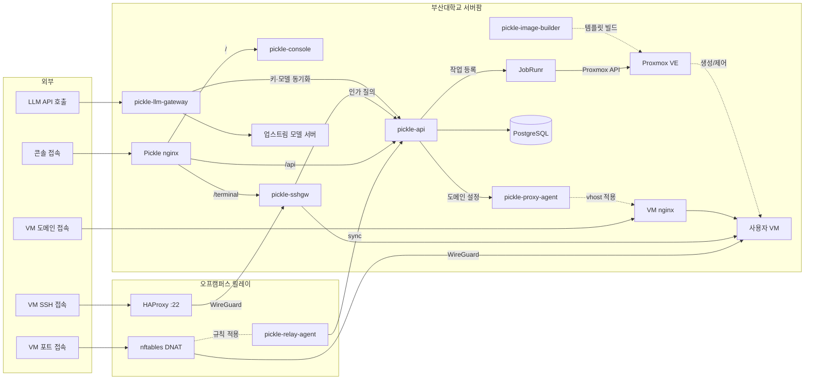

# pickle-api

부산대학교 클라우드 플랫폼(Pickle)의 백엔드 API 서버입니다.

사용자가 웹 콘솔에서 VM이나 LLM API 키, 외부 도메인을 신청하면 관리자 승인을 거쳐
리소스가 발급됩니다. 외부 도메인만은 사람이 승인할지를 고른 루트 도메인이 정합니다.
VM은 Proxmox VE 프로비저닝과 SSH 접속, 도메인 기반 HTTPS 공개, 웹 터미널로
이어집니다. 실제 SSH 종단과 nginx 조작은 각각 게이트웨이와 에이전트가 맡고, 이 서버는
리소스 수명주기 전체에서 무엇을 해야 하는지 정하고 결과를 기록합니다.

접속: https://pickle.pusan.ac.kr

REST API(`/api/v1`), JobRunr 백그라운드 워커, Proxmox REST 클라이언트, 주기 스케줄러가
fat jar 하나로 동작합니다. 상태는 데이터베이스 한 곳에서 관리하며 잡 큐와 IP 할당,
라우팅 정보가 같은 곳에 있습니다.

스택: Spring Boot 4.1 / Java 25 / PostgreSQL 18 / Flyway / JobRunr / springdoc

## 주요 기능

플랫폼은 VM과 LLM API 키, 외부 도메인의 신청과 승인, 발급부터 사용과 만료, 폐기까지를
다룹니다.
이 레포지토리가 맡는 부분은 아래와 같습니다.

- **프로비저닝 파이프라인**: 승인된 신청을 받아 VM을 만들고 내부 IP와 초기 계정, 접속
  정보까지 준비합니다.
- **외부 도메인**: 승인된 신청에서 플랫폼 루트 아래 이름 하나를 발급하고, 소유자가 A,
  AAAA, CNAME, TXT 레코드를 직접 편집합니다. 대상은 이 플랫폼 밖 서버여도 되며 콘텐츠는
  플랫폼이 갖지 않습니다. 사람이 승인할지는 루트 도메인마다의 정책이고, 자동이면 접수와
  동시에 승인되어 결재자 없는 승인 기록이 남습니다. 이름은 사용 기한을 가지며 연장하지
  않으면 레코드가 내려가고 예약 기간 동안만 같은 워크스페이스가 되살릴 수 있습니다.
- **LLM API 키 관리**: 승인된 신청에서 키를 만들고 발급과 한도, 정지, 재개, 폐기 상태를
  관리합니다. 키별 metadata와 사용량 집계는 전역 학생 지원 권한으로 조회하며, 기관별
  운영 관측은 기관 역할 범위를 따릅니다. 7·30·90일 수요와 주요 소비처,
  실제 한도 차단, usage 전달 신뢰도를 DB cache에서 함께 조회합니다. 키 하나와 사업
  account 하나, 모델과 호출 경로, 기능 권한별 분해를 제공합니다.
- **usage event의 금액은 귀속이지 청구가 아닙니다**: `llm_usage_events.cost_usd`는 요청마다
  upstream이 알려 준 값이고, 한도를 견주거나 잔액을 말하는 자리는 언제나 vendor meter입니다.
  둘은 창이 다르고 이쪽에는 가격이 붙지 않은 요청이 빠져 있으므로 서로 빼거나 한 숫자로
  합치지 않습니다. **값이 없는 것은 0이 아닙니다** — 자체 서빙 요청에는 금액이라는 것이
  없어서, 모든 금액은 가격이 붙은 요청 수와 함께 다닙니다.
- **기관별 OpenRouter 사업 account**: 한 기관이 사업별 account를 여러 개 등록하고,
  검증된 management credential을 staged overlap으로 교체합니다. 금액 축 key는 승인 시 한
  account에 불변 binding되며, 그 account의 credential 말고 쓸 수 있는 관리 자격증명은
  없습니다.
- **LLM 서비스 관측**: 게이트웨이의 5초 sync 자기보고에서 upstream별 실제 요청 상태와
  별도 `/models` probe, catalog 비교, usage 전송 queue를 현재 상태로 저장합니다. 관리자
  `GET /api/v1/admin/llm/status`와 `/metrics`는 DB와 raw usage event만 읽으며 upstream을
  직접 호출하거나 routing을 바꾸지 않습니다. 지표는 event에 기록된 마지막 처리 upstream의
  최종 결과이므로 중간 retry 경로나 uptime으로 해석하지 않습니다.
- **인가 판정과 감사**: 리소스마다 붙는 접근 목록으로 그 리소스의 접근을 판정하고, 되돌릴 수 없는 작업은
  영구 기록으로 보존합니다.
- **계정과 인증**: 회원가입, 메일 인증, 2단계 인증을 담당합니다. 계정 상태가 바뀌면
  살아 있는 세션과 게이트웨이 접근이 함께 회수됩니다.
- **수명주기 관리**: 사용 기간이 끝나가면 미리 알립니다. 만료된 VM은 데이터를 남긴 채
  종료되고, 삭제는 유예와 보호 게이트를 거칩니다.
- **드리프트 감시**: 기록된 상태와 하이퍼바이저의 실제 상태가 어긋나면 찾아내 관리자
  화면에 올립니다. 스스로 고치거나 지우지 않습니다.
- **알림**: 승인, 만료 임박, 프로비저닝 결과 같은 사건을 콘솔 알림함에 쌓고 메일로도
  내보냅니다. VM 삭제 알림은 접수와 예약, 취소, 강제 삭제, 완료 시점에 활성 VM 소유자와
  워크스페이스 소유자에게 보냅니다. 두 범위에 겹치는 소유자는 한 번만 수신합니다.
- **공지사항**: 팝업으로 띄울지가 로그인 없이 보이는지까지 함께 정합니다. 팝업으로 올린
  공지는 방문자에게 바로 열리고, 나머지는 로그인한 사용자의 게시판에 남습니다. 볼 수 없는
  공지는 거절이 아니라 404로 답합니다. 본문 이미지는 클라이언트가 선언한 형식이 아니라
  실제 바이트로 판별해 받습니다(PNG·JPEG·WebP·GIF, 한 장 2 MiB, 공지당 5장). 점검
  모드에서도 계속 읽힙니다.
- **알림 대상 미리보기**: `POST /api/v1/admin/announcements/preview`는 실제 발송과 같은
  권한으로 현재 활성 대상 인원과 조회 가능한 명단 일부를 확인합니다. 미리보기는 발송 예산을
  쓰지 않습니다. 실제 발송은 큐 접수 때 명단과 주소를 한 번 확정하므로 예상과 달라질 수 있습니다.
  `GET /api/v1/admin/announcements/{announcementId}`는 당시 본문과 대상, 저장 인원을 제공합니다.
- **공지 편집 조회**: `GET /api/v1/admin/notices/{noticeId}`는 관리자 목록과 같은 여섯 역할이
  예정·게시·종료 공지를 조회하는 경로입니다. 본문 입력은 평문 20,000자까지이며 이미지 첨부는
  등록 후 수행합니다. `GET /api/v1/notices?popup=true`는 기존 공개 범위 안에서 팝업만 조회합니다.

## 동작 방식

- **Proxmox 클라이언트**를 이 레포지토리에서 직접 구현합니다. 실제 서버 응답을 캡처해 둔
  WireMock 테스트로 응답 명세를 고정해 검증합니다.
- **잡 큐가 데이터베이스에 있습니다.** JobRunr가 잡을 PostgreSQL 테이블에 저장하므로
  최소 1회 실행과 백오프 재시도, 진행 상황 대시보드가 따라옵니다. 워커는 API와 같은 JVM에서
  돌고, 부하가 늘면 같은 jar를 `--worker-only` 모드로 다른 호스트에 띄울 수 있습니다.
- **LLM 사용량 일별 집계를 직접 갱신할 수 있습니다.** 공유 JobRunr 워커를 끈 후보 API에서
  명시적으로 활성화하면 기존 집계 서비스로 기동 중 누락분을 채우고 이후 5분마다 실행합니다.
  관리자 사용량 화면이 읽는 일별 집계의 성공 시각과 원시 이벤트 ID 경계를 별도로 감시합니다.
- **일일 LLM 토큰 한도를 별도로 갱신할 수 있습니다.** 공유 JobRunr 워커를 끈 API에서
  명시적으로 활성화하면 기동 직후와 이후 5분마다 기존 한도 갱신 서비스를 직접 실행합니다.
  같은 데이터베이스의 두 직접 스케줄러가 동시에 시작되면 뒤에 시작한 인스턴스는 기동을
  거부합니다. 이 기능은 OpenRouter 계정 조회·신규 키 발급, 사용량 집계, 알림 발송을
  실행하지 않습니다. 서로 다른 데이터베이스의 쓰기 소유권은 배포 순서에서 별도로
  확정해야 합니다.
- **민감한 작업에는 인증이 한 겹 더 있습니다.** 비밀번호 열람이나 키 다운로드처럼
  되돌리기 어려운 작업은 로그인 상태여도 짧은 유효기간의 재인증 토큰을 다시 요구하며,
  인터셉터가 대상 작업 전체에 일괄 적용합니다. 회원가입 비밀번호는 유출 이력 차단목록과
  대조합니다.
- **권한 매트릭스를 테스트가 강제합니다.** 운영자가 확정한 역할×기능 매트릭스 YAML과
  실제 엔드포인트 인가 설정을 `PermissionMatrixTest`가 1:1로 대조합니다.
- **책임 경계** — 이 서버는 SSH 연결을 열지 않습니다. 웹 터미널은 별도 브리지가
  담당하고, 필요한 OpenSSH 공개키 파싱과 키쌍 생성은 와이어 포맷을 직접 다룹니다.
- **자격증명 문제는 기동에서 걸러냅니다.** 데이터베이스 비밀번호, JWT 서명 키, 자격증명
  암호화 키, 내부 토큰 중 하나라도 비어 있으면 서버가 실행되지 않습니다.
- **테스트가 외부 런타임을 요구하지 않습니다.** Zonky embedded-postgres와 WireMock으로
  돌기 때문에 `mvn verify` 하나로 전체 테스트가 끝납니다.
- **플랫폼 서브도메인의 DNS 레코드를 서버가 직접 씁니다.** 이름 하나에 A 레코드 하나를
  Google Cloud DNS REST API로 만들고 지우며, 라우트 적용 잡의 한 단계입니다(올릴 때는
  vhost보다 먼저, 내릴 때는 vhost 뒤에). SDK 대신 얇은 HTTPS 클라이언트를 쓰고, 서비스
  계정 인증은 이미 쓰고 있는 jjwt로 RS256 JWT를 서명해 토큰으로 바꿉니다. 제공자가 설정되지
  않았으면 기동은 되고 플랫폼 서브도메인 공개만 거부됩니다.

## 유료 모델 허용·차단

키의 `creditAllowedModels`와 `creditDeniedModels`는 부호 없는 문자열 배열입니다.
승인 입력과 사업 account의 기본값에도 같은 문법을 사용합니다. 각 목록은 최대 50개,
항목은 200바이트까지 받습니다. 허용과 차단에 동시에 해당하면 차단이 우선합니다.

- `openai/*`는 해당 공급자 전체, `openai/gpt-5-*`는 모델 접두 패턴입니다.
- `*/*-pro`는 모든 공급자의 `-pro` 모델을 차단할 때 사용할 수 있으며 `~`별칭도 포함합니다.
  공급자 자리는 정확한 이름 또는 `*`만 받으므로 `open*/*`는 입력 오류입니다.
- 특정 공급자를 허용할 때 `openai/*`와 `~openai/*`는 별개입니다. 차단은 `~`를 제거한
  이름도 검사하지만 별칭이 가리키는 실제 모델까지 추적하지는 않습니다.
- 정확한 모델명과 접미 패턴은 `:batch` 같은 변형도 포함합니다. `openai/gpt-5-*`의
  구분자 생략 규칙은 `openai/gpt-5`에만 적용되고 `openai/gpt-5:batch`에는 적용되지 않습니다.
- 허용 목록이 비면 허용 쪽 제한이 없고, 차단 목록이 비면 차단이 없습니다. 금액이 0이어도
  차단 목록은 저장할 수 있습니다. 모델 제한이 있는 키는 `openrouter/` 라우터를 사용할 수
  없으며 자체 서빙 모델은 두 목록의 영향을 받지 않습니다.

모델 조회는 이 판정을 적용한 목록과 현재 캐시에서 일치하지 않는 패턴을 돌려줍니다.
새 공급자 패턴을 사용하려면 게이트웨이를 먼저 업데이트한 뒤 API와 콘솔을 적용합니다.

## 프로비저닝 파이프라인

승인 트랜잭션이 VM 행(CREATING)을 만들고 잡을 큐에 넣으면 워커가 아래 단계를 순서대로
지나갑니다.

```
guard → 승인 배치 확인 → IP 할당 → VMID 채번 → OS 이미지 clone
  → 설정(사양·cloud-init·고정 IP·protection=1) → 디스크 리사이즈
  → 기동 → qemu-agent 검증 → 호스트키 수집 → 완료(RUNNING, 알림)
```

각 단계는 멱등이라 중간에서 다시 시작해도 안전합니다. 백오프 재시도로도 통과하지
못한 일반 생성 실패는 단계에 따라 반쯤 만들어진 VM과 IP를 정리하거나, VM을
NEEDS_ADMIN 상태로 두고 관리자 콘솔에 띄웁니다. clone pin 누락·변경, 현재 노드 불일치,
prepared NIC 조건 불일치처럼 자동 정리가 안전하지 않은 경우에는 VMID와 IP, 기존 guest와
pin을 그대로 보존하고 NEEDS_ADMIN에서 멈춥니다.

완료 단계는 VM의 RUNNING 상태와 생성 이벤트, 작업 DONE을 한 트랜잭션으로 저장한 뒤
완료 알림을 발행합니다. 완료 기록 저장 실패는 생성 실패와 구분해 재시도하거나 관리자
확인을 기다립니다. 이전 실행이 RUNNING 상태만 남겼다면 완료 단계 재실행으로 누락 이벤트와
작업 결과를 복구하고, 이미 있는 생성 이벤트는 유지합니다.

승인 트랜잭션은 이미지 revision과 후보 노드를 잠근 뒤 CPU, 메모리, 디스크 여유를 함께
확인합니다. 선택한 노드와 clone 원본 행, template VMID, revision metadata hash는 VM에
고정됩니다. 워커 재시도도 이 좌표만 사용하며 이미지 metadata나 위치가 바뀌면 관리자
확인이 필요한 상태로 멈춥니다. 복구로 VM의 현재 노드가 바뀌어도 최초 clone 좌표는
이력으로 남고, 다른 노드에서 clone을 다시 실행할 권한으로 사용되지 않습니다. pin이 없는
기존 VM은 조회와 일반 lifecycle을 계속 지원하지만 CREATING 상태에서 새 clone을 시작하지
않습니다. REINSTALL 파이프라인은 제공하지 않습니다.

OS 이미지 행은 노드별 inventory이며 `(node_id, name, version)`이 유일합니다. 공개 목록은
같은 `(name, version)`의 호환 replica를 하나로 묶고 가장 먼저 등록된 행의 UUID를 계속
노출합니다. 이 원본 행이 비활성 상태여도 활성 노드에 metadata가 일치하는 활성 replica가
있으면 선택할 수 있습니다. 신청과 승인, 실제 clone이 같은 revision 판정을 사용하므로
카탈로그 표시와 생성 가능 여부가 어긋나지 않습니다.

새로 준비한 노드는 `labels`에 `placement_capacity`와 `vm_nic_requirements`를 함께 등록합니다.
첫 문서는 `schema_version`, 측정 시각, `physical`/`reserved`/`allocatable`의 `cpu_threads`,
`memory_mb`, `disk_gb`를 담습니다. 세 축 모두 승인 시 hard limit으로 적용됩니다. NIC 문서는
`schema_version: 1`, `mtu: 1370`, `firewall: true`만 허용합니다. 이미지 활성화와 clone 직전에
template의 `net0`가 이 값과 일치하는지 확인하고, VM 설정에서는 MAC과 기존 NIC 속성을
보존한 채 대상 bridge만 바꿉니다. 이 두 label이 모두 없는 기존 노드는 종전의 메모리 hard
limit과 CPU·aggregate disk advisory 동작을 유지합니다. label 하나라도 등록한 노드는 두
문서가 모두 유효해야 ACTIVE 전환을 통과합니다.

도메인과 포트 매핑별 출발지 정책은 revision CAS로 저장하고 proxy/relay agent에 generation과
함께 전달합니다. 도메인은 IPv4·IPv6, 포트 매핑은 IPv4 CIDR을 지원하며 빈 목록은 새 연결을
거부합니다. Proxy는 적용 직전의 fresh `/status`, relay는 현재 sync 요청에서
`source-acl-v1`을 확인합니다. 어느 쪽이든 확인하지 못하면 정책을 생략하지 않고 반영 대기
또는 실패로 남깁니다. 제거 경로는 capability와 무관하게 계속 동작합니다.

`pickle.network-policy.enabled`는 기본 false입니다. 이 값이 false인 legacy 행만 기존 wire를
유지하며, 저장 정책이나 activation marker가 있는 행은 생략으로 완화되지 않습니다. 교내 CIDR
설정 `pickle.network-policy.campus-source-cidrs`에는 기본 허용 대역이 없습니다. Preset은 이
설정의 확인된 CIDR을 snapshot으로 반환하고 정책에는 최종 CIDR 배열만 저장합니다. VM NIC의
PVE 방화벽 정책은 별도 기능입니다.

VM 통신 정책 API는 `GET`/`PUT /api/v1/vms/{vmId}/network-policy`와 같은 관리자 경로를
제공합니다. 조회는 VM 열람자, 변경은 VM 편집자 이상이며 관리 경로는 기관 범위와 시스템
범위를 각각 검사합니다. 규칙은 IPv4 `ANY`/`TCP`/`UDP`/`ICMP`, `IN`/`OUT`,
`ACCEPT`/`DROP`의 순서 있는 전체 교체이고 `expectedRevision`으로 동시 수정을 거부합니다.
응답의 system rule은 목적만 설명하며 운영 source IP나 PVE group 이름을 노출하지 않습니다.

기능은 `PICKLE_VM_FIREWALL_ENABLED=false`가 기본입니다. 켜려면 운영자가 20자 이하의 immutable
IN/OUT DROP security group을 먼저 만들고 그 이름과 SSH gateway, 웹 터미널, proxy, relay의
IPv4 source를 `PICKLE_VM_FIREWALL_BARRIER_GROUP`,
`PICKLE_VM_FIREWALL_SSH_GATEWAY_SOURCE_IPS`,
`PICKLE_VM_FIREWALL_TERMINAL_SOURCE_IPS`, `PICKLE_VM_FIREWALL_PROXY_SOURCE_IPS`,
`PICKLE_VM_FIREWALL_RELAY_SOURCE_IPS`로 명시해야 합니다. API credential은 group을 조회할
`Sys.Audit`와 VM 방화벽을 다룰 `VM.Audit`/`VM.Config.Network`만 사용하며 group 변경 권한은
갖지 않습니다. 노드 label `vm_firewall_policy: {schema_version: 1}`과 기존 durable policy 행이
모두 있는 VM만 갱신할 수 있습니다. 전역 기능과 `vm_firewall_policy`,
`vm_nic_requirements` label이 모두 준비된 노드의 새 VM은 CONFIG 단계에서 durable policy 행을
만듭니다. 이때 `onboot=0`을 유지하고 firewall options, `ipfilter-net0`, immutable control
prefix와 초기 mutable policy의 exact readback을 `APPLIED`로 기록한 뒤에만 첫 START 직전
`onboot=1`을 설정합니다. durable 행이 생긴 뒤에는 전역 설정이나 node label 소실을 legacy
bypass로 바꾸지 않습니다. START가 접수된 뒤 task polling이나 QGA 확인에서 중단된 retry는
정책 전체를 다시 검증하고 실제 VM이 이미 running이면 START를 재전송하지 않은 채 QGA 확인부터
이어갑니다.

사용자·관리자 START와 REBOOT worker도 durable 행이 있으면 최신 revision/generation/hash와
node·VMID·allocated IP tuple, 실제 PVE config/rules/runtime을 전원 command 접수 직전에 다시
확인합니다. 같은 VM의 policy PUT은 non-blocking advisory lock을 사용하고 CREATING, 진행 중인
전원·장치 작업과 직렬화되며, 충돌하면 작성 중인 draft를 보존하도록 409를 반환합니다.
SHUTDOWN과 FORCE_STOP은 이 시작 gate를 기다리지 않습니다.

적용기는 cluster firewall enable과 노드의 legacy PVE firewall backend부터 확인합니다. 이어서
net0 하나의 유효한 MAC, 승인된 bridge·MTU, `firewall=1`, VLAN tag/trunk 부재, 고정 control rule,
`ipfilter-net0`, immutable group을 정확히 확인한 뒤 group barrier 아래에서 mutable rule을
교체합니다. IPv6는 NDP를 끄고 net0의 IN/OUT DROP control rule로 닫습니다. 추가 `netN`, custom QEMU args,
알 수 없는 enabled rule, IPSet `nomatch`/provider error, group drift는 자동 정리하지 않습니다. barrier가 실제로 enabled이고
지원 NIC 전체와 immutable base를 재확인한 경우에만 `FAILED_CLOSED`로 표시하며, 이는 PVE의
conntrack 때문에 기존 연결 종료가 아닌 새 연결 차단 상태를 뜻합니다. 그 밖의 불확실한 상태는
`FAILED`로 남깁니다. `APPLIED`와 `FAILED_CLOSED`는 PVE 설정 readback 결과이며 실제 packet
enforcement 확인을 대신하지 않습니다. 실행 중인 VM을 자동으로 중단하지 않습니다.

### 복구된 VM의 정책 단독 적용

운영자가 이미 위치를 옮긴 VM 한 대의 정책을 적용할 때는
`RecoveryPolicyMain`을 사용합니다. 전용 Spring 구성은 HTTP listener, JobRunr worker와
recurring producer, Flyway, 시더, 일반 API runner를 생성하지 않습니다. DB와 PVE에 접근할
설정은 일반 운영 API와 같아야 하며, API와 모든 다른 writer는 정지한 상태여야 합니다.
원본과 대상 VM은 모두 stopped, `onboot=0`, 모든 NIC의 `link_down=1` 상태로 유지합니다.
대상 VM에는 유일한 net0와 기존 immutable firewall options, `ipfilter-net0`, control rule,
barrier group이 정확히 복원되어 있어야 합니다. 이 명령은 누락된 기반을 만들지 않습니다.

DB 식별자는 **이 명령이 사용할 DB 계정과 연결로** 다음 SQL을 실행한 JSON 결과를 보호 파일에
저장합니다. `pg_control_system()` 실행 권한이 없으면 명령은 실패합니다. 파일은 이 복구의
DB 이름, 계정, 연결 방식, primary 여부와 PostgreSQL system identifier를 고정합니다.

```sql
select jsonb_build_object(
    'database', current_database(), 'user', current_user,
    'local_socket', inet_server_addr() is null,
    'primary', not pg_is_in_recovery(),
    'system_identifier', (select system_identifier::text from pg_control_system()));
```

위 결과를 담은 `DB_IDENTITY_FILE`과 복구 manifest, 위치 채택 뒤 생성된 작은 정책 proof를
준비합니다. Manifest와 proof는 각각 root 소유 0600 일반 파일이어야 하며 심볼릭 링크는
거부합니다. 두 파일의 실제 SHA-256을 별도 인자로 고정합니다. Proof는 operation ID,
fencing token, DB system identifier, 원본·대상 node UUID/VMID/PVE digest, VM 신원과
정책 revision/generation/hash를 담습니다. Manifest의 owner lease가 유효하고 적용 직전
90초 이상 남아 있어야 하며 최종 DB commit 직전에도 만료되지 않아야 합니다. 파일 경로에는
공백을 넣지 않습니다.

작업 디렉터리는 이 API 레포지토리이고 Java 25와 Maven, 운영 DB/PVE 환경 변수가 준비되어
있어야 합니다. `ATTEMPT_UUID`는 이 호출마다 새로 발급한 UUID입니다. 같은 operation의
재시도에는 새 attempt ID와 앞선 명시적 실패 감사 행이 필요합니다.

```bash
./mvnw -q -DskipTests \
  -Dspring-boot.run.main-class=kr.ac.pusan.pickle.networkpolicy.RecoveryPolicyMain \
  "-Dspring-boot.run.arguments=$MANIFEST_FILE $MANIFEST_SHA256 $POLICY_PROOF_FILE $POLICY_PROOF_SHA256 $DB_IDENTITY_FILE $ATTEMPT_UUID" \
  spring-boot:run
```

명령은 VM ID를 읽어 잠금 대상을 정한 뒤, 같은 JDBC session의 per-VM advisory lock 아래
모든 보호 DB 조회를 수행합니다. 채택 감사 행과 proof, VM `STOPPED`/삭제 없음/채택 후
`updated_at`, 작업 부재, 정책 revision/generation/hash와 IP·노드 정보를 대조합니다.
원본과 대상의 실제 stopped, `onboot=0`, `link_down=1`, HA·진행 task 부재, hostname/MAC/
cloud-init IP·gateway, bridge/MTU/firewall, PVE config digest와 변경 대기 설정 부재를
확인합니다. 원본 description의 `pickle-recovery-owner:<operationId>:<fencingToken>`과 대상의
`pickle-recovery-operation:<operationId>`도 정확한 한 줄로 대조합니다. Config digest는
복원 디스크 설정을 포함한 PVE 현재 config를 고정하며 디스크 내용이나 fencing 자체의
증거는 아닙니다.

기존 정책 compiler/reconciler로 대상 규칙을 적용하고 PVE 최종 정책과 두 VM의 격리 상태를
다시 읽습니다. 그 뒤 같은 JDBC session의 짧은 트랜잭션에서 VM·policy·IP·노드 행과
채택 증거를 재검사하고 `APPLIED`와 `vm.recovery_policy_applied` 감사 행을 함께 commit합니다.
DB commit 결과나 잠금 해제가 불확실하면 명령은 성공을 주장하지 않고 read-only 판정만
표시합니다. `APPLIED_WITH_AUDIT`도 현재 DB tuple과 해당 attempt의 감사 행을 확인했다는
뜻이며 PVE 방화벽 enforcement나 원본 fencing, VM 기동 허가는 아닙니다. 이때 두 VM을
격리한 채 DB 상태와 PVE 상태를 직접 확인합니다. 이미 완료된 operation은 **같은 proof SHA와
완료 attempt ID**를 다시 전달한 경우에만 PVE 쓰기 없이 정책과 감사 행을 조회합니다. 명령은 VM 기동이나 NIC 연결을
수행하지 않습니다.

HTTP/port 공개 경로는 durable operation으로 VM allow와 consumer 적용 순서를 지킵니다.
HTTP 생성·포트 변경은 새 proxy target allow가 `APPLIED`된 뒤에만 DNS/proxy PRESENT를
보내고, ABSENT ACK 뒤에 이전 allow를 제거합니다. Port mapping 생성·재개는 public
`PENDING` 상태로 relay snapshot에서 제외한 채 VM allow를 먼저 적용하고 relay generation
ACK 뒤 `ACTIVE`가 됩니다. 중단은 public `SUSPENDED`, 삭제는 `REMOVING`으로 즉시 의도를
보이되, exact retirement receipt 전에는 VM allow·mapping tombstone·public port·IP allocation을
유지합니다. after-commit enqueue는 정본이 아니며 15초 recurring coordinator가 DB operation을
재시도합니다. 사용자 정책 revision은 그대로 두고 derived path 변화는 desired generation/hash만
올립니다. Operation revision CAS가 close로 대체된 stale open/replace worker의 완료 기록과 path
삭제를 거부하며, port activation의 relay generation·delivery 전환·operation phase 이동은 한 DB
트랜잭션으로 커밋됩니다.

Relay retirement producer는 `PICKLE_RELAY_RETIREMENT_ENABLED=false`가 기본입니다. 활성화에는
relay의 fresh `mapping-retirement-v1` heartbeat, 고정된 durable ledger UUID, 역행하지 않는
consumer-mapping-id/flow-mark/retirement high-watermark, live mark namespace 확인과 armed row가 모두 필요합니다.
Managed mapping은 nonzero uint32 flow mark와 별도 consumer epoch id를 쓰며, restore된 API DB가
consumer ledger에서 이미 퇴역한 mapping/mark를 다시 내보내면 sync를 fail-closed 합니다.
Consumer는 마지막으로 수락한 managed generation과 typed snapshot의 canonical hash도 영구 보존해
generation 역행과 같은 generation의 다른 내용을 거부합니다. API는 consumer가 보고한 managed
generation보다 복원된 값이 낮으면 그 high-watermark보다 큰 generation으로만 다시 발급하고,
active mapping·retirement·ACK content 변화도 같은 규칙으로 generation을 올립니다.
Retirement이 armed된 relay에는 generation이 같아도 `mappings`(빈 배열 포함), `retirements`,
`acknowledgedRetirementHighWater`를 모두 넣은 full managed snapshot을 응답합니다. Compact
`{"generation": N}` 응답은 retirement이 armed되지 않은 legacy relay에만 사용합니다.
퇴역 tuple hash는 `mappingId`, lowercase protocol, public port, canonical target IPv4, target port,
flow mark를 각각 줄바꿈한 ASCII의 SHA-256입니다. Consumer는 DNAT 제거와 exact mark DROP fence를
원자적으로 적용하고 readback한 뒤 native conntrack API로 original/reply exact tuple만 삭제하며,
삭제 후 zero readback까지 성공한 경우에만 `CLEARED` receipt를 냅니다. Receipt는 retirement UUID,
generation, mapping id, mark, tuple hash가 모두 일치해야 인정합니다. Generation ACK만으로는
mapping 삭제나 IP 회수를 진행하지 않습니다. API는 앞선 retirement에 빈틈이 없는 CLEARED prefix만
`acknowledgedRetirementHighWater`로 응답하고, consumer는 ACK 이하의 tuple/fence만 정리합니다.

Consumer는 ACK된 tuple과 fence를 정리한 뒤에도 ledger UUID와 세 high-watermark를 영구 보존합니다.
API도 완료된 tombstone을 정리하되 relay high-watermark는 보존하므로, stale DB가 이미 쓴 epoch나
mark를 다시 발급할 수 없습니다. 중단 후 재개는 같은 public mapping에 새 consumer epoch와 mark를
발급합니다. 한 번 armed된 relay는 retirement ledger를 이해하지 못하는 이전 바이너리로 롤백할 수
없습니다. 일반 VM 정책 변경은 conntrack을 비우거나 세션을 끊지 않으며, 선택적 conntrack 삭제는
mapping 중단·삭제와 VM 소유권 종료의 resource retirement에만 사용합니다.

30초 상태 폴러와 10분 드리프트 리컨실러, 5분 삭제 스위퍼, 10분 고아 태스크 복구가
데이터베이스와 Proxmox를 계속 맞춥니다. 드리프트 리컨실러는 어긋난 지점을 보고만 하고
직접 손대지 않습니다. 관리 대상 VM은 하이퍼바이저 `protection` 플래그를 상시 켜 두고,
의도된 삭제 직전에만 내립니다.

### 노드의 CPU 배치 예산

노드 `labels.placement_capacity`의 schema1은 물리 용량에서 예약량을 뺀 CPU, 메모리,
디스크 예산을 사용합니다. schema2는 `cpu_policy`의 `allocation_ratio`(1 또는 2)와
`committed_vcpu`를 함께 검증합니다. CPU 예산은 `(physical.cpu_threads -
reserved.cpu_threads) × allocation_ratio - committed_vcpu`입니다. `reserved.cpu_threads`는
호스트가 사용하는 물리 CPU 예약량이며, `committed_vcpu`는 플랫폼 VM 목록 밖에서 이미
사용하거나 별도로 확보한 vCPU입니다. 플랫폼에 기록된 VM의 할당량과 새 요청은 남은
예산에 대해 노드를 잠근 상태에서 함께 확인합니다. 외부 vCPU를 다시 빼지 않습니다.

메모리와 디스크는 두 schema 모두 `physical - reserved`로 계산합니다. 노드의 CPU
column은 물리 thread 수를 유지하며 CPU 공유 비율은 VM 개수나 성능 보장 비율이 아닙니다.
메타데이터가 없는 기존 노드는 기존 배치 동작을 유지합니다. 메타데이터가 있는데 version,
정수 값, 필드 구성이나 계산 결과가 맞지 않으면 배치를 거부합니다.

아래 예시는 16 physical threads 중 호스트용 4개를 예약하고 외부 vCPU 6개를 확보한
설정입니다. 플랫폼 VM에 할당할 수 있는 CPU 예산은 18 vCPU입니다.

```json
{
  "schema_version": 2,
  "physical": {"cpu_threads": 16, "memory_mb": 65536, "disk_gb": 512},
  "reserved": {"cpu_threads": 4, "memory_mb": 8192, "disk_gb": 128},
  "allocatable": {"cpu_threads": 18, "memory_mb": 57344, "disk_gb": 384},
  "cpu_policy": {"allocation_ratio": 2, "committed_vcpu": 6},
  "measured_at": "2026-01-01T00:00:00Z"
}
```

## GPU 할당 API

GPU 할당은 가상머신과 별도 리소스입니다. `GPU` 종류로 임대 시간을 직접 신청하고
관리자가 승인하면 대기열에 들어갑니다. 빈 카드가 할당된 순간부터 임대 시간이 흐르며,
가상머신을 연결하지 않아도 점유는 유지됩니다. 기본 임대 시간은 없습니다.

`GET /api/v1/gpu-allocations`와 상세 경로에서 할당을 조회합니다. `attach`는 가상머신과
GPU 양쪽의 편집 권한 및 중단 동의를 확인합니다. `detach`는 연결만 해제하고,
`release`는 GPU를 반납합니다. 기존 전원 상태를 보존하며 정상 종료에 실패하면 강제로
종료하지 않습니다. 장치 상태가 불명확하면 점유와 작업 잠금을 유지하고, 시스템 관리자가
`POST /api/v1/admin/gpu-allocations/{allocationId}/reconcile`로 읽기 검증을 수행합니다.
원격 작업이 진행 중이거나 접수 여부가 불명확하면 이 검증도 잠금을 해제하지 않습니다.

실제 장치 연결에는 같은 노드 배치와 게스트 드라이버 준비 확인이 필요합니다.
기본 게스트 준비 검사기는 확인 불가로 연결을 거부하며, 다른 노드의 가상머신 이동은
제공하지 않습니다. 운영 GPU 등록과 준비 검사 구현을 갖추기 전에는 실제 연결이 열리지
않습니다. 등록된 카드가 없어도 목록과 신청, 검토 화면은 정상 동작합니다.

운영 정책은 DB의 `gpu_unattached_review_hours`, `gpu_low_util_window_hours`,
`gpu_low_util_threshold_percent`, `gpu_low_util_snooze_hours`, `gpu_lease_notice_hours`로
관리합니다. 검토는 실행 시점의 값을 읽으며, 누락되거나 잘못된 설정에는 숨은 기본값을
적용하지 않습니다. 설정 변경은 이미 승인된 임대 만료 시각을 바꾸지 않습니다.
임대 종료는 매분 확인하고, 미연결 및 저사용 검토는 매시간 수행합니다. 저사용 검토는
관리자에게 알리며 스스로 회수하지 않습니다.

`pickle.gpu.collector`는 기본 `none`이고 표본을 만들지 않습니다. 실제 수집기는
`GpuUtilizationCollector`를 구현합니다. 이용률이 측정되지 않은 구간은 0%가 아니며,
연결 후 검토 기간이 온전히 지난 상태에서 5분 구간의 80% 이상과 최근 10분 이내 표본을
확보해야 저사용을 판정합니다. 가상머신을 바꾸면 이전 연결의 표본을 사용하지 않습니다.

## 기관 명단과 신청 알림

기관 역할 명단은 해당 기관의 역할 행으로 조회합니다. 계정의 최고 역할과 구분하며,
기관별 수신 설정과 활성 계정, 실제 수신자 및 제외 사유를 함께 제공합니다.
`GET /admin/orgs/{orgId}/operations`는 시스템 계층 전체와 역할을 보유한 기관 계층에
열려 있습니다. 미리보기는 같은 경로의 `POST /preview`, 전체 저장은 `PUT`입니다.
기관 변경은 기관 관리자와 시스템 관리자에게 허용됩니다.

전체 명단 저장과 단건 역할·수신 변경에는 `expectedRevision`이 필요합니다. 기관 역할
회수는 같은 값을 query로 보냅니다. 오래된 버전은 409로 거절하며 명단과 대상 기관의
전후 감사는 함께 저장합니다. 계정의 행 버전도 동시 변경으로 역할이나 토큰 버전이
덮어써지는 것을 막습니다.

신청 메일은 활성 승인자 전체 또는 지정 명단으로 설정합니다. 지정 0명도 저장할 수
있으며 자동 대체 발송은 없습니다. 새 기관은 지정 0명으로 시작합니다. 기존 미전환
설정은 조회와 명시 저장으로 전환합니다. 신청자 확인 알림과 기관 승인자 알림은 별도이며,
승인자 콘솔 알림은 메일 수신 지정과 분리됩니다.

큐 등록 당시 수신자와 주소를 보존합니다. 이후 기관 명단이나 계정 상태가 바뀌어도
대기 중인 신청 메일은 재선정하거나 재검사하지 않습니다. 발송 결과의 `SENT`는 SMTP
인계이며 메일함 도착을 뜻하지 않습니다.

## 사용자 관계와 접근 조건

기관 열람자와 운영자, 관리자는 시스템 계층 계정을 제외한 사용자의 프로필, 워크스페이스,
초대, 신청 결과와 자원 metadata를 전역 조회합니다. 시스템 계층은 모든 계정을 조회합니다.
역할 부여 자체를 지원 자격으로 사용하며 직책이나 학생의 기관 연결을 추가로 요구하지 않습니다.
`GET /api/v1/admin/users/{userId}/support`는 실제 구성원 관계와 신청 대상자 상태,
생성된 리소스를 연결합니다. 이메일과 저장 학번으로 대기 초대를 연결하며 이미 수락된
초대는 실제 사용자 ID를 따릅니다. 기존 종류별 관리자 목록과 단건 상세에도 같은 지원
읽기를 적용합니다. `orgId`는 조회 필터이며 `GET /api/v1/admin/support-orgs`는 비활성
기관을 포함한 필터 옵션의 ID와 이름, 상태를 제공합니다. 신청과 도메인 목록의
`workspaceId`는 워크스페이스로 대상을 좁힙니다.

사용자 상세의 `supportCapabilities`는 프로필 조회와 정정, 계정 활성화의 가능 여부를
구분합니다. 워크스페이스 구성원의 `supportDetailVisible`도 같은 계정 공개 기준을
따릅니다. 자격증명과 원문 내용, 물리 인프라 조회 및 실제 기관 집행 권한은 기존 인가를
사용합니다. LLM 키 사용량의 토큰·금액·모델별 집계는 지원 metadata에 포함합니다.

`GET /api/v1/admin/users/{userId}/support/access?type=VM&resourceId=...`는 지정 리소스의
구성원 자격과 개인 부여, 워크스페이스 전체 부여 및 계정 상태를 읽습니다. 워크스페이스
소유자의 접근 목록 관리 권한은 내용 접근 등급과 구분합니다. 공통 조건 충족은 VM 연결이나
LLM 호출의 성공 판정이 아니며, 이미 발급된 비밀번호와 키 평문은 부여 회수로 지워지지
않습니다. 외부 도메인이 아닌 VM 연결 도메인은 해당 VM의 접근 조건과 관리자 도메인
목록에서 확인합니다.

기관 운영자와 관리자, 시스템 관리자는 `PATCH /api/v1/admin/users/{userId}/profile`로
프로필을 정정하며 `POST /api/v1/admin/users/{userId}/profile-impact`의 `action: PROFILE`과
정정할 `profile`로 저장 전 초대 영향을 확인합니다. 계정 활성화의 `action: ENABLE`과
실제 활성화·정지·MFA 초기화는 시스템 관리자에게만 허용합니다.
프로필은 실제 정정과 같은 생략 및 명시 null, 학번 정규화를 적용합니다. 활성 계정에
새 학번이 들어가거나 비활성 계정이 ACTIVE로 복원될 때만 초대를 수락할 수 있습니다.
PENDING_VERIFICATION으로 복원하면 인증을 기다립니다. 이 조회는 초대를 수락하거나
작업을 접수하지 않습니다. 저장 후 지원 조회에서 실제 가입과 생성 대기, 생성된 행을
다시 확인하며 VM 자체의 생성 완료는 VM 상태로 확인합니다.

기관 운영자와 관리자, 시스템 관리자는 `/api/v1/admin/workspaces/{workspaceId}`에서 정보를
수정하고 구성원 초대, 소유자 지정과 해제, 구성원 제거 및 삭제를 수행합니다. 응답의
기능별 capability와 구성원별 `canChangeRole`·`canRemove`는 현재 권한과 보호 조건을
반영합니다. 개인 워크스페이스의 구성원 구조와 유형을 유지하며 마지막 소유자는 강등하거나
제거할 수 없습니다. 마지막 소유자의 탈퇴도 자원 유무와 관계없이 차단합니다. 소유자를
위임하거나 워크스페이스를 삭제한 뒤 탈퇴할 수 있습니다. 삭제되지 않은 자원이 남아 있으면
워크스페이스 삭제를 거절합니다.

현재 소유자와 지원 쓰기 역할은 워크스페이스 또는 대기 초대의 `termination-impact`를
조회해 자동 취소될 신청, 종료될 대상자와 남은 자원 차단 수를 확인합니다. 전체 집합의
총계와 페이지별 실제 대상, 현재 실패 이력을 구분하며 기관 선택으로 영향을 축소하지
않습니다. 차단 자원은 실제 ID와 종류, 기관 및 저장 상태로 확인하며 `resourcePage`로
탐색합니다. 신청·대상자 페이지의 `page`와 자원 페이지는 같은 `size`를 사용합니다.
자원별 기존 조회 권한을 적용하며 접근이 제한된 VM은 표시 이름 또는 공개 ID로
표시합니다. 제한된 자원의 기관 정보는 생략하고, 현재 상세 조회 가능 여부를 별도로
제공합니다. 워크스페이스 소유자에게 자원 상세 권한을 자동으로 부여하지 않습니다. 조회는 가입이나 생성, 취소를 실행하지 않습니다. 응답의 fingerprint는 수행자와
현재 권한, 전체 대상 상태를 식별하고 조회 시각과 페이지에는 의존하지 않습니다.

`/api/v1/admin/resource-access/{resourceType}/{resourceId}`는 VM, LLM API 키, 외부 도메인과 GPU 할당의
접근 목록을 읽고 변경합니다. 지원 읽기 역할은 전체 목록을 조회하며 `canManageAccess`가
true인 기관 운영자·관리자와 시스템 관리자만 지원 변경을 수행합니다. 단건과 관리자 일괄
변경은 같은 부여 로직을 사용합니다. 워크스페이스 전체에는 VIEWER 또는 MEMBER까지만
부여합니다. 관리자 일괄 접근 변경의 REVOKE는 비활성 계정이나 워크스페이스를 떠난 사용자의
남은 개인 부여를 회수할 수 있습니다. 새 부여와 등급 변경은 활성 구성원에게만 허용하며,
일괄 회수는 워크스페이스 전체 부여를 유지합니다. 회수할 개인 부여가 없으면 `NO_GRANT`로
거절합니다. 일반 소유자의 기존 단건 등급 변경 조건은 유지합니다. 계정 정지 자체는 부여나
기관 역할을 자동으로 회수하지 않습니다.

수행자의 실효 접근이 증가하면 미리보기의 정확한 대상과 얻는 등급을 확인한
`confirmation`이 필요합니다. 변경 목적과 fingerprint, `confirmed: true`를 제출하며 현재
권한이 달라지면 다시 미리보기를 받아야 합니다. 본인 부여와 등급 상승, 공유 부여로 얻는
권한 및 지원 경로의 자기 초대에도 같은 확인을 적용합니다. 자기 프로필 정정으로 초대를
수락하는 경우 `actorAccessImpact`는 기존 자원의 권한 증가와 승인된 신청의 미래 OWNER
생성 대기를 구분합니다. `QUEUED`는 생성 완료를 뜻하지 않습니다. 일반 가입과 활성화,
첫 프로필 저장의 자동 초대 수락은 기존 흐름을 사용합니다.

## 워크스페이스 종료와 생성 대기 취소

워크스페이스 삭제와 대기 초대 취소는 먼저 각 대상의 `termination-impact`를 조회합니다.
일반 경로는 현재 실제 OWNER, `/admin` 지원 경로는 기존 지원 쓰기 권한을 검사합니다.
DELETE 본문에 `confirmation: { fingerprint, confirmed: true }`가 필요하며 영향이 0건이어도
생략할 수 없습니다. 전체 워크스페이스 또는 정확한 초대 FK의 대상과 상태가 달라지면
409로 다시 확인합니다. 조회 시각이나 페이지 변경만으로 확인값이 달라지지는 않습니다.
확인 후 기존 신청 자동 취소와 승인 명단의 대기 종료를 같은 트랜잭션에서 수행합니다.
PERSONAL과 남은 실제 자원의 삭제 제한은 유지합니다.

승인된 VM·LLM 키 명단은 한 대상자의 `/cancellation-impact`를 조회한 뒤 `/cancel`에
`reason`과 같은 `confirmation`을 제출해 생성 대기를 취소할 수 있습니다. 일반 신청
경로는 현재 실제 OWNER만, 관리자 지원 경로는 ORG_MANAGER·ORG_ADMIN·SYS_ADMIN만
허용합니다. 신청자나 수신자라는 사실만으로는 취소할 수 없습니다. `cancellationCapability`의
`ownerAllowed`와 `supportAllowed`는 각각 실제 호출 경로에 대응합니다.

PENDING_JOIN·QUEUED와 자원 등록 전 FAILED만 취소합니다. 자원 포인터가 있거나 실제
등록 행의 귀속이 불명확하면 기존 자원 상세와 삭제·폐기 경로를 사용합니다. CREATING VM과
미발급 키, DELETED·REVOKED 이력도 등록 행입니다. 다른 대상자에 정상 연결된 자원은
선택한 미등록 대상자의 취소를 막지 않습니다. 선택한 행만 CANCELED로 끝내며 승인값,
다른 대상자, 구성원과 초대를 유지합니다.

신청 상세의 `cancellation`은 취소 사유와 시각, 이전 상태·실패 이유·시도 횟수를 제공합니다.
취소 상태와 감사 결과는 함께 커밋하거나 롤백합니다. 응답을 잃으면 기존 신청 상세에서
같은 결과를 읽고, 같은 수행자·확인값·사유로 재요청해도 실행과 감사를 반복하지 않습니다.
재요청도 현재 권한을 다시 검사합니다. 생성과 취소는 기존 잠금 안에서 순서를 정하며,
취소된 대상자를 가입 처리나 생성기, 실패 기록, 재시도가 되살리지 않습니다.

대상자 생성 재시도는 현재 승인 운영 권한과 해당 기관 범위를 다시 검사합니다. 삭제된
워크스페이스에서는 FAILED를 QUEUED로 접수하지 않고 기존 409 오류로 거부하며,
이전 실패 이유와 시도 횟수를 유지합니다. 생성과 삭제, 재시도는 같은 워크스페이스 행을
잠가 승인된 명단의 대상자 상태 변경 순서를 정합니다. 삭제는 기존 SUBMITTED 신청과
해당 명단을 먼저 잠근 뒤 워크스페이스와 남은 명단을 잠그는 두 단계 순서를 유지합니다.

## 기간 변경과 일괄 변경 결과

VM의 `endDate`는 KST 기준 해당 날짜까지 포함하며, 끝 날짜가 없으면 고정 종료일이
없습니다. 만료만으로 연장을 거절하지 않지만 삭제에 들어간 VM은 기존 상태 보호를
적용합니다. LLM 키의 끝 날짜는 다음 날 KST 00:00의 만료 시각으로 변환합니다.
폐기된 키는 변경할 수 없으며 유료 제공자에 이미 발급된 키의 기존 만료 시각을 뒤로
미룰 수 없습니다. 미발급 키와 교내 키의 만료 변경은 기존 재활성화 조건을 사용합니다.
외부 도메인의 갱신 기한은 기존 도메인 유형과 해제 상태 조건을 유지합니다.

`POST /api/v1/admin/bulk-changes/preview`는 최대 200개 대상의 판정과 확인값을 저장하고
`previewId`·`createdAt`·`expiresAt`를 반환합니다. 대상 자원은 변경하지 않습니다.
`POST /api/v1/admin/bulk-changes`는 같은 변경·대상·fingerprint에 `previewId`와
클라이언트가 한 번 생성한 `operationId`를 추가합니다. `operationId`는 결과의
`batchId`와 같고 응답 유실 뒤에도 유지합니다. 하나의 미리보기는 한 적용에만 사용하며,
같은 적용 식별자에 다른 본문을 보내거나 새 식별자로 소비한 미리보기를 재사용하면
409로 거절합니다. 새 적용은 미리보기 저장 후 24시간까지 허용합니다. 이미 커밋된
동일 적용의 결과 조회와 정확한 재시도에는 이 제한을 적용하지 않습니다.

본인의 미리보기는 `GET /api/v1/admin/bulk-changes/previews/{previewId}`, 결과는
`GET /api/v1/admin/bulk-changes/operations/{operationId}`에서 다시 엽니다.
미리보기의 `consumedOperationId`는 이미 저장된 결과로 연결합니다.
`GET /api/v1/admin/bulk-changes/operations`는 본인의 최근 결과 최대 20개를 반환합니다.
현재 계정의 역할과 대상별 변경 범위를 다시 검사하며 조회할 수 없는 이름·값·확인값과
변경 내용, 후속 작업 참조는 가립니다. 조회는 변경이나 작업을 다시 실행하지 않습니다.
응답 유실 뒤 결과 조회가 404이면 접수 여부를 확인할 수 없다는 뜻이며 새 식별자로
자동 적용하지 않습니다.

대상별 `APPLIED`·`STALE`·`SKIPPED`·`UNCHANGED`는 저장 당시 결과를 유지합니다.
`APPLIED`와 `COMMITTED`는 DB 변경과 결과 저장의 커밋을 뜻합니다. `effects`의
`REGISTERED`는 callback 등록, `ACCEPTED`는 실제 queue 접수 참조가 확인됐다는 뜻입니다.
감사 callback의 `COMPLETED`, 현재 `queueState`의 `SUCCEEDED`도 외부 자원의 물리적
완료를 대신하지 않습니다. 오류를 내부에서 처리해 접수 증거가 없으면 `UNKNOWN`으로
남고 후기 관측 저장 실패가 기존 변경을 되돌리거나 재실행하지 않습니다.
`observations`는 현재 DB가 알고 있는 공개 값과 현재 조회 거절을 별도로 제공합니다.
현재 값이 요청과 같다는 이유만으로 이 적용의 외부 완료를 판정하지 않습니다.

## 통합 자원 기한 조회

`GET /api/v1/admin/resource-deadlines`는 여섯 관리자 역할이 전역 메타데이터를 자원당
주 기한 하나로 조회하는 경로입니다. `orgId`, `workspaceId`, `type`, `deadlineKind`는
선택 필터이며 없는 기관·워크스페이스 식별자는 빈 페이지로 응답합니다. `page`는 0부터,
`size`는 기본 20·최대 100입니다. `sort=deadlineAt` 또는 `-deadlineAt`으로 정렬하고
같은 기한은 종류와 공개 ID 순서로 유지합니다. Count와 페이지는 같은 DB snapshot입니다.

VM은 그날까지 포함하는 사용 종료일, LLM 키는 정확한 만료 시각을 사용합니다. 외부
도메인은 해제 전에는 갱신 기한, 해제 후에는 현재 예약 설정을 적용한 예약 종료입니다.
GPU는 대기 중이면 승인 종료일, 할당·반납 중이면 실제 임대 종료가 주 기한이며 승인
기간과 임대 시각을 별도 날짜 문맥으로 제공합니다. 종료 상태와 주 기한 없는 자원은
조회에서 제외합니다. 기관·워크스페이스 정보가 없는 해제 도메인도 전역 조회에 남습니다.

`expiringInDays=1..365`는 KST 오늘부터 오늘+N일까지의 달력 창입니다. VM·대기 GPU는
종료일 양끝을 포함합니다. LLM 키는 서버 관측보다 미래인 만료 시각 중 오늘+N 다음 날
0시까지 포함하므로 그날까지 사용 가능한 키를 담습니다. 도메인·GPU 임대의 정확한
시각은 같은 다음 날 0시 미만입니다. `expired=true`는 포함 종료일이 오늘보다 이전이거나
정확한 기한이 관측 시각 이하인 자원을 조회합니다. 두 조건을 지정하면 교집합은 비어 있습니다.

응답의 `overdue`와 `observedAt`은 서버의 기한 판정입니다. `sourceStatus`는 저장 상태이고
LLM 키의 `status`는 현재 만료를 반영합니다. 날짜 경과는 정지·회수·삭제 완료를 뜻하지
않으며 GPU 연결 상태와 종류별 저장 날짜는 따로 제공합니다. 실제 기간 변경·키 만료일
변경·도메인 갱신 조정·GPU 임대 연장은 기존 상세와 실제 기관 쓰기 권한을 사용합니다.

## 신청 검토와 배치 조건

`GET /api/v1/admin/requests/{requestId}/context`는 참고 자료의 실제 기관과 상세 조회
가능 여부를 제공합니다. `recipientUserReadFlags`는 저장된 실제 대상 계정의 사용자 관리
상세 읽기 여부를 현재 디렉터리 권한과 대조합니다. 워크스페이스를 떠난 대상도 연결하며
가입 전 이메일이나 학번으로 새 계정 관계를 추정하지 않습니다. 생성 결과는 VM과 LLM API 키, GPU 할당, 새 발급 도메인의 `request_id`에서
조회하며, VM은 실제 배치 노드도 함께 확인합니다. 대상자 `CREATED`는 자원 행이
등록됐다는 결과입니다. VM의 `CREATING`, `ERROR`, `RUNNING`은 별도로 읽고, LLM 키와
GPU 할당은 각 종류의 상태를 유지합니다. 기록 갱신 시각은 외부 시스템 적용이나 연결
성공을 측정한 시각이 아닙니다. 새 도메인 승인은 발급과 같은 트랜잭션에서 원래 신청
연결을 기록합니다. `REMOVED` 이력은 같은 기관의 역사 목록 범위에서 관측하며 상세
조회 가능 여부는 별도로 표시합니다. raw `ACTIVE`와 해제 시각, 갱신 기한, 예약 종료는
서로 구분합니다. 신청 FK가 없는 과거 도메인의 발급 이름은 보존하며, 현재 같은 이름의
도메인을 과거 결과의 자원 ID로 추정하지 않습니다. 과거 행을 이름으로 backfill하지 않습니다.

`GET /api/v1/admin/domains/{domainId}`는 관리자 목록과 같은 도메인 상태를 정확한 ID로
읽습니다. 조회 가능한 기관과 삭제 여부는 레코드 열람과 같은 기준이며, 접근할 수 없거나
삭제된 도메인은 404로 응답합니다. 해제·갱신·예약 시각과 저장된 DNS 상태를 제공하고
외부 DNS 조회, provider 적용, 감사 기록이나 작업 생성은 실행하지 않습니다.
기관이나 워크스페이스 관계를 확인할 수 없어 필수 정보를 만들 수 없는 과거 행도 404로 응답합니다.

`POST /api/v1/admin/vm-placement/preview`는 승인 가능한 기관과 `imageId`, `vcpu`,
`memoryMb`, `diskGb`를 받아 한 VM의 현재 배치 조건을 조회합니다. 신청 저장 전과
저장된 신청의 승인 검토에서 같은 조회를 사용합니다. 논리 이미지의 동일 revision에
대해 호환 ACTIVE replica와 ACTIVE 노드를 확인하고 실제 배치 용량 계산을 재사용합니다.
노드 식별자와 이름, 현재 한 VM 적합성만 제공하며 일반 노드 목록의 기관 조회 권한을
확대하지 않습니다. 조회는 용량을 예약하거나 승인하지 않고, 다인 전체 용량도 예약하지
않습니다. 실제 생성 시점에는 같은 조건을 다시 검증합니다.
응답의 `inputImageId`는 검증한 입력 식별자이고 `image.id`는 같은 논리 revision의
canonical 이미지 식별자입니다. 호환 replica를 입력한 경우 두 식별자는 다를 수 있습니다.

관리자 신청 목록의 `q`는 신청 표시 이름과 목적, 신청자 이름과 이메일, 워크스페이스
이름을 검색합니다. 프로필 학번은 검색하지 않습니다. `requestedEndFrom`과
`requestedEndTo`, `reqIndefinite`는 신청에 저장된 요청 종료일을 필터링합니다. 현재
기간 카탈로그 날짜나 부여 종료일로 바꾸어 해석하지 않습니다. `relatedUserId`는 실제
신청자와 대상 계정, 수락된 초대의 계정 연결만 조회하며 미가입자의 학번으로 계정을
추측하지 않습니다. 조건은 페이지를 나누기 전에 적용합니다.

## API 명세

springdoc이 생성한 `contract/openapi.yaml`이 커밋된 as-built 스펙이고, 콘솔의
TypeScript 타입도 이 파일에서 만듭니다. 엔드포인트가 바뀌면 재생성합니다.

```bash
mvn test -Dtest=ContractDriftTest -Dcontract.update=true
```

갱신하지 않으면 `ContractDriftTest`가 빌드를 실패시킵니다. 이 테스트는 실행 중인
API의 경로와 HTTP 메서드를 구현 목록과 대조하고, 생성한 YAML 전체가 커밋된 명세와
바이트 단위로 일치하는지도 확인합니다. 모든 오퍼레이션의 `operationId`가 비어 있지 않고
서로 다른지도 검사합니다.

실행 중인 서버도 같은 스펙을 제공합니다: https://pickle.pusan.ac.kr/api/v1/openapi

## 초기 데이터

마이그레이션은 스키마만 담습니다. 노드와 IP 풀, 릴레이, 인증서, OS 이미지, 런타임 설정
값, 약관처럼 배포 환경을 서술하는 행은 마이그레이션에 들어가지 않으므로, 갓 만들어진
데이터베이스는 완전히 빈 채로 시작합니다.

dev와 test 프로파일에서는 시더가 그 자리를 채웁니다. 런타임 설정 전체와 이용약관·
개인정보처리방침 자리표시자 문서, 시스템 관리자와 기관 관리자 계정, 시험용 기관 하나,
그리고 노드와 IP 풀, OS 이미지, 사양 프리셋, 릴레이, 플랫폼 와일드카드 인증서가
들어갑니다. 감사 로그가 비어 있는 데이터베이스에서만 SSH 게이트웨이와 웹 터미널의
킬 스위치도 함께 켭니다. 각 부분은 대상 테이블이 비어 있을 때만 동작하므로 이미 손을
댄 값을 덮어쓰지 않습니다. 로컬에서 별도 준비 없이 신청 화면까지 따라갈 수 있는 것은
이 시더가 미리 채워 두기 때문입니다.

**이 시더는 dev와 test 전용입니다.** `staging`과 `prod`에는 최초 SYS_ADMIN 한 명을 만드는
부트스트랩만 있고, 나머지 행은 운영자 부트스트랩 절차가 넣습니다. 그 절차를 거치기 전의
운영 데이터베이스는 아래 상태입니다.

- 설정 행이 없으면 SSH 게이트웨이와 웹 터미널, 포트 포워딩이 모두 꺼진 것으로 읽혀
  요청이 거부됩니다. 설정 수정 API는 이미 있는 키의 값만 바꾸고 없는 키에는 404로
  답하므로, 빠진 행을 콘솔에서 만들어 넣을 수 없습니다.
- 약관 문서가 없으면 회원가입이 "약관 문서가 준비되지 않았습니다"로 실패합니다.
- 기관이 없으면 VM 신청이 대상 기관을 찾지 못해 거부됩니다.
- 신청 화면의 OS 목록은 활성 상태인 카탈로그 행만 보여줍니다. 상태 전환은 관리자
  API가 담당합니다.

### V127 순차 배포

V127은 기존 OS 이미지의 전역 `(name, version)` unique를 노드 범위로 바꾸고 VM에 nullable
clone pin 네 열과 제약을 추가합니다. 환경 행이나 replica는 삽입하지 않습니다. 배포 전에
대상 데이터베이스의 전체 Flyway 이력이 성공 상태인지 확인하며, 특히 V125와 V126이 모두
성공한 뒤에만 V127을 순서대로 적용합니다. out-of-order 적용은 지원하지 않습니다.

V127 스키마만 적용하고 노드별 replica를 아직 등록하지 않은 단계에서는 이전 jar가 기존
행을 계속 읽을 수 있습니다. 같은 `(name, version)` replica를 둘 이상의 노드에 등록한 뒤에는
이 README의 카탈로그 중복 제거와 clone pin 규칙을 구현한 jar만 사용합니다. 기존 VM 행의 pin은
backfill하지 않으며 null인 채 유지됩니다.

jar를 이전 버전으로 교체해도 V127의 unique 범위와 clone pin 열은 되돌아가지 않습니다.
노드별 replica 등록 뒤에는 기존 global catalog jar나 legacy writer를 rollback 경로로 사용하지
않습니다. 등록과 신규 생성을 중지한 상태에서 호환 버전으로 복구하거나 별도로 검증한 DB
복구 지점으로 돌아갑니다. 기존 이미지 행이나 UUID를 임의로 삭제해 전역 unique를 복원하지
않습니다.

그래서 운영 환경은 부트스트랩 절차를 마친 뒤에야 쓸 수 있습니다. `staging`과 `prod`는 이
절차를 그대로 공유합니다.

### 부트스트랩 관리자 자격

`PICKLE_BOOTSTRAP_ADMIN_EMAIL`과 `PICKLE_BOOTSTRAP_ADMIN_PASSWORD`는 `staging`과 `prod`
기동에서 아래를 모두 통과해야 하고, 하나라도 어긋나면 기동이 중단됩니다. SYS_ADMIN이 이미 있으면 이
단계는 아무것도 하지 않습니다.

- 두 값 모두 비어 있지 않아야 합니다. 이메일이 이미 다른 계정에 쓰이고 있으면 기동을
  거부합니다.
- 비밀번호는 12자 이상이어야 합니다.
- `changeme`, `password`, `admin`, `secret`, `pickle`, `qwerty`, `letmein`, `12345678`
  같은 자리표시자 목록에 걸리지 않아야 합니다. 대소문자는 구분하지 않습니다.
- 회원가입과 같은 비밀번호 정책을 통과해야 합니다. 유출 이력 차단목록과 `pusan`,
  `busan`, `student`, `ubuntu` 같은 플랫폼 연관 단어를 대조하고, 서로 다른 문자가 둘
  이하인 값과 연속된 문자나 숫자로만 이어지는 값, 이메일 아이디를 포함하는 값을
  거부합니다. UTF-8로 72바이트를 넘는 값도 거부합니다.
- 문자 종류 조합 규칙은 없습니다. 길이와 차단목록이 판정 기준입니다.

### 격리 검증 프로파일

`isolated` 프로파일은 새 복구 환경의 schema와 인증 경로를 실제 jar로 확인할 때 사용합니다.
개발용 시더는 실행되지 않고 메일은 SMTP로 나가거나 로컬 spool에 기록되지 않으며, DNS
provider는 `none`입니다. JobRunr server/dashboard와 외부 정책 producer는 실행 unit에서도
꺼야 합니다.

최초 관리자는 일반 기동이 아니라 `isolated,isolated-bootstrap` one-shot으로만 만듭니다.
`PICKLE_ISOLATED_BOOTSTRAP_ENABLED=true`와 별도 보호 파일의
`PICKLE_BOOTSTRAP_ADMIN_EMAIL`/`_PASSWORD`를 함께 제공해야 합니다. 이 실행은 Flyway와
JobRunr metadata를 제외한 애플리케이션 테이블이 모두 비어 있는지 같은 transaction의
advisory lock 아래 확인합니다. V87이 넣는 endpoint/credential 없는 logical registry
`llm_upstreams` 세 행(`openai`, `openrouter`, `dgx`)은 모든 tuple이 migration과 정확히
같을 때만 허용합니다. 그 뒤 verified ACTIVE SYS_ADMIN 하나와 그 계정의 PERSONAL
워크스페이스/OWNER membership만 만들고 종료합니다. 일반 `isolated` 기동은 계정을 만들지
않습니다.

### 공유 워커를 끈 LLM 사용량 일별 집계

후보 API에서 `PICKLE_LLM_USAGE_ROLLUP_DIRECT_ENABLED=true`와
`--jobrunr.background-job-server.enabled=false`를 함께 지정합니다. 직접 집계는 기본적으로
꺼져 있고 일반 JobRunr 서버가 켜져 있거나 실제 서버 bean이 있으면 기동을 거부합니다.
기동 중 기존 `LlmUsageRollupService.refresh()`를 한 번 실행하고, 기동 전 확인한 원시 이벤트
최고 ID까지 watermark가 진행해야 준비를 완료합니다. 이후 집계가 끝난 시점부터 5분 간격으로
다시 실행합니다. 기존 집계 서비스의 PostgreSQL advisory lock이 같은 데이터베이스에서
겹친 실행을 건너뛰게 합니다. 시작 시 누락분이 남는 잠금 경합은 기동 실패로 드러나며,
정기 실행의 경합은 뒤처진 ID와 성공 시각을 기록합니다. 원시 이벤트가 없는 상태에서
같은 DB의 직접 스케줄러 둘이 모두 기동할 수는 있으며, 잠금은 실행 겹침만 막습니다.
실행 주체 한 곳을 정하는 운영 절차를 대신하지 않습니다.

원시 사용량 배치는 첫 이벤트를 넣기 전에 별도 transaction advisory lock을 얻고 commit까지
유지합니다. 집계기는 같은 잠금을 watermark·최고 이벤트 ID·대상 날짜를 읽는 짧은
transaction에서만 얻고, 날짜별 재집계 작업 전에 놓습니다. PostgreSQL의 이벤트 ID 할당
순서와 commit 순서가 어긋나도 미커밋의 낮은 ID를 건너뛰지 않기 위한 경계입니다. 이 때문에
동시 사용량 배치는 잠금 앞에서 직렬화될 수 있으며, DB `lock_timeout`을 넘으면 해당 전송은
실패해 게이트웨이가 재시도합니다. 오래 걸리는 날짜별 재집계 동안에는 이 잠금을 잡지 않습니다.

사용량 원시 기록의 보존 기간을 설정하면 일별 집계와 보존 작업이 같은 session advisory lock을
사용합니다. 보존 작업은 그 잠금을 잡은 뒤 짧은 transaction에서 위 commit 잠금, 집계
watermark와 아직 집계되지 않은 만료 이벤트의 첫 KST 날짜를 확인합니다. 집계가 완료된
**온전한 날짜의 prefix**만 `swept_before`에 먼저 동결하고 transaction을 끝낸 뒤, session
잠금을 유지한 채 1,000행씩 원시 기록을 삭제합니다. 삭제 중 실패하면 동결 경계는 남고
다음 보존 실행이 삭제를 재시도합니다. 동결 뒤 늦게 재전송된 해당 날짜의 이벤트는 일별
집계를 다시 그리지 않으며, 다음 보존 실행에서 원시 행이 삭제됩니다. 잠금 경합은 경고와
JobRunr 작업 실패로 드러납니다. 기본 보존 설정은 0으로, 원시 기록은 삭제하지 않습니다.
동결 경계는 원시 행이 이미 모두 삭제됐다는 뜻이 아닙니다.

이 협조 잠금은 이를 사용하는 기록·집계·보존 실행기에만 유효합니다. 이전 버전의 API와
보존 작업, 수동 SQL·별도 배치의 `llm_usage_events` INSERT를 같은 DB에서 새 버전과
동시에 실행하지 마세요. 모든 raw writer를 중지하고 단일 writer를 확인한 뒤 새 집계를
시작해야 합니다. 커밋 순서 테스트도 이 잠금에 참여하는 writer만 증명합니다.
이미 동결되거나 원시 기록이 삭제된 날짜는 DB의 현재 원시
행만으로 완전하게 재집계할 수 없으므로 보호 백업을 확인하고 별도 복구 절차를 마련해야
합니다.

이 경계는 새로 기록되는 배치에 적용됩니다. 이전 버전에서 이미 watermark 아래로 빠진
원시 이벤트가 있다면 정기 집계만으로는 복구되지 않습니다. 원시 이벤트가 남아 있는
날짜를 보호 백업과 조용한 작업 시간에 별도로 재집계해야 합니다. 보존 작업으로 원시
이벤트를 지운 날짜는 그 DB만으로 복구할 수 없습니다.

별도 관측 작업은 매분 데이터베이스의 `last_success_at`, watermark와 원시 이벤트 최고 ID를
읽습니다. 마지막 성공이 15분 이상 지났거나 같은 원시 이벤트 ID를 15분 동안 집계하지
못하면 readiness를 거부하고 직접 스케줄러를 멈춥니다. DB를 읽지 못할 때는 마지막으로
정상 관측한 시각부터 15분을 잽니다. 자동으로 readiness를 되살리지 않으므로 원인을
확인한 뒤 재기동해야 합니다. 애플리케이션과 데이터베이스가 함께 멈춘 경우처럼 관측
작업 자체가 실행되지 못할 때는 이 경고가 발생하지 않으므로 외부 서비스 감시도 필요합니다.

이 경로는 JobRunr 대기열의 다른 작업을 실행하지 않습니다. `llm_usage_events` 적재와
키별 원시 사용량 조회도 바꾸지 않습니다. 두 데이터베이스 복사본은 advisory lock을 공유하지
않으므로 실제 사용량 전송과 API 쓰기를 한 환경으로 옮기는 절차는 별도로 확인해야 합니다.

### 공유 워커를 끈 LLM 일일 한도 갱신

기존 LLM 키의 일일 토큰 한도를 유지하면서 공유 JobRunr 작업을 실행하지 않아야 하는
후보 API에서 `PICKLE_LLM_QUOTA_DIRECT_ENABLED=true`와
`--jobrunr.background-job-server.enabled=false`를 함께 설정합니다. 한쪽만 설정하면
직접 갱신이 실행되지 않거나 API 기동이 거부됩니다. 첫 갱신은 API 기동 중에 완료되어야
하며 실패하면 기동이 중단됩니다. 이후 5분 간격의 실패는 로그에 남기고 다음 주기에
재시도합니다. 마지막 성공 뒤 15분 동안 갱신하지 못했거나 소유한 PostgreSQL 세션을
잃으면 직접 스케줄러를 중지하고 readiness를 거부 상태로 바꿉니다. 자동으로 readiness를
되살리지 않으므로 원인을 확인한 뒤 재기동해야 합니다. 종료 중 갱신이 길어지면
작업이 끝나거나 프로세스가 종료될 때까지 advisory lock을 유지합니다.

동일한 데이터베이스의 직접 스케줄러 둘은 advisory lock으로 충돌을 막습니다. 서로 다른
데이터베이스에는 이 잠금이 통하지 않으므로 원본 API와 게이트웨이의 쓰기·사용량 전송을
멈춘 뒤 새 실행 주체를 활성화해야 합니다. OpenRouter 계정 잔액 조회·키 상태 대사,
신규 유상 키 발급, 알림 발송과 사용량 집계는 이 설정으로 실행되지 않습니다.

## 시작하기

JDK 25와 Maven, 로컬 PostgreSQL 18이 필요합니다.

```bash
# 로컬 또는 별도 개발 PostgreSQL에 역할과 데이터베이스를 먼저 만듭니다.
sudo -u postgres psql -c "create role pickle login password '<직접 정한 값>'"
sudo -u postgres createdb -O pickle pickle_dev

# 자격증명에는 커밋된 기본값이 없습니다. 로컬 기동 전에 직접 export 하세요.
export PICKLE_DB_PASSWORD=...            # 위에서 역할에 준 값
export PICKLE_DB_URL=jdbc:postgresql://127.0.0.1:5432/pickle_dev
export PICKLE_JWT_SECRET=...             # 32바이트 이상
export PICKLE_CREDENTIALS_KEY=...        # base64 32바이트
export PICKLE_SEED_SYSADMIN_PASSWORD=...
export PICKLE_SEED_ORGADMIN_PASSWORD=...

mvn spring-boot:run -Dspring-boot.run.profiles=dev   # :8080
scripts/verify.sh        # checkstyle + mvn verify(전체 테스트) + 의존성 감사
```

알아두면 좋은 것들:

- 프로파일을 지정하지 않으면 기동이 실패합니다. `MailSender` 구현이 프로파일 한정이라
  활성 프로파일 없이는 빈을 찾지 못합니다.
- dev 프로파일에서 메일은 실제로 발송되지 않습니다. `MockMailSender`가 본문을 스풀
  파일(`PICKLE_MOCK_MAIL_SPOOL`, 기본 `/var/lib/pickle/mock-mail.log`)에 적으므로,
  회원가입 인증 링크는 거기서 꺼내면 됩니다.
- `users.email` 컬럼이 `citext` 확장을 쓰므로 마이그레이션 역할에 확장 생성 권한이
  필요합니다.
- dev 프로파일은 loopback PostgreSQL을 사용하거나 원격 개발 DB의 기대값을
  `PICKLE_DEV_DB_HOST`, `_NAME`, `_USER`로 지정합니다. 원격 접속에는
  `sslmode=verify-full`과 절대 경로의 `sslrootcert`가 필요합니다. 실제 접속 설정과
  DB의 개발 표시를 context 생성과 Flyway 실행 전에 검사합니다.

## 구성

관리형 환경에서는 자격증명을 `/etc/pickle/api.env`로 주입합니다. 기동을 좌우하는 것만
추리면 이렇습니다.

| 변수 | 용도 |
|---|---|
| `PICKLE_DB_URL` / `_USER` | PostgreSQL 접속 (기본 `jdbc:postgresql://localhost:5432/pickle_dev`, 사용자 `pickle`) |
| `PICKLE_DB_PASSWORD` | 데이터베이스 비밀번호. 기본값이 없어 비면 기동 실패 |
| `PICKLE_JWT_SECRET` | HS256 서명 키. 없으면 기동 실패 |
| `PICKLE_CREDENTIALS_KEY` | VM 초기 비밀번호 저장용 AES-256-GCM 키. 없으면 기동 실패 |
| `PICKLE_PROXMOX_TOKEN_ID` / `_SECRET` | PVE API 토큰. Proxmox 없는 로컬 개발은 비워 둬도 됩니다 |
| `PICKLE_SSH_PLATFORM_PUBLIC_KEY` | 전 VM에 주입되는 게이트웨이 공개키. 없으면 프로비저닝 중단 |

환경 변수는 아니지만 기동을 좌우하는 호스트 파일이 하나 더 있습니다.

| 파일 | 용도 |
|---|---|
| `/etc/pickle/departments.json` | 소속 학과 목록을 앱에 내장된 것 대신 씁니다. **선택입니다** — 없으면 내장 목록으로 뜨고, 지우면 내장 목록으로 돌아옵니다. 다만 **파일이 있는데 읽을 수 없으면 권한이든 JSON 문법이든 기동을 거부합니다.** 내장 목록으로 조용히 돌아가면 바꿨다고 믿는 목록과 실제가 어긋나고, 증상이 「편집이 아무 일도 안 했다」뿐이기 때문입니다. 형식은 `src/main/resources/departments.json`과 같고, 코드가 중복되면 안 되며 목록에 없는 소속을 담는 `OTHER` 항목이 있어야 합니다 |

<details>
<summary>전체 환경 변수 표 (메일, Proxmox, 내부 연동, 시드 계정)</summary>

### 메일 발송 기록

시스템 세 역할은 `/admin/mail-deliveries`에서 당시 수신 주소와 결과, 개별 시도를 확인합니다.
`SENT`는 SMTP 서버 인계이며 최종 메일함 도착을 뜻하지 않습니다. 발송 중 행은 다른
작업자가 다시 가져가지 않으며, 인계 여부가 불명인 `UNKNOWN`은 자동 재시도하지 않습니다.
확실한 실패는 총 세 번 시도합니다(1분, 5분 간격). 일반 관리자 메일은 기본 60분 묶음을
사용하며, 서로 다른 확정 주소의 대기분은 각각 발송합니다. 과거 주소가 미상인 인계 기록은
그 사용자의 기존 묶음 창을 유지합니다. 신청 수신자와 당시 정책은 현재 명단으로 다시 계산하지 않습니다.

결과 metadata와 시도 기록은 영구 보존하고, 알림함 본문은 설정된 보존 기간 후 정리합니다.
시스템 관리자와 운영자는 확실한 실패 코드·본문·주소가 남은 알림 한 건을 재발송할 수 있습니다.
주소나 과거 실패 근거가 미상인 기록, 본문이 정리된 기록, 계정 인증 메일은 재발송하지 않습니다.
계정 메일은 두 작업자와 최대 1,000건의 메모리 큐를 사용하고 자동 복구하지 않습니다.
지원 기록에는 종류·주소·접수/시도/결과 시각과 안전한 사유만 남깁니다. 본문·인증 링크·토큰은
기록하지 않습니다. 서버 종료·큐 초과로 보내지 못한 인증 메일은 사용자가 다시 요청합니다.

### 메일

| 변수 | 용도 | 기본값 |
|---|---|---|
| `PICKLE_VERIFICATION_BASE_URL` | 인증 메일이 링크하는 콘솔 페이지 | `https://pickle.pusan.ac.kr/verify-email` |
| `PICKLE_PASSWORD_RESET_BASE_URL` | 비밀번호 재설정 메일 링크 | `https://pickle.pusan.ac.kr/reset-password` |
| `PICKLE_MOCK_MAIL_SPOOL` | dev 전용 메일 스풀 파일 | `/var/lib/pickle/mock-mail.log` |
| `PICKLE_SMTP_HOST` / `_USERNAME` / `_PASSWORD` | SMTP 접속. staging/prod 전용, 미설정이면 기동 실패 | 없음 |
| `PICKLE_SMTP_PORT` | SMTP 포트(STARTTLS) | `587` |
| `PICKLE_MAIL_FROM` | 수신함에 표시할 발신자. `Pickle <주소>` 형식을 권장합니다. staging/prod 전용이고 **필수입니다** — 비어 있거나 주소 모양이 아니면 기동을 거부합니다. SMTP 사용자 이름으로 대신하지 않습니다(발송 서비스를 쓰면 그 값은 주소가 아니라 자격증명입니다) | 없음 |
| `PICKLE_NOTIFICATION_ADMIN_BUNDLE_WINDOW` | 관리자에게 가는 메일을 수신자마다 이 창에 한 통으로 모읍니다. 조용하던 중의 첫 메일은 바로 가고, 창 안에 생긴 나머지는 창이 닫힐 때 요약 한 통으로 갑니다. 긴급(HIGH) 알림과 사용자 본인에게 가는 메일은 묶지 않습니다. ISO-8601 기간 | `PT60M` |

### Proxmox / 프로비저닝

| 변수 | 용도 | 기본값 |
|---|---|---|
| `PICKLE_PROXMOX_CA_CERT` | PVE API 검증용 신뢰 CA PEM 경로 | 없음(JVM 기본) |
| `PICKLE_TERMINAL_PUBLIC_KEY` | 웹 터미널 브리지 공개키. 게이트웨이 키와 따로 폐기 가능 | 없음(경고만) |
| `PICKLE_SSH_HOST` / `PICKLE_SSH_PORT` | 응답에 노출하는 SSH 접속 주소 | 없음 / `0` |
| `PICKLE_MFA_ENFORCE_ADMIN` | 관리자 2FA 등록 강제 | `false` (prod `true`) |
| `PICKLE_BOOTSTRAP_ADMIN_EMAIL` / `_PASSWORD` | staging/prod 최초 SYS_ADMIN. 12자 이상과 비밀번호 정책을 통과해야 기동 | 없음 |
| `PICKLE_ISOLATED_BOOTSTRAP_ENABLED` | `isolated-bootstrap` one-shot 명시 opt-in. 일반 `isolated`에서는 항상 false로 둠 | `false` |
| `PICKLE_LLM_USAGE_ROLLUP_DIRECT_ENABLED` | 공유 JobRunr 워커가 꺼진 후보 API의 LLM 일별 사용량 집계를 직접 실행합니다. 기동 중 누락분을 채우고 이후 5분마다 실행하며, 마지막 성공과 watermark를 별도로 감시합니다 | `false` |
| `PICKLE_LLM_QUOTA_DIRECT_ENABLED` | JobRunr 워커를 끈 후보 API에서만 일일 LLM 토큰 한도를 직접 갱신합니다. 워커가 켜져 있으면 기동을 거부합니다. 기동 직후 한 번 실행하고 이후 완료 시점부터 5분 간격으로 재실행합니다. 같은 DB의 중복 인스턴스는 PostgreSQL advisory lock으로 거부합니다 | `false` |
| `PICKLE_JOBRUNR_DASH_*` | JobRunr 대시보드 노출과 basic auth. 활성 상태에서 자격이 비면 기동 거부 | `false` |

### 내부 연동 (게이트웨이, 프록시, 터미널)

| 변수 | 용도 | 기본값 |
|---|---|---|
| `PICKLE_SSHGW_TOKEN` | `/internal` 공유 bearer. 비면 전 요청 거부 | 없음 |
| `PICKLE_SSHGW_SOURCE_IP` | `/internal` 허용 출발지 | `172.30.1.30` |
| `PICKLE_SSHGW_RATE_LIMIT` / `_GLOBAL_RATE_LIMIT` | `/internal` 분당 한도 | `60` / `600` |
| `PICKLE_PROXY_AGENT_URL` / `_TOKEN` | 프록시 에이전트 주소와 bearer | `http://172.30.1.10:9443` / 없음 |
| `PICKLE_NETWORK_POLICY_ENABLED` | 도메인·포트 매핑 출발지 정책 producer와 CRUD 활성화. Agent capability 확인 전에는 켜지 않습니다 | `false` |
| `PICKLE_NETWORK_POLICY_CAMPUS_SOURCE_CIDRS` | 교내 preset이 반환할 확인된 CIDR 목록. 빈 값이면 preset은 unavailable입니다 | 없음 |
| `PICKLE_TERMINAL_BRIDGE_URL` / `PICKLE_TERMINAL_CONTROL_TOKEN` | 터미널 브리지 제어 주소와 bearer | `http://172.30.1.30:8083` / 없음 |
| `PICKLE_TERMINAL_PER_USER_CAP` / `_PER_VM_CAP` / `_PER_ORG_CAP` | 동시 터미널 세션 상한 | `3` / `5` / `20` |
| `PICKLE_TERMINAL_RATE_LIMIT` | 티켓 발급 분당 한도 | `10` |
| `PICKLE_TERMINAL_SINGLE_INSTANCE` | 기동 시 단일 인스턴스 확인(PG advisory lock) | `true` |
| `PICKLE_PROXY_PUBLIC_IP` | 커스텀 도메인 A 레코드가 가리킬 프록시 공개 IP. 플랫폼 서브도메인의 A 레코드도 같은 값을 가리킵니다 | `164.125.249.87` |
| `PICKLE_DNS_PROVIDER` | 플랫폼 서브도메인 A 레코드를 쓰는 DNS 제공자. `none`이면 기동은 되지만 플랫폼 서브도메인 공개가 409로 거부되고, `google`이면 아래 세 값이 필요하며, `noop`은 dev/test 전용(쓰는 척만 함) | `none` (dev 프로필은 `noop`) |
| `PICKLE_DNS_GOOGLE_PROJECT` / `_ZONE` | Google Cloud DNS 프로젝트 id와 관리형 존 이름(리소스 이름) | 없음 |
| `PICKLE_DNS_GOOGLE_CREDENTIALS` | 서비스 계정 키 파일(JSON) 경로. 값이 아니라 경로이며, 파일이 없거나 읽을 수 없으면 `none`과 같이 동작 | `/etc/pickle/gcp-dns.json` |
| `PICKLE_DNS_RECORD_TTL` | 플랫폼 A 레코드의 TTL | `5m` |
| `PICKLE_DNS_PRUNE_ORPHANS` | 관리자 전체 재동기화가 플랫폼 루트 바로 아래의 단일 라벨 A 레코드 중 프록시 IP를 가리키면서 살아 있는 도메인 행이 없는 것을 **삭제**할지. 꺼져 있으면 지울 대상을 로그로만 남깁니다 | `false` |
| `PICKLE_RELAY_SYNC_RATE_LIMIT` | 릴레이별 동기화 분당 한도 | `20` |
| `PICKLE_RELAY_POLL_INTERVAL_SECONDS` | 릴레이 에이전트 폴링 주기(접촉 두절 판정 기준) | `30` |
| `PICKLE_RELAY_FIRST_CONTACT_GRACE_SECONDS` | 활성 릴레이가 첫 동기화 없이 허용되는 시간(초과 시 미접속 알림) | `900` |
| `PICKLE_RELAY_MAX_SYNC_BODY_BYTES` | 동기화 요청 본문 상한 | `1048576` |
| `PICKLE_RELAY_RESTRICTED_SOURCE_IPS` | 릴레이 동기화 경로 외 접근이 차단되는 출발지 목록(쉼표 구분) | `10.100.100.1` |
| `PICKLE_LLM_GATEWAY_TOKEN` / `_PREVIOUS_TOKEN` | LLM 게이트웨이 `/internal/llm` 공유 bearer(교체 중에는 이전 값도 병행 허용). 비면 전 요청 거부 | 없음 |
| `PICKLE_LLM_GATEWAY_SOURCE_IP` | `/internal/llm` 허용 출발지 | `172.30.1.40` |
| `PICKLE_LLM_{SYNC,USAGE,BODIES}_RATE_LIMIT` | `/internal/llm` 하위 경로별 분당 한도(버킷 분리) | `60` / `120` / `120` |
| `PICKLE_LLM_MAX_{SYNC,USAGE,BODIES}_BODY_BYTES` | `/internal/llm` 하위 경로별 요청 본문 상한 | `65536` / `4194304` / `8388608` |
| `PICKLE_OPENROUTER_URL` | OpenRouter 관리 API 주소 | `https://openrouter.ai/api/v1` |
| `PICKLE_OPENROUTER_DIRECT_POLLING_ENABLED` | 후보 전용 GET polling 경로. 켜면 일반 JobRunr worker가 꺼져 있어야 합니다 | `false` |
| `PICKLE_OPENROUTER_DIRECT_POLLING_ACCOUNT_PUBLIC_IDS` | 직접 polling할 account public UUID allowlist. 쉼표로 구분하며 활성화할 때 비어 있으면 기동을 거부합니다 | 없음 |
| `PICKLE_OPENROUTER_DIRECT_POLLING_FIXED_DELAY` | allowlist account 확인 간격. 최소 `PT1M`이며 더 짧으면 기동을 거부합니다 | `PT1M` |
| `PICKLE_LLM_BODY_WRITE_KEY_ID` | 기록된 프롬프트·응답 본문을 암호화하는 현재 key id. 비어 있으면 API는 기동하지만 **본문을 저장하지 않고 배치를 통째로 버립니다** | 없음 |
| `PICKLE_LLM_BODY_READ_KEYS` | `keyId=base64-32-byte-key`를 쉼표로 나열한 본문 전용 복호화 keyring. write key도 반드시 포함 | 없음 |
| `PICKLE_OPENROUTER_CREDENTIAL_WRITE_KEY_ID` | DB에 저장할 account별 management credential을 암호화하는 현재 key id. 비어 있으면 API는 기동하지만 credential 쓰기는 거부 | 없음 |
| `PICKLE_OPENROUTER_CREDENTIAL_READ_KEYS` | `keyId=base64-32-byte-key`를 쉼표로 나열한 전용 복호화 keyring. write key도 반드시 포함 | 없음 |

본문 keyring은 VM 비밀번호를 여는 `PICKLE_CREDENTIALS_KEY`와 **별도의 키**입니다. 기존 키는
이미 여러 데이터셋을 열고 회전 경로가 없어, 거기에 본문을 얹으면 되돌릴 수 없게 폭발 반경이
넓어집니다. 비어 있어도 기동에 실패하지 않는 것은 의도입니다 — 본문 기록은 기본이 꺼진
선택 기능이라 그 키 때문에 서비스 전체가 못 뜨면 잘못된 결합입니다. 대신 그 상태에서는
적재가 `keyring unconfigured` 한 줄을 남기고 배치를 저장 없이 버리며, 읽기는 해당 기록을
`readable: false`로 돌려줍니다. **로그를 보지 않으면 정상 동작과 구별되지 않으므로, 본문
기록을 켜기 전에 이 두 변수가 실제로 설정돼 있는지 확인하십시오.** read key를 내릴 때는
`llm_request_bodies.cipher_key_id`에 그 key id를 참조하는 행이 남아 있지 않은지 먼저
확인합니다.

OpenRouter management credential keyring에서 read key를 제거하려면 DB의 어떤 암호문 frame도
그 key id를 참조하지 않는지 먼저 확인해야 합니다. 현재 자동 재암호화 잡은 없으므로 기존
암호문을 새 key id로 바꾸는 경로는 vendor credential을 다시 stage하고 rotation하는 절차뿐입니다.
V100부터 관리 자격증명의 출처는 account credential 하나뿐입니다. 금액 한도가 0보다 큰
key는 반드시 account를 지정해야 하고 그 지정은 바뀌지 않으며, 이미 remote key가 있는
미결합 key는 account에 묶지 않고 새 key를 발급해 전환합니다. Account 호출은 복호화
가능한 DB ACTIVE credential만 사용합니다.
첫 ACTIVE 전환은 limit 0·disabled 상태의 `pickle-billing-identity-*` runtime key를 하나 만들고
hash만 account 행에 불변 reservation으로 남깁니다. 평문은 즉시 버리고 API에 반환하지 않습니다.
다른 사업 account 등록은 candidate management credential이 기존 marker를 읽을 수 있는지 검사해,
workspace가 달라도 같은 vendor billing account면 거부합니다. Marker는 마지막 management
credential을 안전 삭제해도 남고 account `/keys` 대사에서는 Pickle key/orphan 집계에서 제외됩니다.
Vendor console에서 marker를 지우면 다음 account 대사가 실패하므로 임의 삭제하지 않습니다.
Marker가 사라지고 그 account에 ACTIVE management credential도 없으면 같은 billing account인지
증명할 방법이 없으므로 다른 account 등록도 fail-closed로 막습니다. 기존 account credential을 먼저
복구해 cross-management probe가 다시 가능해져야 합니다.
V97에서 이미 ACTIVE였던 account는 첫 V98 credential rotation이 marker를 확정합니다. 그 전에도
ACTIVE credential끼리 cross-management probe로 중복을 막으며, marker가 없는 account의 마지막
ACTIVE credential 삭제는 거부합니다.

V98부터 ACTIVE account credential은 영속 due/claim을 가진 dispatcher가 관측합니다. `/credits`는
account별 10분, workspace-filtered `/keys` 전체 대사는 30분이며, 세 번째 credits cycle은 한 claim
window 안에서 두 응답을 pair로 저장합니다. Dispatcher는 1분마다 DB due만 확인하고 vendor를 더
자주 호출하지 않습니다. 429·transport·5xx는 account별 exponential backoff와 jitter를 적용합니다.
새 `credit_exhausted` usage event는 account별 5분 debounce를 거쳐 credits refresh를 요청합니다.
Credential 활성화·rollback은 이전 credential의 진행 중 claim과 backoff를 무효화하고 credits와
`/keys` 전체 대사를 즉시 요청합니다. JobRunr 인자에는 account UUID와 claim token만 들어가며 management key는
worker 실행 시 ACTIVE ciphertext에서 복호화합니다. 화면 응답은 DB cache만 읽고 마지막 성공이
30분을 넘으면 STALE, 성공 이력이 없으면 UNKNOWN입니다. 잔액은 구매액에서 사용액을 뺀 값이라
음수도 그대로 반환합니다.
Account `/keys` 대사는 이 dispatcher만 수행합니다. `llm-openrouter-reconciler` recurring row는
V100 배포와 함께 `jobrunr_recurring_jobs`에서 삭제합니다. JobRunr는 사라진 잡의 등록 행을
스스로 지우지 않으므로, 남겨 두면 실행될 때마다 없는 target을 찾아 실패합니다.
V98 jar가 새 account poll dispatcher recurring row나 poll job을 한 번이라도 등록한 뒤에는 V97 jar로
rollback하지 않습니다. V97에는 새 JobRunr target class가 없어 영속 recurring·queued job을 실행할 수
없기 때문입니다. 문제 발생 시 V98 forward-fix 또는 DB restore로 복구합니다.

후보 실행에서는 `PICKLE_OPENROUTER_DIRECT_POLLING_ENABLED=true`와 명시적인 account public UUID
allowlist를 함께 설정하면 전용 scheduler가 기존 DB due/claim 경로를 사용해 account poll을
직접 실행합니다. 이때 API는 일반 JobRunr background worker가 켜져 있으면 기동을 거부하고,
시작할 때 allowlist의 각 account가 ACTIVE이고 검증된 ACTIVE credential 암호문을 현재 keyring으로
실제 복호화할 수 있는지도 확인합니다. 하나라도 맞지 않으면 polling을 시작하지 않으며, 평문과
암호문 값은 로그에 남기지 않습니다. refresh 요청은 JobRunr enqueue 없이 DB에
기록되어 다음 직접 poll에서 처리됩니다. 직접 경로의
provider client 타입은 `GET /credits`와 workspace-filtered `GET /keys`만 제공합니다. 대사 결과,
사용액 snapshot, drift finding, credential 사용·확인 시각과 cadence/backoff는 기존 테이블에
기록하지만 provider `POST`, `PATCH`, `DELETE`는 실행하지 않습니다. provider drift는 자동 복구하지
않고 finding으로 남깁니다. 예상치 못한 계정별 polling 오류가 발생해도 다음 allowlist 계정은
계속 처리합니다. 오류 난 claim은 기존 10분 lease 만료까지 유지해 즉시 반복 실행을 막습니다.
성공 관측이 30분을 넘으면 계정 UUID와 관측 지연·저장된 오류 범주를
민감값 없이 로그에 남깁니다. allowlist 밖 account의 refresh 요청은 DB에 기록되지만 직접 scheduler가
처리하지 않습니다. 이 동작은 key provisioning이나 기타 JobRunr 작업을 실행하지 않습니다.

Poll claim은 연결한 PostgreSQL 데이터베이스 안에서만 서로 배타적입니다. 동일한 provider account를
가리키는 독립 DB 복사본은 서로 claim을 공유하지 않아 중복 GET과 서로 다른 cache 상태가 생길 수
있으므로, 한 account allowlist에는 한 시점에 하나의 authoritative DB/runtime만 직접 polling을
활성화합니다. 일반 dispatcher와 provisioner를 처리하는 JobRunr worker는 직접 polling과 함께 켜지
않습니다.

미관리 지출 baseline은 첫 정상 paired observation에서 확정합니다. Key usage reset은 key별
누적 ledger로 이어 붙이고 vendor key가 삭제돼도 그 누계를 보존하므로, 현재 `/keys` 합계를 단순히
빼서 과거 관리 지출을 미관리 지출로 바꾸지 않습니다. Account total이나 paired delta가 뒤로 간
reset 경계에서는 값을 꾸미지 않고 null로 반환하며 그 관측값을 새 구간 baseline으로 잡습니다.
그 다음 정상 pair부터 새 구간의 미관리 지출을 다시 계산합니다. Account snapshot과 key spend
snapshot은 90일 보존하지만 현재 구간 baseline은 account current-state에 남습니다.

V100은 contract migration이라 `openrouter_legacy` 컬럼을 지우며, 그 컬럼을 non-null로
매핑하는 이전 jar는 결과 스키마에서 기동하지 않습니다. 배포 전에 DB 백업 지점을 먼저
잡습니다. 롤백 경로는 forward-fix 또는 DB restore입니다.

### 시드 계정 (dev/test 전용, 멱등)

새 dev DB의 노드, IP 풀, relay, 루트 도메인, OS 이미지의 template VMID와 사용자 VMID
시작값은 `PICKLE_DEV_*` 변수로 지정합니다. 기본값은 `.invalid` 호스트와 문서 전용
`192.0.2.0/24` 주소를 사용하므로 실제 인프라 작업에 쓸 수 없습니다. 시더는 빈 표만
채우고 새 DB에 개발 표시를 기록합니다. 기동 시 실제 Spring datasource 설정을 검사한 뒤,
context 생성과 Flyway 실행 전에 읽기 전용 연결로 기존 DB의 개발 표시를 확인합니다.
사용자 테이블이나 시퀀스가 있는데 표시가 없으면 거부합니다. 마이그레이션 뒤 시드 전에
첫 기동이 실패한 DB도 이 조건에 해당하므로 자동으로 개발 표시를 추가하지 않습니다.
새 개발 DB는 비어 있는 상태에서 시작해야 합니다. 별도 Flyway URL·자격증명, Hikari의
연결 대상·자격증명 재정의 및 추가 JDBC driver 속성은 허용하지 않습니다. JDBC URL의
query는 중복 없는 `sslmode`와 `sslrootcert`만 허용합니다. 이미 할당한 VMID가 지정한 시작값보다 낮으면 기동을 거부하며,
시퀀스를 되감지 않습니다.

| 변수 | 용도 | 기본값 |
|---|---|---|
| `PICKLE_DEV_ROOT_DOMAIN` | 시드 루트 도메인 | `dev.pickle.test` |
| `PICKLE_DEV_NODE_NAME` / `_API_HOST` / `_CPU_THREADS` / `_MEMORY_MB` / `_VM_BRIDGE` / `_STORAGE` | 시드 Proxmox 노드의 이름, API URL, 자원 및 배치 경로 | `dev-pve` / `https://dev-proxmox.invalid:8006` / `4` / `4096` / `vmbr-dev` / `dev-storage` |
| `PICKLE_DEV_IP_POOL_NAME` / `_CIDR` / `_GATEWAY` / `_DNS` / `_RESERVED_RANGES` | 개발 게스트 전용 주소와 예약 범위. 마지막 값은 JSON 배열 | `dev-guest` / `192.0.2.0/24` / `192.0.2.1` / `192.0.2.53` / `[]` |
| `PICKLE_DEV_TEMPLATE_VMID` / `_VMID_START` | 시드 이미지의 template VMID와 새 VM 번호의 시작값 | `9001` / `900000000` |
| `PICKLE_DEV_RELAY_NAME` / `_SOURCE_IP` / `_PUBLIC_HOST` / `_PORT_START` / `_PORT_END` | 시드 relay의 식별자와 별도 접속 범위 | `dev-relay` / `192.0.2.2` / `relay.invalid` / `30000` / `30999` |
| `PICKLE_DEV_ENABLE_GATEWAYS` | 새 개발 DB의 SSH와 웹 터미널 전역 스위치 | `false` |
| `PICKLE_DEV_JOBRUNR_ENABLED` | 개발 DB의 background worker | `false` |
| `PICKLE_DEV_REAL_INTEGRATIONS_ENABLED` | 별도 토큰과 실제 연동을 사용하는 개발 검증의 명시적 선택 | `false` |

dev 프로파일은 mock 메일, noop DNS, `.invalid` agent와 OpenRouter URL을 기본으로
선택합니다. 실제 Proxmox 검증에는 전용 토큰, 확인된 node URL, 별도 IP 풀과 예약 범위,
충돌하지 않는 VMID 시작값을 설정합니다. `PICKLE_DEV_REAL_INTEGRATIONS_ENABLED=true`도
함께 지정해야 외부 자격증명이나 worker를 사용할 수 있습니다. 내부 agent·gateway 토큰은
loopback 또는 `.invalid` mock endpoint와 문서 전용 출발지 주소에 연결할 때 이 선택 없이
사용할 수 있습니다. mock 단계의 임의 외부 endpoint와 일반 네트워크 주소는 기동에서
거부합니다. synthetic publishing의 루트 도메인도 `.test` 또는 `.invalid`를 사용해야 합니다.
공개 개발 콘솔의 도메인은 별도 `PICKLE_CONSOLE_BASE_URL`로 설정합니다. 실제 연동을
선택하기 전에 대상 endpoint와 저장된 inventory의 격리를 확인합니다.
SMTP 자격증명과 직접 OpenRouter polling은 dev 프로파일에서 허용하지 않습니다.

로컬 DB는 loopback 주소를 사용합니다. 원격 개발 DB는 `PICKLE_DEV_DB_HOST`,
`PICKLE_DEV_DB_NAME`, `PICKLE_DEV_DB_USER`를 기대값으로 지정해야 하며, 실제
Spring datasource의 host·DB 이름·사용자가 이 값과 일치해야 합니다.
`PICKLE_DEV_DB_PORT`를 지정하면 port도 대조합니다. 원격 URL에는
`sslmode=verify-full`과 절대 경로의 `sslrootcert`가 필요합니다.
이 변수들은 기대값을 선언하므로 기존 `PICKLE_DB_URL`, `_USER`, `_PASSWORD`도
실제 연결 값으로 함께 설정합니다. 개발 DB 기대값은 각 환경에서 관리합니다.

개발용 공개 콘솔을 사용할 때에는 `PICKLE_CONSOLE_BASE_URL`,
`PICKLE_VERIFICATION_BASE_URL`, `PICKLE_PASSWORD_RESET_BASE_URL`,
`PICKLE_GOOGLE_REDIRECT_URI`를 그 도메인으로 지정합니다. 기본값은 모두
`dev.pickle.test`이며, 로그인에 Google OAuth를 사용할 경우 개발 전용 client를
별도로 설정합니다.

| 계정 | 환경 변수 | 기본값 |
|---|---|---|
| SYS_ADMIN | `PICKLE_SEED_SYSADMIN_EMAIL` / `_PASSWORD` | `admin@pickle.local` / 없음(필수) |
| ORG_ADMIN (`test-org`) | `PICKLE_SEED_ORGADMIN_EMAIL` / `_PASSWORD` | `orgadmin@pickle.local` / 없음(필수) |

두 계정은 dev와 test에서만 만들어집니다. `staging`과 `prod`에서 최초 SYS_ADMIN 한 명이
어떻게 들어오는지는 위의 초기 데이터를 보세요.

</details>

## 전체 아키텍처

<!-- arch:begin -->


| 레포지토리 | 역할 |
|---|---|
| [pickle-api](https://github.com/PNUops/pickle-api) | REST API와 프로비저닝 워커 (Spring Boot 4, Java 25, PostgreSQL 18, JobRunr) |
| [pickle-console](https://github.com/PNUops/pickle-console) | 사용자·관리자 웹 콘솔 (React 19, TypeScript) |
| [pickle-sshgw](https://github.com/PNUops/pickle-sshgw) | SSH 게이트웨이와 웹 터미널 브리지 (sshpiperd, Go) |
| [pickle-proxy-agent](https://github.com/PNUops/pickle-proxy-agent) | nginx 리버스 프록시 제어 에이전트 (Go) |
| [pickle-relay-agent](https://github.com/PNUops/pickle-relay-agent) | 오프캠퍼스 릴레이의 nftables DNAT 에이전트 (Go) |
| [pickle-llm-gateway](https://github.com/PNUops/pickle-llm-gateway) | 교내 LLM API 게이트웨이 (Go) |
| [pickle-image-builder](https://github.com/PNUops/pickle-image-builder) | 사용자 VM OS 이미지 빌드 레시피 (shell, virt-customize) |
| [pickle-infra](https://github.com/PNUops/pickle-infra) (비공개) | 인프라 프로비저닝 스크립트와 운영 런북 (shell) |
| [pickle-infra-example](https://github.com/PNUops/pickle-infra-example) | 프로비저닝·배포 스크립트와 런북 샘플 |
| [pickle-secrets](https://github.com/PNUops/pickle-secrets) (비공개) | 호스트 시크릿 볼트 (git-crypt) |
| [pickle-secrets-example](https://github.com/PNUops/pickle-secrets-example) | 볼트 레이아웃과 git-crypt 운용 절차 |
<!-- arch:end -->
